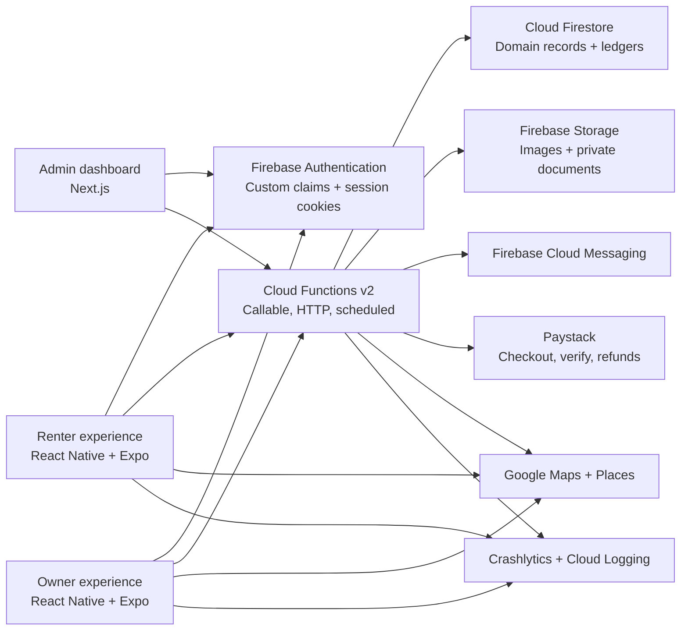
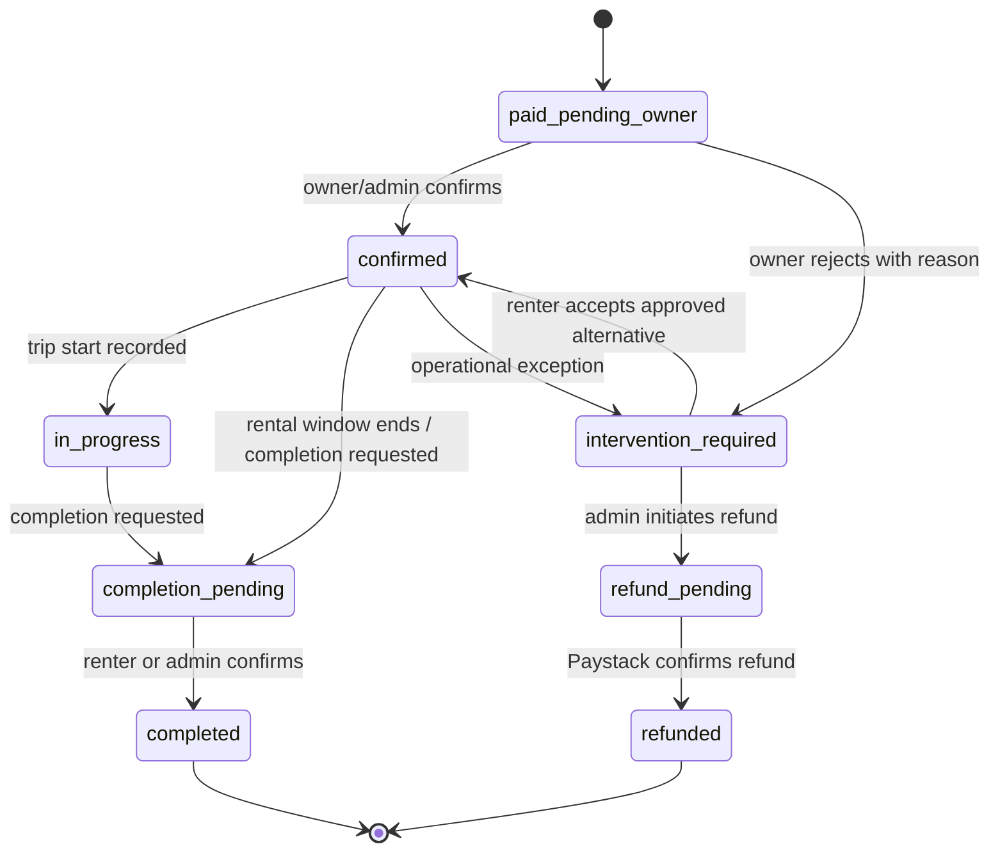

# MMG Concierge Technical Architecture and Implementation Handoff

**Status:** Final source of truth for MVP implementation  
**Version:** 1.1
**Date:** 30 August 2026
**Launch market:** Lagos, Nigeria  
**Product:** Chauffeured luxury-car rental marketplace  

---

## 1. Document authority and decision precedence

This document is the implementation authority for the MMG Concierge controlled MVP and gradual public launch. Product, design, engineering, QA, operations, and AI coding agents must use it as the default decision source.

When sources disagree, use this order:

1. The product rules explicitly locked in the current MMG Concierge conversation.
2. The user's detailed answers in the referenced **MMG Concierge Architecture** conversation.
3. The locked stack and implementation direction from that conversation.
4. The 2024 proposal and technical architecture PDFs as historical intent only.
5. The current landing-page repository as a brand, content, and interaction reference only.

The historical PDFs mention AWS, S3, a custom REST/JWT backend, broad renter-owner chat, and live location tracking. Those choices are superseded. The current platform uses Firebase serverless services, Firebase Storage, authenticated callable functions, payment-gated chat, and no live vehicle tracking in MVP.

Version 1.1 supersedes the original three-project Firebase plan with a two-tier model: the Emulator Suite for local/automated isolation, `mmg-concierge-dev` for cloud development and integration, and the existing `mmg-concierge` project for controlled and public production. A dedicated staging project is not required for MVP. See ADR 0008.

### 1.1 Reference inputs

- [MMG Concierge landing-page repository](https://github.com/franklinnweke/mmgconciergeweb)
- [Original development proposal](https://github.com/franklinnweke/mmgconciergeweb/blob/main/Proposal%20for%20Luxury%20Car%20Rentals%20iOS%20Application%20Development.pdf)
- [Original technical architecture](https://github.com/franklinnweke/mmgconciergeweb/blob/main/Technical%20Architecture%20Document%20for%20Luxury%20Car%20Rentals%20Mobile%20Application.pdf)
- The complete product clarification in the referenced ChatGPT conversation

### 1.2 Document map

- Sections 2-4 define the product, business rules, and brand direction.
- Sections 5-6 define the runtime architecture and Firestore model.
- Sections 7-9 define state transitions, function contracts, and financial behavior.
- Sections 10-12 define security, privacy, admin operations, events, and observability.
- Sections 13-16 define tests, implementation phases, agent rules, and MVP acceptance.
- Sections 17-19 record superseded assumptions, official references, and the implementation directive.

---

## 2. Executive source of truth

MMG Concierge is a Lagos-first marketplace connecting approved luxury-car owners with renters. Every MVP rental includes a chauffeur and delivery. The owner chooses the vehicle's daily rate; MMG controls the renter service fee and owner commission. The renter pays before the owner is notified. Payment does not bypass operational confirmation: the owner may confirm or reject with a reason. A rejection opens an admin-managed case for an alternative vehicle or refund.

The product has three surfaces:

- One React Native/Expo mobile application for iOS and Android, with separate renter and owner onboarding, navigation, permissions, and workflows.
- One private Next.js admin dashboard for verification, vehicle moderation, booking intervention, refunds, configuration, wallets, withdrawals, privacy requests, and audit review.
- One Firebase serverless backend using Firebase Authentication, Cloud Firestore, Cloud Functions v2, Firebase Storage, Firebase Cloud Messaging, App Check, Crashlytics, and Cloud Logging.

Paystack is the only MVP payment processor. Google Maps and Places support address selection, map presentation, and geolocation. Exact owner/vehicle addresses are private; renters receive distance and an approximate map position before payment. No live vehicle telemetry is collected.

### 2.1 Product principles

- **Controlled luxury, not uncontrolled inventory.** Owners and vehicles are approved before public visibility.
- **Payment integrity before convenience.** The server calculates all money, verifies Paystack independently, and processes every payment event idempotently.
- **A booking is a state machine, not a mutable status string.** Every transition has a permitted actor, precondition, audit event, and notification.
- **Financial records are append-only.** Wallet balances are projections of immutable ledger entries.
- **Privacy by default.** Do not collect a driver's licence, date of birth, selfie, background location, or live tracking for MVP.
- **Concierge intervention is a first-class workflow.** Owner rejection, alternative placement, refund, completion disputes, and manual withdrawals are represented in the data model and admin UI.

---

## 3. Locked product and business rules

### 3.1 Market and account model

| Rule | MVP source of truth |
|---|---|
| Launch geography | Lagos, Nigeria. Architecture can expand by city later. |
| Currency | NGN only. Every amount is stored as an integer number of kobo. |
| Launch mode | Controlled MVP, followed by gradual public promotion. |
| Primary customer | The renter; owner and admin workflows support delivery of the renter experience. |
| Renter and owner experiences | Separate onboarding, navigation, profiles, and permissions. One codebase and one backend; no in-app role switching in MVP. |
| Account type | `renter`, `owner`, or admin staff role. A normal account has one product account type in MVP. |
| MMG-owned inventory | MMG may use a normal approved owner account. No special inventory architecture is required. |

“Separate experiences” does not mean separate Firebase projects or duplicated mobile apps. It means an authenticated account is routed into exactly one renter or owner product experience. Admins use the web dashboard only.

### 3.2 Renter profile

Required before checkout:

- Full name
- Verified email
- Verified phone number
- Address selected or confirmed through Google Places

Not required in MVP:

- Driver's licence
- Government ID
- Selfie
- Date of birth
- Profile photograph

A profile image may be added later as optional data. If legal counsel requires an age rule, use a terms attestation rather than collecting date of birth unless there is a documented need.

### 3.3 Owner verification

An owner must provide and pass admin review before submitting a vehicle for publication:

- Full name or legal/business name
- Verified email and phone
- Address
- Government-issued ID image and document metadata
- Payout details when withdrawals are enabled
- Acceptance of current owner terms, commission terms, and privacy notice

Owner verification states are `draft`, `submitted`, `under_review`, `approved`, `rejected`, `suspended`, and `revoked`. A rejection and a suspension require an admin reason.

### 3.4 Vehicle listing

Required fields:

- Owner ID
- Make, model, year, colour, body category, seat count
- Registration/plate number in the private record
- Daily price in kobo
- Description
- Chauffeur policy; `included` for every MVP listing
- Delivery policy; `included` for every MVP listing
- Base address and exact coordinates in the private record
- Approximate search location and Lagos area label in the public record
- At least 1 and at most 20 approved images

Optional fields:

- Transmission
- Mileage
- Fuel type
- Features
- Insurance document and expiry date
- Other vehicle documents

Every vehicle requires admin approval before public visibility. A major edit creates a revision that requires approval. Major edits include make, model, year, registration, ownership, daily rate, chauffeur policy, location, primary image, image set, or required documents. Copy-only corrections may be approved under an admin-defined minor-edit policy.

Owners can pause and resume an approved listing immediately. “Delete” removes it from the marketplace and owner workflow, but the backend retains a minimal tombstone and immutable booking/financial snapshots so historical records remain valid. Personal or unnecessary listing data is removed according to the retention policy.

### 3.5 Discovery

- Search supports current location or a manually entered Lagos location.
- The default result order combines distance and daily price.
- Filters: dates, area/location, distance, daily price, make, model, category, year, seats, and features.
- Only approved, active, date-available vehicles are returned.
- Results show an approximate map location and rounded distance, never the owner's exact address.
- Exact coordinates remain server-only.
- Favorites are not in MVP.

Default ranking:

```text
score = 0.60 * normalizedDistance + 0.40 * normalizedDailyPrice
```

Lower is better. Weights live in private system configuration and may be changed by an authorized admin. Availability and moderation are hard filters, not ranking signals.

### 3.6 Chauffeur and delivery

- Every MVP vehicle includes a chauffeur.
- Delivery to the renter's confirmed Lagos address is included in the displayed rental price.
- The renter does not provide a driver's licence because the renter is not the driver.
- The vehicle owner is operationally responsible for supplying the chauffeur and confirming readiness.
- MVP has no driver account, driver app, driver profile, dispatch marketplace, or driver-location collection. The chauffeur is a booking service attribute, not a separate platform actor.
- `chauffeurPolicy` is modeled as `included | optional | self_drive`, but only `included` is enabled for MVP.
- Admin configuration may change the default later, but `selfDriveBookingsEnabled` must remain `false` until licence verification, insurance, deposits, eligibility, and liability rules are separately designed and approved.
- No live vehicle tracking or background location collection exists in MVP.

### 3.7 Daily rental calculation

- Booking dates are date-only values interpreted in `Africa/Lagos`.
- `startDate` is inclusive and `endDate` is exclusive.
- Example: 1 August to 2 August is one charged day.
- `chargedDays = max(1, calendarDaysBetween(startDate, endDate))`.
- There is no business minimum or maximum duration in MVP.
- Date overlap uses `[startDate, endDate)`, so one booking may begin on another booking's end date.

### 3.8 Price and earnings calculation

The owner sets `ownerDailyRateKobo`. MMG sets the service fee and commission. The server calculates and snapshots:

```text
baseRentalKobo     = ownerDailyRateKobo * chargedDays
deliveryFeeKobo    = 0
serviceFeeKobo     = round(baseRentalKobo * serviceFeeBps / 10_000) + serviceFeeFixedKobo
renterTotalKobo    = baseRentalKobo + serviceFeeKobo
commissionKobo     = round(baseRentalKobo * ownerCommissionBps / 10_000)
ownerEarningsKobo  = baseRentalKobo - commissionKobo
platformGrossKobo  = serviceFeeKobo + commissionKobo
```

The renter sees rental, service fee, included delivery, and total. The renter does not see the owner's commission or payout. The owner sees the base rental, commission percentage, expected net earnings, and the version of the fee terms before confirming.

No client may submit a trusted price, fee, total, commission, or earning. It may submit only IDs, dates, and a displayed quote identifier. The server recalculates before payment initialization.

### 3.9 Historical payment-first booking compatibility

This section documents the historical pay-first flow retained only for compatibility with existing records. The current Build 30 request-first source of truth is `AGENTS.md`: approved requests are paid only after an authorized MMG staff member opens a payment window, and verified request-first payment secures a confirmed booking directly.

1. The renter chooses a vehicle, dates, and delivery address.
2. The server revalidates the vehicle, dates, profile, configuration, and price.
3. A short checkout hold is created atomically. Default hold duration: 15 minutes, admin-configurable.
4. The server initializes Paystack and returns the hosted authorization URL/access code.
5. The renter pays.
6. The Paystack webhook is verified. The server independently verifies reference, status, currency, and amount.
7. The hold becomes a paid booking in `paid_pending_owner` and the owner/admin are notified.
8. Payment unlocks the booking conversation.
9. The owner confirms or rejects with a required reason.
10. Confirmation moves the booking to `confirmed`. Rejection releases the vehicle's date block and opens an admin intervention case.

For these historical pay-first records only, the renter-facing language after payment is **“Payment received — confirming your ride”**, not “Your ride is confirmed,” until the owner or admin confirms.

An owner rejection never silently cancels a paid booking. Admin chooses one of these recorded outcomes:

- Offer an alternative vehicle and obtain renter acceptance.
- Keep the case open while sourcing an alternative.
- Initiate a full or approved partial Paystack refund.

### 3.10 Completion, wallet, and withdrawal

- Owner earnings do not become withdrawable merely because payment succeeded.
- On payment, expected owner earnings are recorded as `pending`.
- After successful rental completion, an idempotent ledger credit moves the amount to `available`.
- Completion may be confirmed by the renter; an owner may request completion; admin can resolve and complete manually.
- The owner requests a withdrawal from available balance.
- Admin approves or rejects the withdrawal.
- Fulfillment is manual in MVP. After completing the external bank payment, admin records the bank reference/proof and marks the request `paid`.
- No automatic Paystack Transfer is enabled in MVP.

### 3.11 Chat and notifications

- Renter-owner chat exists only after verified payment.
- One booking has at most one conversation.
- Admin may view the conversation for support, safety, disputes, and mediation. If admin sends a message, the UI clearly identifies MMG Concierge as a participant.
- Users cannot create arbitrary direct conversations.
- Push notifications use FCM for payment, booking, owner response, intervention, trip, completion, wallet, withdrawal, and message events.

### 3.12 Explicit MVP exclusions

- Favorites or wishlists
- Vehicle videos
- Live or background vehicle tracking
- Separate driver accounts, driver app, or automated dispatch
- Self-drive rentals
- Hourly rentals
- Security deposits
- Automated owner payouts/transfers
- Pre-payment renter-owner chat
- In-app owner/renter role switching
- Multi-currency
- Insurance claims and damage-dispute automation

---

## 4. Product experience and brand direction

The existing landing page establishes the visual and verbal direction:

- Black/graphite surfaces, ivory text, champagne-gold accents, chrome detail
- Vehicle-led imagery, especially Prado and executive SUV photography
- Playfair Display for controlled editorial headlines and Inter for functional UI
- Restrained motion: staged entrance, subtle reveal, refined hover/press states
- Tone: executive, discreet, precise, premium, confident
- Repeated promises: curated vehicles, verified marketplace, private service, concierge support

Shared design tokens should begin with:

```text
black          #040404
graphite       #151515
ivory          #F7F1E7
silver         #E5E2DC
muted          #B4AEA4
gold           #C9A646
goldStrong     #E3C365
```

Mobile renter screens should be image-led and calm. The owner experience should prioritize listing status, bookings, and earnings without losing the premium tone. The admin dashboard should use a dark branded navigation shell with high-legibility neutral work surfaces; operational clarity takes priority over cinematic styling.

Gold is an accent for hierarchy and confirmed value, not a default fill for every card. Production UI must use real listing photography or approved campaign assets and must not inherit placeholder claims from the marketing site.

---

## 5. Technical architecture

### 5.1 System context



### 5.2 Locked stack

| Layer | Decision |
|---|---|
| Mobile | React Native, TypeScript, Expo Router, EAS Build/Submit, custom Expo development builds |
| Native Firebase | React Native Firebase modules with Expo config plugins; Expo Go is not a supported runtime |
| Admin | Next.js App Router, TypeScript, server-rendered protected routes |
| Backend | Firebase Cloud Functions v2 in TypeScript on Node.js 22 |
| Database | Cloud Firestore |
| Authentication | Firebase Authentication; email and phone verification; custom claims for staff roles |
| Files | Firebase Storage |
| Notifications | Firebase Cloud Messaging |
| Payments | Paystack hosted checkout initialized and verified server-side |
| Maps | Google Maps SDK and Places API (New) |
| Validation | Shared Zod schemas and generated TypeScript types |
| Testing | Vitest/Jest, Firebase Emulator Suite, React Native Testing Library, Maestro, Playwright |
| CI/CD | GitHub Actions, EAS, Firebase CLI, Firebase App Hosting |
| Observability | Crashlytics, Firebase Performance where useful, structured Cloud Logging and alerts |

React Native Firebase includes custom native code, so the project must use Expo development builds and pinned compatible package versions. Agents must not assume Expo Go support.

### 5.3 Firebase environments, isolation, and regions

Use two Firebase cloud projects:

- `mmg-concierge-dev` — cloud development and integration
- `mmg-concierge` — controlled and public production

Do not add a dedicated staging Firebase project for MVP. Local development and automated tests must prefer the Firebase Emulator Suite and deterministic fixtures. EAS development builds and sandbox provider integrations target `mmg-concierge-dev`; release/TestFlight/Play Store builds target `mmg-concierge`.

The development project must isolate Auth users, Firestore data, Storage objects, Functions, Rules, indexes, FCM tokens, App Check registrations, restricted Maps keys, Secret Manager values, logs, alerts, and future Paystack test credentials from production. Data promotion means reviewed code/configuration deployment, not copying development users, government IDs, exact locations, or other private records into production.

Repository documents currently record `africa-south1` for the existing Firestore, Storage, and Cloud Functions resources. Firestore location is immutable after provisioning, so an operator must verify and record the live `mmg-concierge` database and bucket locations before provisioning `mmg-concierge-dev`; the live project is authoritative if documentation differs. Use the matching supported data location for development unless a reviewed ADR records an exception. Cloud Functions v2 remain in `africa-south1`.

Deploy the Next.js admin with Firebase App Hosting in `europe-west4`, the nearest currently supported App Hosting region, while keeping all data mutations in `africa-south1` functions. The dashboard is staff-only and is not on the customer latency path.

Environment rules:

- Local emulator configuration and fixtures remain separate from both cloud projects.
- Development-only fixture flags must fail closed and be impossible in production release builds.
- Paystack test and live credentials, if introduced, live in different Firebase projects; project identity and credential mode must agree server-side.
- Google Maps keys remain separately restricted by bundle/package, signing certificate, web origin, and API list.
- Admin claims, App Check providers, logging, alerts, deployment identities, and backups are environment-specific.
- No script may bulk-delete or reset cloud data as an implicit development step.
- Production deploys require explicit operator authorization; agent-default cloud work targets development only after it is provisioned.

### 5.4 Monorepo structure

```text
apps/
  mobile/                 Expo iOS/Android app
  admin/                  Next.js admin dashboard
  functions/              Cloud Functions v2 entrypoints
packages/
  contracts/              Zod request/response and Firestore schemas
  domain/                 Pure pricing, availability, transitions, ledger logic
  firebase/               Typed clients, converters, emulator helpers
  brand/                  MMG tokens, typography, icons, shared copy rules
  test-fixtures/           Deterministic users, vehicles, bookings, payments
firebase/
  firestore.rules
  firestore.indexes.json
  storage.rules
  firebase.json
docs/
  architecture/           This document and ADRs
  runbooks/               Refund, outage, payout, privacy, incident procedures
```

Use one package manager and workspace lockfile. Pin Expo, React Native, React Native Firebase, Firebase SDK, and native plugin versions. Dependency upgrades require a dedicated change with iOS and Android build verification.

The marketing website may remain in its current repository. Share approved tokens and assets deliberately; do not couple its deployment to the marketplace backend.

### 5.5 Trust boundaries

The mobile app and browser are untrusted clients.

Clients may directly read only data explicitly permitted by Security Rules. Sensitive or invariant-changing writes go through Cloud Functions. The following are always server-authoritative:

- Prices, fees, commissions, totals, and currency
- Availability and date blocking
- Moderation and verification
- Booking and payment transitions
- Refunds and alternatives
- Wallet entries and balances
- Withdrawal state
- Admin roles and audit records
- Sanitized discovery results using exact coordinates

All callable functions require Firebase Authentication and App Check unless explicitly documented as public. Paystack webhooks are unauthenticated HTTP endpoints protected by signature verification, replay/idempotency protection, strict payload limits, and server-side transaction verification.

---

## 6. Firestore data model

### 6.1 Conventions

- Document IDs are random/opaque except where a deterministic idempotency key is useful.
- Timestamps use Firestore server timestamps.
- Booking dates are `YYYY-MM-DD` strings in `Africa/Lagos` plus derived UTC boundaries where jobs require timestamps.
- Money fields end in `Kobo` and are integers.
- Percentage fields end in `Bps`; 1,500 basis points means 15%.
- Every mutable aggregate has `createdAt`, `updatedAt`, `version`, and actor metadata where applicable.
- Financial and payment documents are append-only or transition-only; destructive updates are forbidden.
- Public/sanitized data is separated from private identity, exact location, and payout data.
- Bookings snapshot the vehicle, owner rate, fee configuration, location labels, chauffeur/delivery policy, and terms versions used at purchase.

### 6.2 Collections

| Collection | Purpose and critical fields | Client access |
|---|---|---|
| `users/{uid}` | `accountType`, display name, avatar, account status, onboarding state, terms versions | Self read; narrow self update; admin read |
| `renterProfiles/{uid}` | verified email/phone, default delivery address reference, profile completion | Self and authorized admin only |
| `ownerProfiles/{uid}` | public owner display data, verification summary, owner terms version | Self; sanitized fields through server |
| `ownerVerifications/{uid}` | ID metadata, private Storage paths, review status/reason, reviewer | Server and authorized compliance/admin only |
| `ownerPayoutProfiles/{uid}` | bank name/code, encrypted account number, last four, beneficiary name, verification | Server, owner masked read, finance admin |
| `vehicles/{vehicleId}` | approved public listing snapshot, owner ID, specs, rate, moderation, visibility, approximate area/geohash | Discovery through server; owner/admin scoped read |
| `vehiclePrivate/{vehicleId}` | exact address/coordinates, plate, document paths, internal notes | Server, owner, authorized admin; never renter |
| `vehicleRevisions/{revisionId}` | proposed major edit, diff, submitter, moderation decision | Owner and admin |
| `vehicles/{vehicleId}/images/{imageId}` | original/derived Storage paths, order, moderation, dimensions, hash | Approved variants only to renters |
| `vehicleAvailability/{vehicleId}` | serialization sentinel/version for overlap transactions | Server only |
| `bookingBlocks/{blockId}` | vehicle, `[startDate,endDate)`, hold/booking owner, expiry, block state | Server only |
| `bookingIntents/{intentId}` | quote, selected dates/address, hold expiry, renter, Paystack init state | Renter owner of intent and admin read; server writes |
| `bookings/{bookingId}` | parties, snapshots, dates, current state, case, completion, financial summary | Booking parties and admin read; server writes |
| `payments/{paymentId}` | booking/intent, Paystack reference, expected/received amount, state, verification | Renter/admin/owner-safe projection; server writes |
| `paymentEvents/{eventKey}` | event hash/reference, type, received/processed timestamps, result | Server only |
| `refunds/{refundId}` | payment, amount, reason, Paystack status/reference, actor | Renter/admin read, server writes |
| `bookingCases/{caseId}` | rejection/exception type, owner reason, admin actions, alternative/refund resolution | Parties receive scoped view; admin writes through server |
| `conversations/{bookingId}` | booking participants, `unlockedAt`, status, last message metadata | Participants/admin read; server writes |
| `conversations/{bookingId}/messages/{messageId}` | sender, body, attachment metadata, moderation fields, timestamps | Participants/admin read; server-validated writes |
| `wallets/{ownerId}` | materialized `pending`, `available`, `reserved`, `withdrawn` balances | Owner masked read, finance admin |
| `wallets/{ownerId}/entries/{entryId}` | immutable debit/credit, category, booking/withdrawal link, event id | Owner read, server writes |
| `withdrawalRequests/{requestId}` | owner, amount, payout snapshot, state, review and fulfillment refs | Owner and finance/admin read; server writes |
| `deviceTokens/{uid}/tokens/{tokenId}` | FCM token, platform, app version, last seen, disabled | Self create/rotate through server; server read |
| `notificationOutbox/{eventId}` | notification payload reference, recipients, attempts, status | Server only |
| `adminAuditLogs/{logId}` | actor, role, action, target, before/after hashes, reason, IP/device metadata | Authorized admin read; server append only |
| `systemConfig/public` | safe UX flags and limits | Authenticated read; admin change through server |
| `systemConfig/private` | fees, commission, ranking, SLA, Paystack behavior, operational flags | Server and super-admin only |
| `dataRightsRequests/{requestId}` | access/correction/deletion request state and completion proof | Requester and privacy admin |

### 6.3 Booking price snapshot

Every paid booking stores a self-contained financial snapshot:

```ts
type BookingPriceSnapshot = {
  currency: "NGN";
  chargedDays: number;
  ownerDailyRateKobo: number;
  baseRentalKobo: number;
  deliveryFeeKobo: 0;
  serviceFeeBps: number;
  serviceFeeFixedKobo: number;
  serviceFeeKobo: number;
  ownerCommissionBps: number;
  commissionKobo: number;
  ownerEarningsKobo: number;
  renterTotalKobo: number;
  configVersion: number;
  ownerTermsVersion: string;
  renterTermsVersion: string;
};
```

Later configuration changes never alter existing bookings or earnings.

### 6.4 Availability and concurrency

Availability is enforced only by a Cloud Function transaction:

1. Read `vehicleAvailability/{vehicleId}` as a serialization sentinel.
2. Revalidate vehicle approval, visibility, and dates.
3. Query active overlapping `bookingBlocks` for the vehicle.
4. Treat an expired checkout hold as non-blocking and mark it expired.
5. If no overlap exists, create one block for the entire interval and increment the sentinel version.
6. Commit the hold and booking intent together.

Every concurrent attempt reads and writes the same vehicle sentinel. Firestore retries one transaction when the sentinel changes, forcing it to rerun the overlap check against current data. This is the mandatory protection against double booking; client-side checks are informational only.

Blocking states are `checkout_hold`, `paid_pending_owner`, `confirmed`, and `in_progress`. An owner rejection releases the original block in the same transaction that opens the intervention case.

If a verified payment arrives after its hold expired and another booking now owns the dates, the system must not overwrite availability. It records `paid_conflict`, opens a critical admin case, and requires an alternative or refund.

### 6.5 Vehicle location privacy

`vehiclePrivate` stores the exact base address, Place ID, latitude/longitude, and full geohash. The discovery function:

1. Accepts a renter origin or geocoded search origin.
2. Uses geohash bounds to fetch candidate vehicles.
3. Calculates Haversine distance server-side.
4. Filters by radius, availability, moderation, and requested filters.
5. Returns rounded distance, area label, and an intentionally coarsened map point.

The renter never receives exact base coordinates or a written street address. The owner's exact base remains private after payment as well. The owner receives the renter's delivery address only for a paid booking that requires fulfillment.

---

## 7. State machines

No application may set arbitrary statuses. Each transition must use a named domain command and produce an audit/domain event.

### 7.1 Owner verification

```text
draft -> submitted -> under_review -> approved
                              \----> rejected -> submitted
approved -> suspended -> approved
approved/suspended -> revoked
```

| Transition | Actor | Required conditions |
|---|---|---|
| `draft -> submitted` | Owner | Required profile and government ID uploaded; terms accepted |
| `submitted -> under_review` | Admin/system | Review assigned |
| `under_review -> approved` | Verification admin | Review reason/checklist complete |
| `under_review -> rejected` | Verification admin | Rejection reason required |
| `approved -> suspended/revoked` | Admin | Reason required; active listings paused |

### 7.2 Vehicle moderation and visibility

Moderation and visibility are separate dimensions.

```text
moderation: draft -> pending_review -> approved
                               \----> rejected -> pending_review
approved -> suspended -> approved

visibility: paused <-> active -> deleted
```

Only `approved + active` vehicles appear in discovery. A major revision does not mutate the approved snapshot until approval. Admin may choose whether a safety-critical revision pauses the current listing during review.

### 7.3 Booking intent and payment

```text
intent_created -> checkout_pending -> paid
       |                |              |
       |                +-> expired    +-> paid_conflict
       +-> invalid      +-> failed
```

Payment state:

```text
initialized -> pending -> succeeded -> refund_pending -> refunded
                  \----> failed            \-----------> refund_failed
                  \----> abandoned
```

The client callback never transitions payment to `succeeded`. Only a verified webhook or an authorized server reconciliation may do so.

### 7.4 Paid booking



There is no automatic owner rejection timeout in the controlled MVP. A configurable response SLA, default 30 minutes, creates an admin alert but does not automatically refund or cancel.

### 7.5 Intervention case

```text
open -> sourcing_alternative -> awaiting_renter -> resolved_alternative
  \---------------------------------------------> refund_pending -> refunded
  \---------------------------------------------> closed_no_action (admin reason required)
```

An alternative must create its own availability block. Any price difference must be explicit:

- Lower price: refund the difference or record an approved credit policy.
- Higher price: create a separate Paystack top-up transaction; never silently charge.
- Same price: reassign through an audited admin command after renter acceptance.

### 7.6 Wallet and withdrawal

Wallet entry lifecycle:

```text
expected_pending -> available -> reserved_for_withdrawal -> withdrawn
                         ^              |
                         |              +-> released_on_rejection
                         +-> adjustment (admin reason + compensating entry)
```

Withdrawal request:

```text
requested -> under_review -> approved -> awaiting_manual_fulfillment -> paid
                   \------> rejected
approved/awaiting_manual_fulfillment -> failed -> under_review
```

Balances obey this invariant at all times:

```text
sum(ledger entries by bucket) == materialized wallet balances
```

No admin edits a balance directly. Corrections use compensating ledger entries linked to an audit record.

---

## 8. Cloud Function contracts

### 8.1 Contract standards

Authenticated callable requests use a shared envelope:

```ts
type CommandEnvelope<T> = {
  schemaVersion: 1;
  idempotencyKey: string;
  data: T;
};

type CommandResult<T> = {
  requestId: string;
  result: T;
};
```

Rules:

- Validate every request and response with shared Zod schemas.
- Require Firebase Auth and App Check for mobile/admin callable functions.
- Use limited-use App Check tokens on low-volume security-critical commands such as payment initialization, refunds, withdrawal approval, and account deletion.
- Enforce role and resource ownership in function code even when Security Rules also protect reads.
- Accept an idempotency key on every mutation.
- Return stable error codes, not raw provider errors.
- Write structured logs containing `requestId`, `uid`, `bookingId`, `paymentReference`, and action, while excluding addresses, government ID data, message bodies, and bank account numbers.

Canonical error codes include:

```text
UNAUTHENTICATED
APP_CHECK_REQUIRED
FORBIDDEN
VALIDATION_FAILED
PROFILE_INCOMPLETE
OWNER_NOT_APPROVED
VEHICLE_NOT_APPROVED
VEHICLE_UNAVAILABLE
QUOTE_EXPIRED
PRICE_CHANGED
PAYMENT_NOT_VERIFIED
INVALID_STATE_TRANSITION
IDEMPOTENCY_CONFLICT
INSUFFICIENT_WALLET_BALANCE
CASE_REQUIRES_ADMIN
RATE_LIMITED
```

### 8.2 Identity and profile functions

| Function | Authorization | Input -> output | Transactional effects |
|---|---|---|---|
| `completeRenterProfile` | Renter self | name, email, phone, Places address -> profile summary | Creates/updates renter profile; no ID fields |
| `completeOwnerProfile` | Owner self | identity/contact/address/terms -> owner profile | Creates owner draft |
| `submitOwnerVerification` | Owner self | uploaded ID object IDs -> verification receipt | Validates private uploads; moves to `submitted` |
| `reviewOwnerVerification` | Verification admin | owner, decision, reason/checklist -> status | Updates status, claims/projection, audit log, notification |
| `requestAccountDeletion` | Self | confirmation and optional reason -> request ID | Disables risky mutations, opens privacy workflow |

### 8.3 Vehicle functions

| Function | Authorization | Input -> output | Transactional effects |
|---|---|---|---|
| `createVehicleDraft` | Approved owner | initial specs -> vehicle ID | Creates paused draft and private record |
| `createVehicleUploadSession` | Approved owner | vehicle, file metadata, type -> upload authorization | Enforces 1-20 image/document rules and owner path |
| `finalizeVehicleImage` | Owner of vehicle | upload object ID/order -> image record | Verifies object metadata, queues processing/moderation |
| `submitVehicleForReview` | Owner | vehicle ID -> review receipt | Validates completeness; moves to pending review |
| `reviewVehicle` | Vehicle admin | vehicle/revision, decision, reason -> approved snapshot | Publishes snapshot or rejection; audit + notification |
| `submitVehicleRevision` | Owner | vehicle + changed fields -> revision ID | Preserves live approved version until review |
| `setVehicleVisibility` | Owner/admin | vehicle, `active|paused|deleted` -> state | Enforces ownership and moderation; deleted creates tombstone |

### 8.4 Discovery functions

| Function | Authorization | Input -> output | Notes |
|---|---|---|---|
| `resolveSearchPlace` | Authenticated | Place ID/session context -> safe place | Restrict to Nigeria/Lagos launch policy; request minimal fields |
| `searchVehicles` | Authenticated renter | origin, dates, filters, cursor -> sanitized results | Server geosearch, availability filter, composite ranking |
| `getVehicleDetails` | Authenticated renter | vehicle, dates -> sanitized detail + quote preview | No exact owner address or private documents |

### 8.5 Booking and payment functions

| Function | Authorization | Input -> output | Transactional effects |
|---|---|---|---|
| `createBookingIntent` | Completed renter | vehicle, dates, delivery address ref, quote ID -> intent/hold | Reprices, locks interval, snapshots config, 15-minute expiry |
| `initializePaystackPayment` | Intent owner | intent ID -> authorization URL/access code/reference | Server initializes exact NGN amount; idempotent reference |
| `paystackWebhook` | Public signed HTTP | raw Paystack event -> HTTP 200 | Verify HMAC SHA-512 first; dedupe; enqueue/process event |
| `reconcilePayment` | Intent owner/admin/system | reference -> payment state | Server calls Paystack verify; validates status, amount, currency, reference |
| `confirmBooking` | Owner of vehicle/admin | booking ID -> booking summary | `paid_pending_owner -> confirmed` |
| `rejectBooking` | Owner of vehicle | booking ID + required reason -> case summary | Releases block, opens intervention, notifies renter/admin |
| `resolveBookingCase` | Operations admin | case + alternative/refund action -> result | Locks replacement or initiates refund; audit required |
| `initiateRefund` | Finance/operations admin | payment, amount, reason -> refund | Calls Paystack server-side; state follows refund webhooks |
| `recordTripStart` | Owner/admin | booking -> state | No GPS stream; records timestamp and actor only |
| `requestCompletion` | Owner/renter | booking -> completion pending | Creates completion event/notification |
| `confirmCompletion` | Renter/admin | booking -> completed | Credits owner ledger once; closes conversation per policy |

Webhook processing must acknowledge quickly and perform durable work idempotently. Paystack retries failed webhook deliveries. Every event is deduplicated by a stable event/reference hash, and value is delivered only once.

### 8.6 Chat, wallet, and notification functions

| Function | Authorization | Input -> output | Transactional effects |
|---|---|---|---|
| `sendBookingMessage` | Paid booking participant/admin | booking, text/attachment -> message | Verifies unlocked conversation and rate limits; writes message/outbox |
| `registerDeviceToken` | Self | token/platform/app version -> token ID | Rotates/deactivates duplicates |
| `requestWithdrawal` | Approved owner | amount -> request | Moves `available` to `reserved` atomically |
| `reviewWithdrawal` | Finance admin | request, approve/reject, reason -> state | Approval or release; audit + notification |
| `markWithdrawalFulfilled` | Finance admin | request, external reference/proof -> paid | Ledger debit to withdrawn; immutable fulfillment record |
| `retryNotification` | Support/admin/system | outbox ID -> result | Idempotent FCM retry |

### 8.7 Scheduled jobs

| Job | Frequency | Responsibility |
|---|---|---|
| `expireCheckoutHolds` | Every minute | Expire unpaid holds and release blocks |
| `reconcilePendingPayments` | Every 5-10 minutes | Verify stale pending Paystack references |
| `flagOwnerResponseSla` | Every 5 minutes | Alert admin; do not auto-cancel |
| `sendTripReminders` | Scheduled | Upcoming rental and completion reminders |
| `reconcileWallets` | Daily | Assert ledger/materialized balance equality; alert only |
| `applyRetentionPolicy` | Daily | Delete expired temporary uploads, rejected ID files, stale tokens, and completed privacy tasks |
| `retryNotificationOutbox` | Every few minutes | Retry transient FCM failures and retire invalid tokens |

---

## 9. Paystack integration and financial controls

### 9.1 Checkout choice

Use Paystack hosted checkout initialized from Cloud Functions. The mobile app opens the returned authorization URL in a secure system browser/in-app browser and deep-links back to the app. This keeps the Paystack secret off-device and avoids storing card data.

The callback/deep link is only UX. It may show “checking payment,” then call `reconcilePayment`. It is never proof of payment.

### 9.2 Verification requirements

Before converting a hold to a paid booking, verify:

- Paystack response status is successful.
- The reference matches the server-created payment.
- Amount equals `renterTotalKobo` exactly.
- Currency is `NGN`.
- The transaction has not already delivered value.
- The payment belongs to the same intent/renter/environment.
- The event signature matches HMAC SHA-512 of the raw request body using the environment's Paystack secret.

Store provider metadata needed for reconciliation, but never store full card data or authorization payloads that are not operationally required. If last four digits or channel are displayed, copy only the minimum permitted fields.

### 9.3 Refunds

Refunds are server-initiated and follow Paystack's asynchronous states. The booking stays `refund_pending` until a `refund.processed` event or verified refund result. Failed or attention-required refunds remain visible in the admin queue.

### 9.4 Accounting invariants

- Sum of successful payment principal must equal recorded renter totals.
- A booking can have at most one active owner earning credit.
- Total owner credits plus platform gross plus refunded amount must reconcile to captured amount, accounting for approved adjustments.
- A payment reference is unique per environment.
- Refund total cannot exceed captured amount.
- Withdrawal cannot exceed available balance.
- Every manual financial action requires an admin reason and audit event.

---

## 10. Security and privacy

### 10.1 Security baseline

- Deny by default in Firestore and Storage Security Rules.
- Use Firebase Auth email verification and linked phone verification.
- Use custom claims for `support`, `vehicle_admin`, `verification_admin`, `finance_admin`, `privacy_admin`, and `super_admin`.
- Require MFA for all admin accounts before controlled public-release sign-off.
- Admin sessions use secure, HTTP-only, same-site Firebase session cookies created server-side.
- Client route guards are convenience only; server layouts/actions enforce admin authorization.
- Enforce App Check on production callable functions after staged monitoring.
- Use replay protection for payment initialization, refund, withdrawal approval, and account deletion where supported.
- Store Paystack secrets, encryption keys, and service credentials in Secret Manager.
- Restrict Google Maps keys by app bundle/package, signing certificate, web origin, and API list.
- Use least-privilege service accounts for Functions, App Hosting, CI, and support tooling.
- Enable budget alerts, function error alerts, webhook failure alerts, and unusual auth/activity alerts.

### 10.2 Access matrix

| Data/action | Renter | Owner | Admin | Server |
|---|---:|---:|---:|---:|
| Sanitized approved vehicle result | Yes | Yes | Yes | Yes |
| Exact vehicle address/coordinates | No | Own only | Scoped | Yes |
| Renter delivery address | Self | Paid assigned booking only | Scoped | Yes |
| Owner government ID | No | Own submission/status, not raw URL after upload | Verification scoped | Yes |
| Create booking/payment/wallet transition | No direct write | No direct write | No direct write | Yes |
| Paid booking chat read | Participant | Participant | Support scoped | Yes |
| Wallet ledger | No | Own read | Finance scoped | Yes |
| Admin audit logs | No | No | Role scoped | Append only |

Server Admin SDK calls bypass Firestore Security Rules, so IAM and function-level authorization are mandatory. Security Rules tests do not replace server authorization tests.

### 10.3 Storage layout and upload safety

```text
public/vehicles/{vehicleId}/approved/{variant}
private/vehicle-uploads/{ownerId}/{vehicleId}/{uploadId}
private/owner-verification/{ownerId}/{uploadId}
private/vehicle-documents/{ownerId}/{vehicleId}/{uploadId}
private/message-attachments/{bookingId}/{messageId}/{uploadId}
private/withdrawal-proof/{requestId}/{uploadId}
```

Requirements:

- Validate extension, MIME signature, size, dimensions, and ownership.
- Reject executable/polyglot files and unsupported types.
- Strip EXIF/GPS metadata from public images.
- Generate approved image variants and serve only processed variants publicly.
- Never make government IDs, insurance documents, payout proofs, or message attachments public.
- Use short-lived signed access or authorized proxy access for admin review.
- Delete abandoned uploads automatically.

### 10.4 Data minimization

Do not collect or retain for MVP:

- Renter driver's licence
- Renter government ID
- Selfie or biometric template
- Date of birth
- Contacts/address book
- Background location
- Live vehicle location history
- Full card or bank authorization data from Paystack
- Exact vehicle base location in public documents

Location permission is requested only when the user chooses **Use my location**. Manual address search remains available. No background-location entitlement is included in either mobile build.

### 10.5 Privacy rights and deletion

The system must support access, correction, deletion, consent/terms history, and documented retention exceptions. Both mobile apps and the public website must provide an account-deletion path. Deactivation is not deletion.

Deletion workflow:

1. Reauthenticate the user.
2. Explain active bookings, open refunds, wallet balances, or legal records that affect timing.
3. Immediately prevent new bookings/listings/withdrawals as appropriate.
4. Delete optional profile data, device tokens, drafts, abandoned uploads, and non-required files.
5. Anonymize messages and historical marketplace records where possible.
6. Retain only records with a documented contractual, fraud, tax, dispute, or legal reason.
7. Delete the Firebase Auth account when operational/legal holds are resolved.
8. Record completion without retaining the deleted identity in the completion proof.

### 10.6 Provisional retention schedule

These are engineering defaults and must be reviewed by Nigerian privacy/legal counsel before public launch:

| Data | Default retention |
|---|---|
| Abandoned uploads and incomplete checkout holds | 24 hours to 30 days depending on type |
| Unsubmitted owner verification draft | 30 days after last activity |
| Rejected owner ID files | 90 days after final rejection/appeal window, then delete |
| Approved owner ID files | While verification is active; review necessity annually and delete when no longer required |
| Precise current-location search input | Process request, do not persist unless user saves an address |
| Device tokens | Until logout, invalidation, account deletion, or 90 days inactive |
| Chat messages | Active booking plus defined dispute window; then anonymize/delete attachments on schedule |
| Booking/payment/ledger records | Retain only for the approved legal, tax, accounting, fraud, or dispute period |
| Admin audit logs | Defined security/compliance period with restricted access |

MMG should complete a Data Protection Impact Assessment before public launch because the platform combines identity documents, precise locations, payments, and behavioral records. The privacy policy, Nigeria Data Protection Act obligations, Apple App Privacy answers, Google Play Data Safety form, and SDK disclosures must agree with actual code.

---

## 11. Admin dashboard

### 11.1 Architecture

- Next.js App Router with protected server-rendered layouts.
- Firebase Auth sign-in; server exchanges ID token for a secure session cookie.
- All pages enforce custom claims server-side.
- Reads use scoped server services; mutations call the same domain commands used by Functions.
- No browser bundle contains Firebase Admin credentials, Paystack secrets, encryption keys, or unrestricted data exports.
- Every mutation requires reason fields where the operation affects approval, availability, money, privacy, or user access.

### 11.2 Modules

| Module | MVP capabilities |
|---|---|
| Overview | Paid bookings awaiting owner, overdue confirmations, open cases, refund failures, withdrawals, verification/listing queues |
| Owners | Review IDs, approve/reject/suspend, view terms version and linked vehicles |
| Vehicles | Review listing/revision/images/documents, approve/reject/suspend, pause for safety |
| Bookings | Timeline, parties, date block, payment, chat, trip/completion, internal notes |
| Intervention cases | Owner rejection reason, source alternative, renter decision, refund/top-up/reassignment |
| Payments/refunds | Reference, amount/currency verification, webhook timeline, reconciliation, refund state |
| Wallets | Pending/available/reserved/withdrawn, immutable ledger, reconciliation warnings |
| Withdrawals | Approve/reject, masked payout details, manual fulfillment reference/proof |
| Users | Account status, role, verification, support-safe profile; no broad raw exports |
| Chat/support | Booking-scoped conversation access with explicit admin participation |
| Configuration | Service fee, commission, hold time, ranking weights, SLA, feature flags, versioned terms |
| Privacy | Access/correction/deletion queue, retention holds, completion checklist |
| Audit/security | Searchable admin actions, role changes, suspicious events, export logging |

### 11.3 Configuration model

Private configuration is versioned. A change creates a new immutable version and an audit record; paid bookings retain the version they used.

```ts
type MarketplaceConfig = {
  version: number;
  currency: "NGN";
  timezone: "Africa/Lagos";
  serviceFeeBps: number;
  serviceFeeFixedKobo: number;
  ownerCommissionBps: number;
  checkoutHoldMinutes: number;
  ownerResponseSlaMinutes: number;
  searchDistanceWeight: number;
  searchPriceWeight: number;
  defaultSearchRadiusKm: number;
  maxVehicleImages: 20;
  chauffeurDefault: "included";
  selfDriveBookingsEnabled: false;
  deliveryDefault: "included";
  liveTrackingEnabled: false;
  favoritesEnabled: false;
  vehicleVideoEnabled: false;
  automaticPayoutsEnabled: false;
  effectiveAt: Timestamp;
};
```

Only `super_admin` can change fees, commission, or high-risk feature flags. Fee changes show an effective date and owners receive an in-app notification before the version applies to new booking intents.

---

## 12. Notifications, events, and observability

### 12.1 Domain events

Important commands emit a durable event/outbox record in the same transaction as the state change. Background workers deliver FCM/email integrations later without risking the business transaction.

Required event names include:

```text
owner.verification_submitted
owner.verification_decided
vehicle.submitted
vehicle.approved
booking.payment_verified
booking.owner_confirmed
booking.owner_rejected
booking.case_opened
booking.alternative_offered
booking.refund_updated
booking.trip_started
booking.completed
wallet.earning_available
withdrawal.requested
withdrawal.decided
withdrawal.paid
message.created
privacy.deletion_requested
```

### 12.2 Structured logging

Every backend request logs:

- `severity`
- `eventName`
- `requestId`
- `environment`
- `functionName`
- `uid` or hashed actor identifier
- `bookingId`, `vehicleId`, `caseId`, `withdrawalId` when relevant
- `paymentReference` when relevant
- `durationMs`
- stable error code

Never log full names, phone numbers, emails, addresses, exact coordinates, government ID data, bank account numbers, raw chat messages, secrets, or full Paystack payloads.

### 12.3 Alerts

Create alerts for:

- Webhook signature failures above threshold
- Payment succeeded but booking conversion failed
- Paid booking date conflict
- Owner response SLA exceeded
- Refund pending/failed beyond threshold
- Wallet reconciliation mismatch
- Withdrawal approved but not fulfilled within operations SLA
- Repeated admin permission failures
- Crash-free user rate regression
- Function error/latency regression
- Storage upload malware/validation failures

---

## 13. Testing and release gates

### 13.1 Test layers

| Layer | Required coverage |
|---|---|
| Pure domain unit tests | Date math, pricing, fee snapshots, transitions, ledger arithmetic, ranking |
| Contract tests | Every callable input/output and stable error code |
| Emulator integration | Auth, Firestore, Functions, Storage, rules, triggers, outbox |
| Security Rules tests | Positive and negative tests for every role/collection/path |
| Paystack adapter tests | Initialize, verify, webhook signature, duplicates, wrong amount/currency, refunds |
| Concurrency tests | Competing holds/payments for same vehicle/dates |
| Mobile tests | Renter/owner onboarding, discovery, checkout return, offline/error states, chat |
| Admin Playwright tests | All approval, case, refund, wallet, withdrawal, configuration, privacy workflows |
| Device E2E | iOS and Android development/release builds using Maestro |
| Development integration | `mmg-concierge-dev` Auth/App Check, deep links, FCM, Maps restrictions, Functions and sandbox webhook reachability |
| Controlled-release smoke | Production `mmg-concierge` configuration, deep links, FCM, Maps restrictions, webhook reachability |

### 13.2 Non-negotiable scenarios

The build cannot enter controlled MVP until these pass:

1. Two renters attempt the same vehicle/dates concurrently; only one hold succeeds.
2. Paystack sends the same success event repeatedly; one booking and one financial result exist.
3. Callback opens without a successful payment; no booking value is delivered.
4. Verified amount or currency differs from snapshot; payment enters investigation, not booking.
5. Payment arrives after hold expiry and dates were taken; critical case opens without double booking.
6. Owner rejects after payment; vehicle dates release and renter/admin receive the correct case state.
7. Admin offers an alternative; replacement availability is locked before reassignment.
8. Refund events move through pending/processed/failed correctly.
9. Completing a booking twice produces one wallet credit.
10. Two withdrawal requests race against one balance; reserved amount never exceeds available.
11. An owner cannot read another owner's private vehicle, ID, wallet, or payout data.
12. A renter cannot read exact vehicle location or chat before payment.
13. Deleted/suspended users cannot create new money or booking operations.
14. Account deletion removes optional data while preserving only documented legal records.

### 13.3 CI gates

Every pull request must pass:

- Formatting, lint, TypeScript, unit tests
- Contract compatibility checks
- Firestore and Storage Rules tests in Emulator Suite
- Function integration tests
- Admin build and Playwright critical path
- Mobile typecheck/tests and native configuration validation
- Secret scanning and dependency vulnerability review
- Firestore index/schema diff review when applicable

Development cloud deploys require passing relevant emulator checks and an exact `mmg-concierge-dev` target. Production deploys require controlled-release approval, tagged release, migration/backfill plan when data changes, rollback plan, and a named operator. Never infer the target from an ambiguous alias.

---

## 14. Phased implementation plan

Phases are dependency-based, not calendar promises. Work may run in parallel only when contracts and write ownership are clear.

### Phase 0 — Source-of-truth foundation

Deliver:

- Monorepo and pinned toolchain
- This architecture under version control
- ADR template and initial decisions
- Shared contracts/domain packages
- Emulator Suite plus `mmg-concierge-dev` development and `mmg-concierge` production project topology
- CI baseline and secret/environment model
- Imported brand tokens and approved asset usage rules

Exit gate: iOS/Android dev builds, admin dev build, emulators, tests, and deployment skeleton all run from documented commands.

### Phase 1 — Identity, roles, and privacy baseline

Deliver:

- Renter and owner separate onboarding/navigation
- Email and phone verification
- Required renter profile with no licence/ID fields
- Owner profile and private government-ID upload
- Admin authentication, MFA policy, custom claims
- Deny-by-default Firestore/Storage rules
- Privacy policy placeholders, consent/terms versioning, account-deletion request

Exit gate: role isolation and private document access pass emulator tests.

### Phase 2 — Owner verification and approved inventory

Deliver:

- Owner review queue
- Vehicle drafts, 1-20 image pipeline, EXIF stripping/variants
- Private exact location and public approximate location
- Vehicle/revision moderation
- Pause/resume/delete semantics
- Owner listing dashboard and admin vehicle tools

Exit gate: only approved/active vehicles are discoverable; major edits require review.

### Phase 3 — Renter discovery and vehicle detail

Deliver:

- Places address/current-location search with Lagos restriction/bias
- Server-side geohash candidate search and distance calculation
- Default distance/price ranking and MVP filters
- Date availability preview
- Image-led vehicle details, chauffeur/delivery disclosure, quote preview

Exit gate: exact locations never reach renter clients; permission denial still allows manual search.

### Phase 4 — Atomic booking and Paystack

Deliver:

- Server price/config snapshot
- Transactional overlap protection and 15-minute holds
- Paystack hosted checkout, deep-link return, signed webhook, verify/reconcile
- Paid-pending-owner status and truthful renter messaging
- Owner confirm/reject reason
- Admin intervention case, alternative, top-up, and refund workflows

Exit gate: all concurrency and payment non-negotiable scenarios pass.

### Phase 5 — Chat, notifications, and rental lifecycle

Deliver:

- Payment-gated booking conversation
- FCM tokens, outbox, retries, deep links
- Booking timeline, trip start timestamp, completion request/confirmation
- Admin support participation and audit
- No live tracking permissions or code

Exit gate: chat access, message privacy, notification idempotency, and completion transitions pass.

### Phase 6 — Wallet and manual withdrawals

Deliver:

- Pending/available/reserved/withdrawn ledger
- Completion-based earning credit
- Owner wallet/earning views
- Private/masked payout profile
- Withdrawal request, approval/rejection, manual fulfillment proof/reference
- Daily wallet reconciliation and finance alerts

Exit gate: ledger conservation and withdrawal race tests pass; no direct balance edits exist.

### Phase 7 — Controlled MVP hardening

Deliver:

- Crashlytics, structured logs, dashboards, alerts
- App Check enforcement rollout
- Rate limits and abuse controls
- Backup/restore and incident/refund/payout/privacy runbooks
- Accessibility, low-bandwidth, offline/error-state review
- Store privacy disclosures and account deletion web route
- Production Paystack/Maps/FCM/App Check validation

Exit gate: named operational owners can execute an owner rejection, refund, wallet correction, failed withdrawal, privacy request, and outage runbook without developer improvisation.

### Phase 8 — Gradual public launch

Deliver:

- Invite/feature-flag rollout
- Small Lagos owner cohort and renter cohort
- Daily operations review of paid-pending-owner time, case rate, refund time, conversion, crash rate, and support volume
- Capacity and cost thresholds
- Public promotion only after controlled metrics remain within agreed thresholds

Future phases may add favorites, video, pre-payment inquiries, self-drive verification, automated Paystack Transfers, multi-city expansion, and live tracking only after separate product, legal, privacy, and security review.

---

## 15. AI-agent development rules

These rules apply to every coding agent and human reviewer.

### 15.1 Scope and source control

1. Read this document and the relevant contracts/state machine before editing.
2. Work in one bounded domain and declare the intended file/write scope.
3. Do not rename collections, states, function contracts, event names, money fields, or security roles without an approved ADR and migration plan.
4. Do not “simplify” a server-authoritative operation into a direct client write.
5. Do not invent missing business rules. Use a versioned config value or raise a decision request.
6. Preserve unrelated user changes and never bulk-rewrite generated/native files without need.
7. Commit generated lockfiles, Firestore indexes, rules, and migrations with the code that requires them.

### 15.2 Contract-first implementation

1. Add or update the Zod contract and pure domain tests first.
2. Implement the server command and transition tests.
3. Add Security Rules and negative tests.
4. Implement mobile/admin clients against the shared contract.
5. Add integration/E2E coverage for the user-visible path.

No client may depend on undocumented Firestore shapes.

### 15.3 Financial and booking safety

- Use integer kobo only; never floating-point money.
- Recalculate on the server; never trust displayed client totals.
- All payment, refund, booking, wallet, and withdrawal handlers are idempotent.
- Never mark a payment successful from a redirect/callback alone.
- Never bypass the vehicle sentinel/overlap transaction.
- Never mutate or delete ledger entries; use compensating entries.
- Never make production Paystack calls from automated tests.
- Test duplicate events, retries, partial failures, and concurrent requests.

### 15.4 Privacy and security

- No secrets in code, logs, fixtures, screenshots, or AI prompts.
- Use synthetic people, IDs, bank details, addresses, messages, and payment references in tests.
- Do not log raw request payloads on sensitive endpoints.
- Do not add permissions for contacts, background location, microphone, camera, or photo library unless the implemented feature and privacy disclosure require them.
- Do not expose exact coordinates, government IDs, payout data, signed URLs, or admin notes in client contracts.
- New SDKs require a privacy/data-safety review and an explicit reason.

### 15.5 Dependency and native build discipline

- Pin Expo SDK, React Native, React Native Firebase, Firebase, Gradle, CocoaPods, and config-plugin versions.
- Do not casually upgrade native dependencies as part of a feature.
- Verify both iOS and Android development builds after native configuration changes.
- Maintain EAS build profiles and checked-in app configuration as source of truth.
- Expo Go is not an acceptance environment.

### 15.6 Definition of done for an agent task

A task is not done until:

- Code and contracts agree.
- Valid and invalid state transitions are tested.
- Authorization and Rules tests cover success and denial.
- Loading, empty, retry, offline, and provider-failure states are handled where relevant.
- Structured logs and domain/audit events are added without PII.
- Documentation/ADR/indexes/config are updated.
- Relevant mobile/admin builds and tests pass.
- The agent reports files changed, tests run, assumptions, and any follow-up risk.

---

## 16. MVP acceptance checklist

The controlled MVP is ready only when all are true:

- [ ] Renter can register with name, verified email/phone, and address without a driver's licence.
- [ ] Owner cannot publish until government-ID verification is approved.
- [ ] Every visible vehicle is approved, active, chauffeured, delivery-included, and has 1-20 approved images.
- [ ] Renter can search Lagos by current or entered location, distance, price, dates, and core filters.
- [ ] Exact vehicle address/coordinates are absent from renter network responses.
- [ ] The server prices daily rentals in NGN/kobo and snapshots fees/commission.
- [ ] Concurrent booking test proves one winner for overlapping dates.
- [ ] Paystack initialize, signature verification, independent verification, duplicates, wrong amount/currency, and refunds are tested.
- [ ] After payment the renter sees processing/confirmation language, not a false confirmed promise.
- [ ] Owner can confirm or reject with a reason; rejection opens an admin case.
- [ ] Admin can offer an alternative or issue/reconcile a refund.
- [ ] Chat is unavailable before payment and available only to booking participants/support afterward.
- [ ] Completion creates exactly one available owner earning.
- [ ] Owner can request withdrawal; admin can approve/reject and record manual fulfillment.
- [ ] Wallet and ledger reconcile exactly.
- [ ] Firestore/Storage Rules have automated negative tests.
- [ ] Account deletion works in-app and through a public web route.
- [ ] No favorites, video, live tracking, self-drive, or automatic payout code is exposed in MVP UI.
- [ ] Privacy disclosures match actual Auth, Maps, Paystack, Firebase, FCM, Crashlytics, Storage, and chat behavior.
- [ ] Operations runbooks and alerts are tested by the MMG team.

---

## 17. Superseded assumptions

Do not implement these historical ideas unless a later approved ADR explicitly reintroduces them:

- AWS EC2/RDS/S3, DigitalOcean, Redis, custom Express/Django REST backend, or custom JWT sessions
- iOS-only delivery
- One mixed renter/owner mode with unrestricted role switching
- Live car tracking through Google Maps
- Renter-owner contact before payment
- Automatic booking confirmation immediately from a client callback
- Automatic owner transfer on payment
- Public exact vehicle addresses
- Driver's licence requirement for chauffeured renters
- Unlimited/unmoderated image upload or vehicle video
- Client-calculated fees, commissions, earnings, or wallet balances

---

## 18. Current official implementation references

- [Expo: using Firebase and React Native Firebase](https://docs.expo.dev/guides/using-firebase/)
- [Firebase callable functions](https://firebase.google.com/docs/functions/callable)
- [Firebase App Check enforcement for Cloud Functions](https://firebase.google.com/docs/app-check/cloud-functions)
- [Firebase transactions and batched writes](https://firebase.google.com/docs/firestore/manage-data/transactions)
- [Firebase Firestore Security Rules testing](https://firebase.google.com/docs/firestore/security/test-rules-emulator)
- [Firebase geoqueries](https://firebase.google.com/docs/firestore/solutions/geoqueries)
- [Firebase Firestore locations](https://firebase.google.com/docs/firestore/locations)
- [Firebase Cloud Functions locations](https://firebase.google.com/docs/functions/locations)
- [Firebase App Hosting architecture and locations](https://firebase.google.com/docs/app-hosting/about-app-hosting)
- [Paystack accept payments](https://paystack.com/docs/payments/accept-payments/)
- [Paystack verify payments](https://paystack.com/docs/payments/verify-payments/)
- [Paystack webhooks](https://paystack.com/docs/payments/webhooks/)
- [Paystack refunds](https://paystack.com/docs/payments/refunds/)
- [Google Places Autocomplete (New)](https://developers.google.com/maps/documentation/places/web-service/place-autocomplete)
- [Nigeria Data Protection Act 2023](https://www.ndpc.gov.ng/ndp-act-2023/)
- [Apple App Privacy Details](https://developer.apple.com/app-store/app-privacy-details/)
- [Apple account deletion guidance](https://developer.apple.com/support/offering-account-deletion-in-your-app/)
- [Google Play account deletion requirements](https://support.google.com/googleplay/android-developer/answer/13327111)
- [Google Play Data Safety guidance](https://support.google.com/googleplay/android-developer/answer/10787469)

---

## 19. Final implementation directive

Begin with Phase 0 and Phase 1. Do not start Paystack, wallet, or booking UI by writing directly against guessed Firestore documents. First establish the shared contracts, pure domain rules, state transition engine, emulator environment, deny-by-default rules, and CI gates. Then implement vertical slices in the phase order above.

The first complete commercial slice is:

```text
approved owner
-> approved active chauffeured vehicle
-> Lagos discovery
-> atomic date hold
-> server-priced Paystack payment
-> paid pending owner
-> owner confirmation or admin intervention
-> completed rental
-> immutable wallet credit
-> admin-approved manual withdrawal
```

If a proposed implementation cannot trace itself through that flow and the state, privacy, and accounting invariants in this document, it is not ready to merge.
