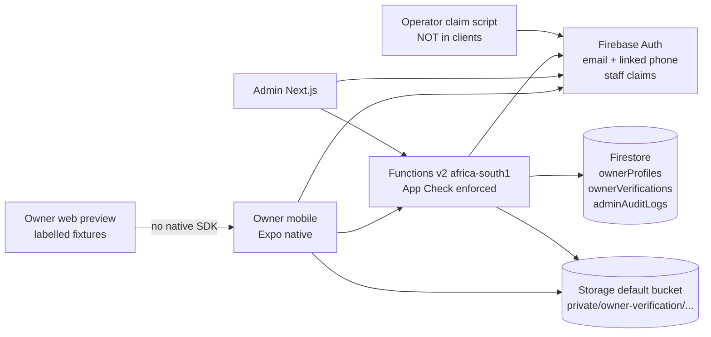
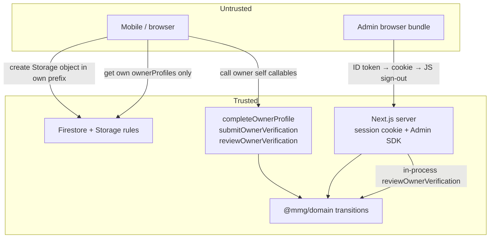
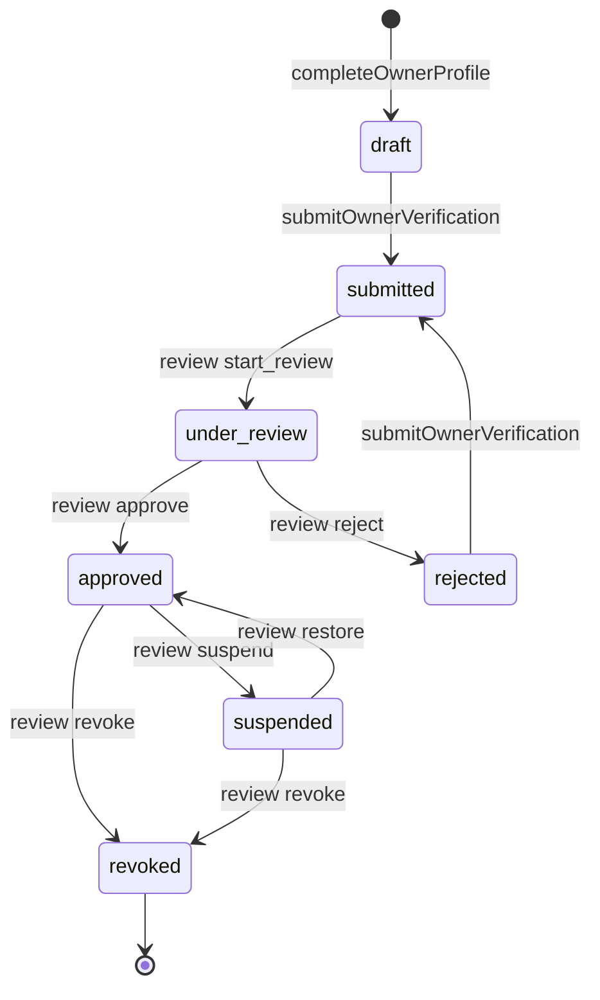

# Owner Sequence 1 — Owner application and verification

**Document type:** Agent implementation contract
**Author:** _Implementation architect (draft)_
**Date:** 14 August 2026
**Status:** Draft (revision 4 — review issues closed)
**Branch:** `Taste_Redesign`
**Repository:** `/Users/franklin/Documents/ChatGPT/MMG Concierge Development`
**Firebase project at this historical checkpoint:** `mmg-concierge`
**Firestore:** Standard edition, Native mode, `(default)`, `africa-south1`
**Architecture authority:** `docs/architecture/MMG_CONCIERGE_TECHNICAL_ARCHITECTURE_AND_IMPLEMENTATION_HANDOFF.md` v1.1 (30 August 2026)

> **Environment supersession:** This historical implementation contract uses
> “staging” in some original gates. ADR 0008 supersedes those references:
> cloud development now targets `mmg-concierge-dev`, production remains
> `mmg-concierge`, and controlled-release sign-off replaces staging sign-off.

This document is the implementation contract for **Owner Sequence 1** only. A coding agent executes it. A separate reviewer reruns the gates and reviews the diff. The implementer does not invent business rules, collection names, states, error codes, Storage paths, or security shortcuts.

When sources disagree: architecture locked rules win; this spec then binds the Owner Sequence 1 slice.

**Sequence numbering.** `docs/implementation/ANTIGRAVITY_SEQUENCE_1_3_WORKPLAN.md` already used “Sequence 1–3” for the **completed** booking-intent / admin-booking / renter-trips slice (`docs/IMPLEMENTATION_PHASES.md` Phase 2). This contract is the **next** Sequence 1: owner verification. Do **not** implement booking confirm/reject, Paystack, vehicles, or discovery. The workplan is a format reference for `[AUDIT]`/`[VALIDATE]` gates only.

---

## Overview

Authentication, renter discovery (preview fleet), vehicle details, booking review, `createBookingIntent`, renter Trips, and a fail-closed admin booking queue already exist. The owner surface is still a placeholder: `apps/mobile/src/features/auth/screens/owner-onboarding-screen.tsx` tells the owner that applications are the next phase.

Sequence 1 is the first real owner-supply vertical slice. An `accountType === 'owner'` user completes identity, links a verified Nigerian phone, accepts versioned owner/commission/privacy terms, uploads a government ID to a private Storage path, and submits for admin review. A verification admin (or super admin) signs into the Next.js dashboard with a session cookie, inspects the application, and records `under_review` / `approved` / `rejected` / `suspended` / `revoked` through a trusted command. The owner UI reads only a server-owned status projection. No client may write verification status.

Approved owners are required before Sequence 2 (vehicles). Trusted vehicles are required before Sequence 3 (replacing the preview fleet). Real payments stay after that. This slice does not list vehicles, change discovery, touch Paystack, wallets, chat, or owner booking confirm/reject.

---

## Authority and precedence

1. Architecture handoff locked rules (`docs/architecture/MMG_CONCIERGE_TECHNICAL_ARCHITECTURE_AND_IMPLEMENTATION_HANDOFF.md`), especially §§3.1–3.3, 5.3, 5.5, 6.1–6.2, 7.1, 8.1–8.2, 10, 11, 12.1–12.2, 14 Phase 1–2, 15.
2. This Owner Sequence 1 contract, for names, fields, transitions, UX copy, files, and tests in this slice.
3. Existing booking callable/rules/admin fixture patterns, which this slice must copy rather than redesign.

Do not rename collections, states, callable names, staff claim keys, Storage path prefixes, or money/error field conventions. Architecture §15.3–15.4 still apply even though this slice has no money movement.

Do not treat the completed booking workplan as in-scope work. Session cookies in this slice authorize the **owners** module only. The bookings page stays `fixture | unavailable` (`apps/admin/src/app/page.tsx`). Do not cookie-gate `/` or “fix” fixture booking review.

---

## Background and motivation

**Current state**

| Surface | What exists | What is missing |
|---|---|---|
| Mobile identity | Email/password, Google, email verification, immutable `users/{uid}.accountType` (`renter` \| `owner`) | Phone linking; owner application |
| Owner mobile | `(owner)` stack + placeholder onboarding | Application desk, forms, upload, truthful status |
| Functions | `createBookingIntent` in `africa-south1`, App Check fail-closed, Zod envelope, idempotency, `BookingCommandError` | Owner callables |
| Firestore | Deny-by-default; `users` client-create-once; booking paths server-write-only | `ownerProfiles`, `ownerVerifications`, `adminAuditLogs` |
| Storage | Client config mentions `mmg-concierge.firebasestorage.app`; no rules, emulator, or tests | Entire private ID pipeline |
| Admin | Booking queue; `MMG_ADMIN_FIXTURES=1` visual mode; live mode is `unavailable` | Session cookies, claims, owners module |
| Domain/contracts | Booking states, prices, renter-visible docs | Owner verification states, commands, documents |

**Pain.** MMG cannot onboard the owner cohort that later sequences depend on. The placeholder must not be replaced with a client-writable status field or a public ID bucket.

---

## Goals and non-goals

### Goals

1. Replace the owner placeholder with a real application desk that is truthful in every verification state.
2. Collect the locked owner fields (legal name, verified email, verified phone, structured Lagos address, government ID, versioned terms). No payout fields.
3. Persist `ownerProfiles/{uid}` (owner-self + server; **not** renter-readable) and `ownerVerifications/{uid}` (server-only; raw contact + Storage path). Project status/metadata without paths onto the profile. Keep raw ID paths off every browser client. Staff reads go through Next.js + Admin SDK only.
4. Ship Storage rules, emulator, tests, and abandoned-upload cleanup for `private/owner-verification/{ownerId}/{uploadId}`.
5. Ship named callables `completeOwnerProfile`, `submitOwnerVerification`, `reviewOwnerVerification` with the existing command envelope, App Check, idempotency, and canonical errors.
6. Ship thin admin staff-auth (session cookie + custom claims) sufficient to operate the owners/verification module. Live mode fail-closed. Fixture mode labelled and non-production.
7. Model all seven verification states even if the owner UI only exercises draft → submitted → (admin) under_review → approved | rejected, plus resubmit.
8. Add Firestore/Storage rules and negative tests without weakening booking, payment, availability, or `users` immutability.

### Non-goals (explicitly deferred)

| Deferred | Why |
|---|---|
| Sequence 2 vehicle onboarding / moderation | Depends on approved owners |
| Sequence 3 trusted inventory / discovery replacement | Depends on approved vehicles |
| Paystack, wallets, withdrawals, payout profiles | Architecture later phases; payout details out of Sequence 1 |
| Owner booking confirm/reject, chat, FCM delivery | Not this slice. Audit events are mandatory; FCM may be a no-op adapter |
| Renter phone / Google Places checkout profile | Renter path; Places is not wired today |
| In-app renter↔owner conversion | `users.accountType` is immutable from the client (firestore.rules + §3.1) |
| MFA-for-all-admins release policy | Follow-up. Claim + emailVerified + cookie is the floor. **Not** controlled-release sign-off. Do not add a second `verification_admin` without an MFA policy. |
| Account deletion / privacy request workflow | Architecture §10.5; not this slice |
| Commit, deploy, secret addition, unknown user files | Agent rule |

---

## Key Decisions

| # | Decision | Rationale |
|---|---|---|
| K1 | All seven states exist in contracts/domain/rules/admin filters even if owner UI only drives the application path. | Architecture §3.3 / §7.1. Do not invent a shorter machine. |
| K2 | Owner never writes `status`, reviewer, reasons, or Storage paths. Those fields are server-only. Owner client writes are limited to creating a private Storage object in their prefix. Staff clients have **zero** Storage and Firestore access to ID/PII collections. | Architecture §5.5, §10.2–10.3, §11.1. Same write trust model as `bookingIntents`; staff reads are Admin SDK only. |
| K3 | Email is taken from the Firebase Auth token on both owner callables. Phone is a linked credential on the existing user (`linkWithPhoneNumber`), never a second Auth user, and is **required only on `submitOwnerVerification`**. `completeOwnerProfile` does **not** require `token.phone_number`. Phone is never accepted from the command body. | Architecture §10.1. Identity → phone → ID → submit is the route map; requiring phone on profile-save made that flow impossible. |
| K4 | Address is a structured Lagos object: `areaLabel` enum + written `line1`/`line2` + `city: 'Lagos'` + `country: 'NG'` + optional `placeId`. No coordinates stored on `ownerVerifications` or `ownerProfiles` in this slice. `Lekki` and `Lekki Phase 1` are both valid and distinct owner-operating labels; discovery’s shorter set is unchanged. | Locked Sequence 1 address rule. Places is not wired. Coordinates are renter-sensitive if leaked. |
| K5 | Government ID lives at `private/owner-verification/{ownerId}/{uploadId}` on the existing default bucket `mmg-concierge.firebasestorage.app`. Never public. Owner sees upload/submission status, not a durable download URL. Admin preview uses a ≤15-minute signed GET URL minted **only** in a server-only admin module (`mintOwnerVerificationReadUrl`). **No** `createOwnerVerificationDocumentAccess` callable. | Architecture §5.3, §10.3. `google-services.json` already names this bucket. |
| K6 | Callables copy `createBookingIntent`: `schemaVersion: 1` envelope, `idempotencyKey`, `africa-south1`, `enforceAppCheck: true`, Zod parse, `CommandError` + `httpsCodeByDomainCode`. | Architecture §8.1–8.2. Existing code in `apps/functions/src/index.ts`. |
| K7 | Thin admin auth is in this slice: session cookie + `verification_admin` \| `super_admin`. Privileged mutations run on the Next.js **Node** server via an in-process import of `reviewOwnerVerification`. Never Admin SDK in the browser. Never mint an ID token and invoke the callable (App Check would force a bypass). Fixture mode is `NODE_ENV !== 'production' && MMG_ADMIN_FIXTURES === '1'` and is labelled. Production/live never silently uses fixtures. Mode is computed **only** on the server after a real `verifySessionCookie` (or fixture short-circuit). | Locked Sequence 1 decision + existing `apps/admin/src/app/page.tsx` pattern. Next 16 middleware is Edge; `firebase-admin` is Node-only. |
| K8 | Staff claim set is declared in full (`support`, `vehicle_admin`, `verification_admin`, `finance_admin`, `privacy_admin`, `super_admin`). Sequence 1 authorizes review with `verification_admin` or `super_admin` only. | Architecture §10.1. Do not invent `admin: true`. |
| K9 | Claim minting is an operator console/script path, not a client endpoint. No “make me admin” callable. | Prevents a half-baked self-serve privilege hole. |
| K10 | `reviewOwnerVerification` updates the verification doc, the owner profile projection, `adminAuditLogs`, and a domain event. FCM is written as `notificationOutbox` with `status: 'unavailable'` if FCM is not connected. UI must not claim a push was sent. | Architecture §8.2 / §12.1. Honest adapters match Sequence 3. |
| K11 | Approved owners do **not** receive a custom Auth claim in Sequence 1. Approval is the Firestore projection `ownerProfiles.verificationStatus === 'approved'`. | Avoids claim sprawl; Sequence 2 reads the projection. Architecture’s “claims/projection” is satisfied by the profile projection plus staff claims. |
| K12 | Current terms versions are constants in `@mmg/contracts`. Client sends the versions it displayed. Server rejects if they are not current. | Architecture §3.3 requires versioned acceptance. No terms CMS exists. |
| K13 | Automatic single-field indexes suffice. Admin and owner list queries are equality-on-one-field or direct document gets. Do not add a composite index unless a compound query is introduced and emulator-tested. | Same rule as Sequence 3 renter reads. |
| K14 | Web Expo preview never selects native Firebase Storage, Functions, or Phone Auth. Owner visual review on web uses a labelled fixture gateway, matching renter trip preview. | `auth-context.web.tsx` and `firestore-renter-trip-repository.web.ts` already enforce this split. |
| K15 | Payout details, vehicle listing, discovery, Paystack, wallets, chat, and role switching are out of scope. | Product lock for this slice. Those surfaces belong to later sequences. |
| K16 | Staff data access is **server-only**. Storage rules deny **all** client `read`/`write`, including staff. Firestore: owner **get** (not list) on own `ownerProfiles/{uid}` only; `ownerVerifications` and `adminAuditLogs` are `allow read, write: if false`. `users/{uid}` stays self-get; no staff client read. After `POST /api/auth/session` succeeds, the browser **signs out** the Firebase JS client so no privileged ID token remains. | Architecture §10.2–10.3, §11.1. Staff `getDownloadURL` / `getDocs` must fail. Admin SDK bypasses rules. |
| K17 | Session cookies are verified only in Node (`apps/admin/src/features/auth/server/session.ts` + Node `layout.tsx` / route handlers). Do **not** call `firebase-admin` from Edge `middleware.ts`. Do not add `middleware.ts` for this purpose. Admin SDK uses ADC or named non-committed env vars in `.env.example`. Reject ID tokens with `auth_time` older than 5 minutes before `createSessionCookie`. On every privileged request, `getUser(uid)` and re-check **current** custom claims. | Next 16 Edge ≠ Node. Claim removal must kill the 5-day cookie without relying on refresh-token revoke alone. |
| K18 | `ownerProfiles` in this slice is **owner-self + server**, not renter-readable. Sequence 2/3 must not open renter reads of this shape. Raw email/phone live only on `ownerVerifications`. Mask on the **server** (`maskEmail` / `maskPhoneE164`) before any object enters a Client Component. Owner reads Auth email/phone from the Auth SDK. | Architecture §6.2 public projection is a **future** field set (`displayName`, `verificationStatus`). Do not leak phone/address via a later renter grant. |
| K19 | `CommandError.safeDetails.reason` is an allowlist: `email_unverified \| phone_unverified \| not_owner \| not_staff \| upload_invalid \| terms_stale \| stale_version`. Client maps `code + reason` only. `getFriendlyAuthError` must not return raw `error.message` for unknown Firebase/Storage codes. | One `FORBIDDEN` / `FAILED_PRECONDITION` code cannot distinguish copy otherwise. |
| K20 | `submitOwnerVerification` sniffs magic bytes via Admin SDK (JPEG/PNG/WEBP/PDF signatures). Mismatch with declared `contentType` fails submit. Storage rules MIME check is a first gate only. Dimensions stay Sequence 2. | Architecture §10.3. Storage `contentType` is client-set. |
| K21 | `approve` requires the five checklist booleans all `true` and does **not** require a reason. Architecture §7.1 “reason/checklist complete” is filled as checklist-only for approve. `reject` / `suspend` / `revoke` require reason 10–500. `start_review` and `restore` take no note field. | Conservative fill-in so the implementer does not invent a free-text approve reason. |
| K22 | Review commands carry `expectedVersion`. The transaction re-reads and fails with `FAILED_PRECONDITION` + `reason: 'stale_version'` if `version` changed. `ownerMaySubmit` is true only for `draft \| rejected`, never `null`. | Architecture §6.1 version on mutable aggregates. Draft must exist before submit. |

---

## Proposed design

### System context



### Trust boundary



The mobile app and the admin browser are untrusted. Admin SDK credentials, session-cookie verification, signed URL minting, staff Firestore/Storage reads, and status writes stay on Functions or Next.js **Node** server modules that are never imported from a `'use client'` file. After the session cookie is set, the admin browser must not retain a Firebase ID token.

---

## State machine

Architecture §7.1 is the source. Sequence 1 implements the full graph and fills the gaps conservatively. Do not add states. Do not skip `under_review` on the way to `approved` or `rejected`.

```text
draft -> submitted -> under_review -> approved
                              \----> rejected -> submitted
approved -> suspended -> approved
approved/suspended -> revoked
```



### States

| State | Meaning | Owner primary action | Admin primary action |
|---|---|---|---|
| `draft` | Profile and/or ID incomplete or not yet submitted | Continue application / submit when complete | None (not in review queue by default) |
| `submitted` | Ready for staff. Immutable to owner | Wait. Secondary: concierge copy only | Start review |
| `under_review` | Staff has opened the file | Wait | Approve or reject |
| `approved` | May later create vehicles (Sequence 2). Sequence 1 shows success only | None that claims listing exists | Suspend or revoke |
| `rejected` | Staff recorded a reason. Owner may correct and resubmit | Review reason, edit, resubmit | None until new `submitted` |
| `suspended` | Previously approved; listings would be paused in Sequence 2 | Concierge / wait | Restore or revoke |
| `revoked` | Terminal in Sequence 1 | Concierge | None |

`draft` is created by `completeOwnerProfile` if no verification doc exists. An owner who has not called it has no `ownerVerifications/{uid}` document; the UI treats that as `draft` incomplete, not as `approved`.

### Legal transitions

| From | To | Command | Actor | Preconditions | Required payload |
|---|---|---|---|---|---|
| _(missing)_ | `draft` | `completeOwnerProfile` | Owner self | `users.accountType === 'owner'`; email verified; terms versions current. **Phone is not required.** | legal name, Lagos address, three accepted versions |
| `draft` | `draft` | `completeOwnerProfile` | Owner self | Same as create; not in a locked state | Same. Updates profile + draft verification. Result `verificationStatus: 'draft'` |
| `rejected` | `rejected` | `completeOwnerProfile` | Owner self | Same. Allowed so the owner can correct fields before resubmit | Same. Does **not** clear `lastDecisionReason` until resubmit. Result `verificationStatus: 'rejected'` |
| `draft` | `submitted` | `submitOwnerVerification` | Owner self | Verification doc exists in `draft`; profile complete; email verified; phone linked and `+234` **on the Auth token**; terms still current; upload exists, owned, magic-bytes match MIME, size ok | `uploadId`, `documentKind`, `originalFileName` |
| `rejected` | `submitted` | `submitOwnerVerification` | Owner self | Same completeness; status is `rejected` (not `null`) | New or replacement `uploadId` |
| `submitted` | `under_review` | `reviewOwnerVerification` decision `start_review` | `verification_admin` or `super_admin` | Status is `submitted`; `expectedVersion` matches | `ownerId`, `expectedVersion`. No note field. |
| `under_review` | `approved` | decision `approve` | same | Status is `under_review`; all five checklist booleans true; `expectedVersion` matches | `ownerId`, `expectedVersion`, checklist. **No reason.** |
| `under_review` | `rejected` | decision `reject` | same | Status is `under_review`; `expectedVersion` matches | `ownerId`, `expectedVersion`, reason 10–500 chars |
| `approved` | `suspended` | decision `suspend` | same | Status is `approved`; `expectedVersion` matches | `ownerId`, `expectedVersion`, reason 10–500 |
| `suspended` | `approved` | decision `restore` | same | Status is `suspended`; `expectedVersion` matches | `ownerId`, `expectedVersion`. No note field. |
| `approved` | `revoked` | decision `revoke` | same | Status is `approved`; `expectedVersion` matches | `ownerId`, `expectedVersion`, reason 10–500 |
| `suspended` | `revoked` | decision `revoke` | same | Status is `suspended`; `expectedVersion` matches | `ownerId`, `expectedVersion`, reason 10–500 |

### `decisionTargetStatus`

| Decision | Target status |
|---|---|
| `start_review` | `under_review` |
| `approve` | `approved` |
| `reject` | `rejected` |
| `suspend` | `suspended` |
| `restore` | `approved` |
| `revoke` | `revoked` |

### Forbidden transitions (must throw `INVALID_STATE_TRANSITION`)

- Owner or client sets any status.
- `submitted` → `approved` or `submitted` → `rejected` (must pass `under_review`).
- `draft` → anything except `submitted` via `submitOwnerVerification`.
- `rejected` → `under_review` or `approved` without a new submit.
- `revoked` → any state.
- `completeOwnerProfile` or `submitOwnerVerification` while status is `submitted`, `under_review`, `approved`, `suspended`, or `revoked`.
- `start_review` unless `submitted`.
- `approve` / `reject` unless `under_review`.
- `suspend` unless `approved`.
- `restore` unless `suspended`.
- `revoke` unless `approved` or `suspended`.
- Missing reason on `reject` / `suspend` / `revoke`.
- `approve` with any checklist flag false or omitted.
- `approve` requiring or accepting a reason is not specified — ignore extra `reason` on approve (do not persist it).
- `submitOwnerVerification` when no verification doc exists (`null`).
- Review when `expectedVersion` ≠ stored `version` → `FAILED_PRECONDITION` / `stale_version` (not a transition error).
- Renter, anonymous, or other-owner actor on owner-self commands.
- Missing `verification_admin` and `super_admin` on review.

### Actors

| Actor | How identified | May |
|---|---|---|
| Owner self | Callable `auth.uid` + `users/{uid}.accountType === 'owner'` | `completeOwnerProfile`; `submitOwnerVerification` (also needs linked `+234` phone on token); **create** Storage object in own prefix; **get** own `users/{uid}` and `ownerProfiles/{uid}` |
| `verification_admin` | Custom claim on the **Auth user**, checked via `getUser` on the Next.js server / callable token | `reviewOwnerVerification` (callable or in-process). **No** client Firestore/Storage read or write. Signed ID preview only via server `mintOwnerVerificationReadUrl` |
| `super_admin` | Custom claim, same check | Everything `verification_admin` may do. Still no client SDK data access |
| Other staff claims | Declared only | No Sequence 1 review authorization |
| System | Scheduled function | Delete abandoned uploads; never change verification status in Sequence 1 |
| Renter / anonymous | — | Nothing on owner collections or private Storage (Storage create also denied unless `users.accountType == 'owner'`) |

`support`, `vehicle_admin`, `finance_admin`, `privacy_admin` are **declared** in `@mmg/contracts` (`staffRoleKeySchema`) and in the claim-minting script’s allowlist. Sequence 1 does not implement their UIs.

---

## API / interface changes

### Canonical errors

Extend `canonicalErrorCodeSchema` in `packages/contracts/src/index.ts`. Keep every existing booking code. Add only what this slice throws:

```ts
export const canonicalErrorCodeSchema = z.enum([
  'UNAUTHENTICATED',
  'FORBIDDEN',
  'INVALID_ARGUMENT',
  'NOT_FOUND',
  'FAILED_PRECONDITION',
  'ALREADY_EXISTS',
  'IDEMPOTENCY_CONFLICT',
  'VEHICLE_UNAVAILABLE',
  'CONFIGURATION_UNAVAILABLE',
  'INTERNAL',
  'INVALID_STATE_TRANSITION',
  'PROFILE_INCOMPLETE',
]);
```

Do **not** add `APP_CHECK_REQUIRED` as an application-thrown code. Missing App Check is rejected by the Functions runtime before the handler (`enforceAppCheck: true`), which is the existing booking behavior.

Promote `apps/functions/src/booking/errors.ts` to `apps/functions/src/errors.ts`. **`commandSafeReasonSchema` lives only in `@mmg/contracts`.** `CommandError` imports the type. Do **not** re-declare the enum in `errors.ts`.

```ts
import type { CanonicalErrorCode, CommandSafeReason } from '@mmg/contracts';

export class CommandError extends Error {
  constructor(
    public readonly code: CanonicalErrorCode,
    message: string,
    public readonly safeDetails?: Readonly<{ reason?: CommandSafeReason }>,
  ) {
    super(message);
    this.name = 'CommandError';
  }
}

/** @deprecated alias — existing booking tests may keep importing this name */
export class BookingCommandError extends CommandError {
  constructor(code: CanonicalErrorCode, message: string, safeDetails?: Readonly<{ reason?: CommandSafeReason }>) {
    super(code, message, safeDetails);
    this.name = 'BookingCommandError';
  }
}
```

Map new codes next to the existing table in `apps/functions/src/index.ts`:

| Domain code | `HttpsError` HTTPS code |
|---|---|
| `INVALID_STATE_TRANSITION` | `failed-precondition` |
| `PROFILE_INCOMPLETE` | `failed-precondition` |

When to throw which code. `HttpsError` details must include only `{ code, reason? }` from the allowlist — never provider text, paths, or emails.

| Situation | Code | `safeDetails.reason` | Safe message (server) |
|---|---|---|---|
| No `auth.uid` | `UNAUTHENTICATED` | — | `Sign in to continue.` |
| Email not verified | `FORBIDDEN` | `email_unverified` | `Verify your email before continuing.` |
| Phone missing / not linked / not `+234` on **submit** (or review of phone-gated paths) | `FORBIDDEN` | `phone_unverified` | `Verify a Nigerian phone number before continuing.` |
| `accountType !== 'owner'` | `FORBIDDEN` | `not_owner` | `Only an owner account can submit this application.` |
| Missing admin claim | `FORBIDDEN` | `not_staff` | `You are not authorized to review owner applications.` |
| Zod failure | `INVALID_ARGUMENT` | — | `The request is invalid.` |
| Unknown `ownerId` on review | `NOT_FOUND` | — | `Owner application was not found.` |
| Upload missing / wrong path / MIME / magic-byte mismatch / oversize | `FAILED_PRECONDITION` | `upload_invalid` | `The identity document could not be verified.` |
| Terms version stale | `FAILED_PRECONDITION` | `terms_stale` | `Accept the current owner terms to continue.` |
| `expectedVersion` mismatch | `FAILED_PRECONDITION` | `stale_version` | `This record changed. Refresh and try again.` |
| Required profile fields missing at submit | `PROFILE_INCOMPLETE` | — | `Complete your owner profile before submitting.` |
| Illegal transition | `INVALID_STATE_TRANSITION` | — | `This application cannot move to that state.` |
| Same key, different payload | `IDEMPOTENCY_CONFLICT` | — | `This idempotency key was already used for a different request.` |
| Current terms/config doc unreadable | `CONFIGURATION_UNAVAILABLE` | — | `Owner verification configuration is unavailable.` |
| Unexpected | `INTERNAL` | — | `The request could not be completed.` Never include provider text. |

Client UI maps `code + reason` only (see Owner error copy). Never interpolate `error.message`.

### Shared constants (lock these strings)

```ts
export const CURRENT_OWNER_TERMS_VERSION = 'owner-terms-2026-08-01';
export const CURRENT_COMMISSION_TERMS_VERSION = 'owner-commission-2026-08-01';
export const CURRENT_PRIVACY_NOTICE_VERSION = 'privacy-notice-2026-08-01';

export const OWNER_VERIFICATION_STATES = [
  'draft',
  'submitted',
  'under_review',
  'approved',
  'rejected',
  'suspended',
  'revoked',
] as const;

export const LAGOS_AREA_LABELS = [
  'Ikoyi',
  'Victoria Island',
  'Lekki',
  'Lekki Phase 1',
  'Lagos Island',
  'Banana Island',
  'Oniru',
  'Ikeja',
  'Maryland',
  'Ajah',
  'Yaba',
  'Surulere',
] as const;

export const GOVERNMENT_ID_KINDS = [
  'national_id',
  'international_passport',
  'drivers_licence',
  'voters_card',
  'residence_permit',
] as const;

export const OWNER_REVIEW_DECISIONS = [
  'start_review',
  'approve',
  'reject',
  'suspend',
  'restore',
  'revoke',
] as const;

export const OWNER_REVIEW_CHECKLIST_KEYS = [
  'identity_matches_id',
  'document_legible',
  'lagos_address_plausible',
  'current_terms_accepted',
  'no_fraud_indicators',
] as const;

export const STAFF_ROLE_KEYS = [
  'support',
  'vehicle_admin',
  'verification_admin',
  'finance_admin',
  'privacy_admin',
  'super_admin',
] as const;
```

`LAGOS_AREA_LABELS` extends the discovery set in `apps/mobile/src/features/discovery/data/lagos-destinations.ts` (`Ikoyi`, `Victoria Island`, `Lekki`, `Lagos Island`) with additional owner-operating areas. **`Lekki` and `Lekki Phase 1` are both intentional and distinct** (Phase 1 is a common owner base; discovery stays on the shorter renter filter). Do not accept free-text area labels. Do not require Places.

### Zod schemas to add in `@mmg/contracts`

Reuse `schemaVersionSchema` and `idempotencyKeySchema`. **Export** `isoDateTimeSchema` and `boundedIdSchema` (they exist today but are file-private). Admin/mobile parse timestamps through the exported primitives. Reuse the command envelope shape already used by `createBookingIntentCommandSchema`.

```ts
export const ownerVerificationStatusSchema = z.enum(OWNER_VERIFICATION_STATES);
export const lagosAreaLabelSchema = z.enum(LAGOS_AREA_LABELS);
export const governmentIdKindSchema = z.enum(GOVERNMENT_ID_KINDS);
export const ownerReviewDecisionSchema = z.enum(OWNER_REVIEW_DECISIONS);
export const staffRoleKeySchema = z.enum(STAFF_ROLE_KEYS);

export const commandSafeReasonSchema = z.enum([
  'email_unverified',
  'phone_unverified',
  'not_owner',
  'not_staff',
  'upload_invalid',
  'terms_stale',
  'stale_version',
]);
export type CommandSafeReason = z.infer<typeof commandSafeReasonSchema>;

export const nigerianE164Schema = z
  .string()
  .regex(/^\+234[789]\d{9}$/, 'Enter a Nigerian mobile number.');

export const ownerLegalNameSchema = z
  .string()
  .trim()
  .min(2, 'Enter your legal or business name.')
  .max(120, 'Name is too long.')
  .regex(/^[\p{L}0-9][\p{L}0-9 .,'&/-]{1,119}$/u, 'Enter a valid legal or business name.');

export const ownerAddressSchema = z.object({
  areaLabel: lagosAreaLabelSchema,
  line1: z.string().trim().min(8, 'Enter a written address.').max(160),
  line2: z.string().trim().max(160).optional(),
  city: z.literal('Lagos'),
  country: z.literal('NG'),
  placeId: z.string().trim().min(1).max(256).optional(),
}).strict();

export const ownerTermsAcceptanceSchema = z.object({
  ownerTermsVersion: z.literal(CURRENT_OWNER_TERMS_VERSION),
  commissionTermsVersion: z.literal(CURRENT_COMMISSION_TERMS_VERSION),
  privacyNoticeVersion: z.literal(CURRENT_PRIVACY_NOTICE_VERSION),
}).strict();

export const ownerReviewChecklistSchema = z.object({
  identity_matches_id: z.literal(true),
  document_legible: z.literal(true),
  lagos_address_plausible: z.literal(true),
  current_terms_accepted: z.literal(true),
  no_fraud_indicators: z.literal(true),
}).strict();

export const completeOwnerProfileDataSchema = z.object({
  legalName: ownerLegalNameSchema,
  address: ownerAddressSchema,
  acceptedOwnerTermsVersion: z.literal(CURRENT_OWNER_TERMS_VERSION),
  acceptedCommissionTermsVersion: z.literal(CURRENT_COMMISSION_TERMS_VERSION),
  acceptedPrivacyNoticeVersion: z.literal(CURRENT_PRIVACY_NOTICE_VERSION),
}).strict();

export const completeOwnerProfileCommandSchema = z.object({
  schemaVersion: schemaVersionSchema,
  idempotencyKey: idempotencyKeySchema,
  data: completeOwnerProfileDataSchema,
}).strict();

export const completeOwnerProfileResultSchema = z.object({
  requestId: z.string().min(1).max(128),
  result: z.object({
    ownerId: boundedIdSchema,
    verificationStatus: z.enum(['draft', 'rejected']),
    profileVersion: z.number().int().positive(),
  }).strict(),
}).strict();

export const submitOwnerVerificationDataSchema = z.object({
  uploadId: z.string().trim().min(8).max(128).regex(/^[A-Za-z0-9_-]+$/),
  documentKind: governmentIdKindSchema,
  originalFileName: z.string().trim().min(1).max(120),
}).strict();

export const submitOwnerVerificationCommandSchema = z.object({
  schemaVersion: schemaVersionSchema,
  idempotencyKey: idempotencyKeySchema,
  data: submitOwnerVerificationDataSchema,
}).strict();

export const submitOwnerVerificationResultSchema = z.object({
  requestId: z.string().min(1).max(128),
  result: z.object({
    ownerId: boundedIdSchema,
    verificationStatus: z.literal('submitted'),
    submittedAt: isoDateTimeSchema,
    receiptId: boundedIdSchema,
  }).strict(),
}).strict();

export const reviewOwnerVerificationDataSchema = z.object({
  ownerId: boundedIdSchema,
  expectedVersion: z.number().int().positive(),
  decision: ownerReviewDecisionSchema,
  reason: z.string().trim().min(10).max(500).optional(),
  checklist: z.object({
    identity_matches_id: z.boolean(),
    document_legible: z.boolean(),
    lagos_address_plausible: z.boolean(),
    current_terms_accepted: z.boolean(),
    no_fraud_indicators: z.boolean(),
  }).strict().optional(),
}).strict().superRefine((value, ctx) => {
  if (['reject', 'suspend', 'revoke'].includes(value.decision) && !value.reason) {
    ctx.addIssue({ code: 'custom', path: ['reason'], message: 'A reason is required.' });
  }
  if (value.decision === 'approve') {
    const parsed = ownerReviewChecklistSchema.safeParse(value.checklist);
    if (!parsed.success) {
      ctx.addIssue({ code: 'custom', path: ['checklist'], message: 'Complete the approval checklist.' });
    }
  }
});

export const reviewOwnerVerificationCommandSchema = z.object({
  schemaVersion: schemaVersionSchema,
  idempotencyKey: idempotencyKeySchema,
  data: reviewOwnerVerificationDataSchema,
}).strict();

export const reviewOwnerVerificationResultSchema = z.object({
  requestId: z.string().min(1).max(128),
  result: z.object({
    ownerId: boundedIdSchema,
    fromStatus: ownerVerificationStatusSchema,
    toStatus: ownerVerificationStatusSchema,
    decidedAt: isoDateTimeSchema,
  }).strict(),
}).strict();
```

Owner-visible profile (what the mobile client may parse from a **get** of `ownerProfiles/{uid}`):

`ownerProfiles` is **owner-self + server**, not renter-readable, not a public document. Sequence 2/3 must not grant renter reads of this shape. A future public projection is a different field set (`displayName`, `verificationStatus` only).

Do **not** persist email or phone on `ownerProfiles`. The owner reads those from the Auth SDK (`user.email`, `user.phoneNumber`). Address on the profile is the owner’s own application copy (they typed it). Raw staff contact + `storagePath` live only on `ownerVerifications`.

```ts
export const ownerVisibleProfileSchema = z.object({
  ownerId: boundedIdSchema,
  legalName: ownerLegalNameSchema,
  displayName: ownerLegalNameSchema,
  address: ownerAddressSchema,
  verificationStatus: ownerVerificationStatusSchema,
  verificationUpdatedAt: isoDateTimeSchema,
  lastDecisionReason: z.string().min(1).max(500).nullable(),
  ownerTermsVersion: z.string().min(1).max(64),
  commissionTermsVersion: z.string().min(1).max(64),
  privacyNoticeVersion: z.string().min(1).max(64),
  termsAcceptedAt: isoDateTimeSchema,
  governmentId: z.object({
    uploadId: boundedIdSchema,
    documentKind: governmentIdKindSchema,
    contentType: z.enum(['image/jpeg', 'image/png', 'image/webp', 'application/pdf']),
    byteSize: z.number().int().positive().max(10 * 1024 * 1024),
    uploadedAt: isoDateTimeSchema,
    status: z.enum(['uploaded', 'submitted', 'cleared']),
  }).nullable(),
  createdAt: isoDateTimeSchema,
  updatedAt: isoDateTimeSchema,
  version: z.number().int().positive(),
}).strict();
```

`ownerVisibleProfileSchema` **is** the persisted `ownerProfiles/{uid}` shape. Keep `.strict()`. On **every** profile write, persist every owner-visible key. Use `null` for unset nullable fields (`lastDecisionReason`, `governmentId` on first draft) — do **not** omit keys (Firestore drop + `z.nullable()` is a parse failure). Sequence 1 `displayName` is a copy of `legalName`. `ownerVisibleProfileSchema.governmentId` has **no** `storagePath` and **no** download URL. `status: 'cleared'` means the bytes were deleted by retention and only metadata remains.

Admin-visible verification (built on the **Next.js server** after Admin SDK read; this object is what may enter a Client Component):

```ts
export const adminVisibleOwnerVerificationSchema = z.object({
  ownerId: boundedIdSchema,
  status: ownerVerificationStatusSchema,
  legalName: ownerLegalNameSchema,
  emailMasked: z.string().min(3).max(254),
  phoneMasked: z.string().min(4).max(20).nullable(),
  address: ownerAddressSchema,
  governmentId: z.object({
    uploadId: boundedIdSchema,
    documentKind: governmentIdKindSchema,
    contentType: z.enum(['image/jpeg', 'image/png', 'image/webp', 'application/pdf']),
    byteSize: z.number().int().positive(),
    originalFileName: z.string().min(1).max(120),
    uploadedAt: isoDateTimeSchema,
    bytesState: z.enum(['present', 'cleared']),
  }).nullable(),
  checklist: z.record(z.boolean()).nullable(),
  lastDecision: ownerReviewDecisionSchema.nullable(),
  lastDecisionReason: z.string().min(1).max(500).nullable(),
  reviewerUid: boundedIdSchema.nullable(),
  submittedAt: isoDateTimeSchema.nullable(),
  reviewedAt: isoDateTimeSchema.nullable(),
  terms: ownerTermsAcceptanceSchema,
  createdAt: isoDateTimeSchema,
  updatedAt: isoDateTimeSchema,
  version: z.number().int().positive(),
  documentPreviewUrl: z.string().url().max(2048).nullable(),
}).strict();
```

`documentPreviewUrl` is a ≤15-minute signed GET minted in the same server request, or `null` when `bytesState === 'cleared'`. **`storagePath` never crosses into a Client Component.** Mask on the server with `@mmg/domain` helpers before serialization. Do **not** “mask in the client presentation layer.”

Masking rules (pure helpers in `@mmg/domain`):

- Email: `a***@example.com` (first local character + `***@` + domain).
- Phone: `+234****5678` (keep country code and last 4). `null` when no phone is stored yet.

### Domain helpers in `@mmg/domain`

Add beside the existing booking transition maps. Do not reuse booking helpers for owner states.

```ts
export const ownerVerificationTransitions = {
  draft: ['submitted'],
  submitted: ['under_review'],
  under_review: ['approved', 'rejected'],
  approved: ['suspended', 'revoked'],
  rejected: ['submitted'],
  suspended: ['approved', 'revoked'],
  revoked: [],
} as const;

export type OwnerVerificationStatus = keyof typeof ownerVerificationTransitions;
export type OwnerVerificationActor = 'owner' | 'verification_admin' | 'super_admin' | 'system';
export type OwnerReviewDecision =
  | 'start_review' | 'approve' | 'reject' | 'suspend' | 'restore' | 'revoke';

export function canTransitionOwnerVerification(from: OwnerVerificationStatus, to: OwnerVerificationStatus): boolean;

export function decisionTargetStatus(decision: OwnerReviewDecision): OwnerVerificationStatus;
// start_review→under_review, approve→approved, reject→rejected,
// suspend→suspended, restore→approved, revoke→revoked

export function actorMayApplyDecision(actor: OwnerVerificationActor, decision: OwnerReviewDecision): boolean;
// owner: none; verification_admin/super_admin: all review decisions; system: none in Sequence 1

export function ownerMayMutateProfile(status: OwnerVerificationStatus | null): boolean;
// true when status is null, draft, or rejected

export function ownerMaySubmit(status: OwnerVerificationStatus | null): boolean;
// true only when status is 'draft' or 'rejected'. False for null.

export function isTerminalOwnerVerification(status: OwnerVerificationStatus): boolean;
// revoked

export function requiresReviewReason(decision: OwnerReviewDecision): boolean;
// reject, suspend, revoke

export function requiresApprovalChecklist(decision: OwnerReviewDecision): boolean;
// approve

export function validateReviewReason(reason: string): string;
// trim; throw if length not in [10, 500]. Same numeric bounds as
// apps/admin/src/features/bookings/domain/admin-booking.ts#validateRejectionReason
// but implemented in @mmg/domain — do not import the admin helper.

export function maskEmail(email: string): string;
export function maskPhoneE164(phone: string): string;
```

Unit-test every legal cell and a representative illegal cell. Include `submitted → approved` as an explicit failure. Include `ownerMaySubmit(null) === false`.

### Callable adapters

Export from `apps/functions/src/index.ts` alongside `createBookingIntent`:

```ts
export const completeOwnerProfile = onCall(
  { region: 'africa-south1', enforceAppCheck: true, timeoutSeconds: 30, memory: '256MiB' },
  handler,
);
export const submitOwnerVerification = onCall(
  { region: 'africa-south1', enforceAppCheck: true, timeoutSeconds: 30, memory: '256MiB' },
  handler,
);
export const reviewOwnerVerification = onCall(
  { region: 'africa-south1', enforceAppCheck: true, timeoutSeconds: 30, memory: '256MiB' },
  handler,
);
```

Each handler:

1. Authenticates via `apps/functions/src/owner/callable-auth.ts`.
2. Parses `request.data` as the command. Builds a **trusted** actor from the auth helpers (`uid`, and for review `requireVerificationAdmin` → `{ uid, role }`). Actor is **never** taken from `command.data` / the client body.
3. Calls the matching service with `(command, actor, deps)` — same shape as booking’s trusted `renterId` separate from `request.data`.
4. Logs `owner.profile_completed` / `owner.verification_submitted` / `owner.verification_decided` with `requestId`, `uid`, `ownerId`, `fromStatus`, `toStatus` only.
5. Maps `CommandError` through `httpsCodeByDomainCode`. Unexpected errors become `internal` with no provider text.

### Auth helpers

`apps/functions/src/owner/callable-auth.ts`:

```ts
export function requireAuthenticatedUser(auth): string; // UNAUTHENTICATED

export function requireVerifiedEmailOwnerAuth(auth): string;
// email_verified === true else FORBIDDEN / email_unverified
// Does not accept accountType from the caller.

export function requireLinkedNigerianPhone(auth): string;
// production Auth: token.phone_number parses nigerianE164Schema AND
// token.firebase.identities.phone is an array that includes that number
// emulator: identities.phone may be omitted; then phone_number alone is enough
// else FORBIDDEN / phone_unverified
// returns the E.164 string

export function requireVerificationAdmin(auth): { uid: string; role: 'verification_admin' | 'super_admin' };
// super_admin wins if both are set
// FORBIDDEN / not_staff otherwise
```

`accountType` is **never** an argument. Each service reads `users/{uid}` inside the transaction and throws `FORBIDDEN` / `not_owner` if it is not `'owner'`.

- `completeOwnerProfile`: `requireVerifiedEmailOwnerAuth` + Firestore `accountType`. Phone optional. If `token.phone_number` is a valid `+234`, copy it onto `ownerVerifications.phoneE164` (not onto `ownerProfiles`).
- `submitOwnerVerification`: `requireVerifiedEmailOwnerAuth` + `requireLinkedNigerianPhone` + Firestore `accountType`. Persist phone on `ownerVerifications` from the token.

Phone claim source: Firebase sets `phone_number` on the ID token after `linkWithPhoneNumber` + SMS confirm. The client cannot send a different number.

### Idempotency

Extend the booking formula in `apps/functions/src/booking/create-booking-intent-service.ts` (that file hashes `{ renterId, idempotencyKey }` only). Owner commands **add `commandName`** because they share `idempotencyKeys`:

- `requestHash = sha256(JSON.stringify(command.data))`
- `idempotencyDocumentId = sha256({ actorId, commandName, idempotencyKey })`
- Collection: existing `idempotencyKeys/{idempotencyDocumentId}` (already server-only in rules)
- Stored fields: `requestHash`, `result`, `commandName`, `actorId`, `createdAt`
- Same actor + key + hash → return stored result (parsed by the result Zod schema)
- Same actor + key + different hash → `IDEMPOTENCY_CONFLICT`
- Different actor + same key → different document id; no collision

`commandName` is one of `completeOwnerProfile` | `submitOwnerVerification` | `reviewOwnerVerification`.

### Service transactional effects

**`completeOwnerProfile`**

1. Parse command.
2. `requireVerifiedEmailOwnerAuth` (no phone).
3. Transaction:
   - Read `users/{uid}`; require `accountType === 'owner'` (`FORBIDDEN` / `not_owner`).
   - Read `ownerVerifications/{uid}`; allow create or update only when `ownerMayMutateProfile`.
   - Read `systemConfig/ownerVerification` if present; if present, its term versions must equal the CURRENT_* constants; if absent, use the constants (fail closed only when the doc exists and is malformed → `CONFIGURATION_UNAVAILABLE`).
   - Upsert `ownerProfiles/{uid}` **without** email or phone fields. Persist **every** `ownerVisibleProfileSchema` key: `displayName` = `legalName`; `termsAcceptedAt` = now (ISO/timestamp); `lastDecisionReason` and `governmentId` written as `null` when unset (never omit). Keep `.strict()` parseable after Timestamp → ISO.
   - Create `ownerVerifications/{uid}` in `draft` if missing; if existing `draft`/`rejected`, update address/name/terms snapshots but do not change status. Copy Auth email onto the verification doc. Copy phone onto the verification doc only if `requireLinkedNigerianPhone` would succeed; otherwise leave `phoneE164` null.
   - Write `auditEvents/{eventId}` with `eventType: 'owner.profile_completed'`.
   - Save idempotency.
4. Return `{ ownerId, verificationStatus: storedStatus, profileVersion }` where `storedStatus` is `'draft'` or `'rejected'` — **never** coerce `rejected` to `'draft'`.

**`submitOwnerVerification`**

1. Parse command.
2. `requireVerifiedEmailOwnerAuth` + `requireLinkedNigerianPhone`.
3. Using Admin Storage, `getMetadata` + first-bytes read on `private/owner-verification/{uid}/{uploadId}`:
   - Object must exist.
   - Path owner segment must equal `uid`.
   - Declared `contentType` ∈ `{image/jpeg, image/png, image/webp, application/pdf}`.
   - `size` ≤ 10_485_760.
   - Custom metadata `ownerId` if present must equal `uid`.
   - **Magic bytes** (lock in `storage-validation.ts`):
     - JPEG: `FF D8 FF`
     - PNG: `89 50 4E 47 0D 0A 1A 0A`
     - WEBP: `52 49 46 46` at 0 and `57 45 42 50` at 8
     - PDF: `%PDF-`
   - Declared `contentType` must match the sniffed family. JPEG magic + `contentType: application/pdf` → `FAILED_PRECONDITION` / `upload_invalid`.
4. Transaction:
   - Profile must be complete (name, address, terms). Email from Auth; phone from token (now required).
   - Status must pass `ownerMaySubmit` (`draft` or `rejected` only). Missing verification doc → `PROFILE_INCOMPLETE`.
   - Write verification: `status: 'submitted'`, `submittedAt`, government ID metadata including server-derived `storagePath`, clear `reviewerUid` / checklist, move previous reason to `previousDecisionReason`, set `lastDecisionReason` null.
   - Project `ownerProfiles.verificationStatus = 'submitted'`, update `governmentId` summary without `storagePath`. Rewrite the **full** owner-visible field set (do not drop `displayName` / `termsAcceptedAt` / nullables).
   - `auditEvents` `owner.verification_submitted`.
   - `notificationOutbox/{eventId}` `{ eventType, ownerId, status: 'unavailable', reason: 'fcm_not_in_sequence_1', createdAt }`.
   - Save idempotency.
5. Return `{ ownerId, verificationStatus: 'submitted', submittedAt, receiptId }` with `receiptId === ownerId`.

**`reviewOwnerVerification(command, actor, deps)`**

Signature (lock this; same trusted-actor split as booking’s `renterId`):

```ts
export function reviewOwnerVerification(
  command: z.infer<typeof reviewOwnerVerificationCommandSchema>,
  actor: { uid: string; role: 'verification_admin' | 'super_admin' },
  deps: ReviewOwnerVerificationDeps,
): Promise<z.infer<typeof reviewOwnerVerificationResultSchema>>;
```

`actor` comes only from `requireVerificationAdmin(auth)` (callable wrapper) or `requireLiveStaffSession()` (admin server action). **Never** from `command.data`. No `skipAuth` / `alreadyChecked` flag. The service may assert `actor.role` is one of the two staff roles (defense in depth) but must not re-read a role out of the client body.

1. Parse `command` (includes `expectedVersion`). Require a trusted `actor` argument.
2. Do **not** accept “the caller already checked” as a missing `actor`.
3. Transaction:
   - Read verification; `NOT_FOUND` if missing.
   - If `version !== expectedVersion` → `FAILED_PRECONDITION` / `stale_version`.
   - Compute `to` via `decisionTargetStatus`; `canTransitionOwnerVerification` + reason/checklist guards.
   - Update verification status, `reviewerUid`, `reviewedAt`, `lastDecision`, `lastDecisionReason` (null for `start_review` / `restore` / `approve`; required text for reject/suspend/revoke), checklist (approve only).
   - Increment `version`.
   - Project `ownerProfiles.verificationStatus` and `lastDecisionReason` (non-null for reject/suspend/revoke; null for approve/restore/start_review). Persist the **full** owner-visible field set (`displayName`, `termsAcceptedAt`, nullables written as `null`).
   - `adminAuditLogs/{logId}`: actor, role, action `owner.verification_decided`, target `ownerVerifications/{ownerId}`, `beforeHash` / `afterHash` (sha256 of `{ status, lastDecision, lastDecisionReason, uploadId, version }` — never raw ID bytes), reason (null when the decision has no reason), `requestId`, `createdAt`.
   - `auditEvents` `owner.verification_decided`.
   - `notificationOutbox` `{ eventType: 'owner.verification_decided', ownerId, status: 'unavailable', reason: 'fcm_not_in_sequence_1', createdAt }`.
   - Save idempotency.
4. Return `{ ownerId, fromStatus, toStatus, decidedAt }`.

**Admin live mutations (locked).** The service lives at `apps/functions/src/owner/review-owner-verification-service.ts`, imported via `@mmg/functions-owner/*` → `apps/functions/src/owner/*`. Side-effect-free (no `onCall` in that module). **Delete** any “mint a Google ID token and invoke the callable” option. Do not implement a second transition table. Do not disable App Check.

The **only** admin entrypoint is:

`apps/admin/src/features/owners/data/review-owner-verification-action.ts`

- First lines: `'use server'` then `import 'server-only'`.
- Export `reviewOwnerVerificationAction`.
- Body: `const actor = await requireLiveStaffSession()` **before** calling `reviewOwnerVerification(command, actor, deps)`.
- Command fields come from the client; `actor` does not.
- `owner-operations.tsx` (`'use client'`) must **not** import `@mmg/functions-owner/*`, `review-owner-verification-service.ts`, or Admin SDK. It may call the server action (or a live gateway that only exists in a server module that itself calls the action).
- No `skipAuth` flag on the service or the action.

### Scheduled cleanup

Add `expireAbandonedOwnerVerificationUploads` as Functions v2 scheduled, `africa-south1`, `schedule: 'every 24 hours'`, **`timeZone: 'Africa/Lagos'`**, 512MiB, 540s.

Rules (architecture §10.6 engineering defaults):

| Object | Condition | Action |
|---|---|---|
| Unreferenced upload | Object under `private/owner-verification/{ownerId}/` whose `uploadId` is not the current `ownerVerifications.governmentId.uploadId`, and `timeCreated` > 24 hours | Delete object |
| Unsubmitted draft | Verification `draft` and `updatedAt` < now − 30 days | Delete all objects under that owner prefix. Leave verification `status` as `draft`. In the **same write**, split the two documents: **profile** `governmentId` = `{ uploadId, documentKind, contentType, byteSize, uploadedAt, status: 'cleared' }` (exactly the owner-visible keys; write `null` for the whole map only if there was never an upload — **never** `storagePath` or `bytesState` on the profile); **verification** `governmentId` = `{ …metadata, storagePath: null, bytesState: 'cleared' }`. Persist every other owner-visible profile key (`displayName`, `termsAcceptedAt`, `lastDecisionReason` as `null` if unset). |
| Rejected ID bytes | Status is `rejected` and `reviewedAt` < now − 90 days and owner has not resubmitted | Delete object bytes. In the **same write**, split the two documents the same way: **profile** `governmentId` = `{ uploadId, documentKind, contentType, byteSize, uploadedAt, status: 'cleared' }` (owner-visible keys only; never `storagePath` / `bytesState`); **verification** `governmentId` = `{ …metadata, storagePath: null, bytesState: 'cleared' }`. Keep verification `status` / reason. Persist every other owner-visible profile key. |
| Approved / suspended / revoked ID | Do not delete in Sequence 1 | Annual review is out of scope |

Never change verification `status` from the cleanup job. After byte delete, admin preview must show “Document expired / re-upload required”, not a broken ``. `mintOwnerVerificationReadUrl` returns null when verification `bytesState === 'cleared'` or `storagePath` is empty. Profile `governmentId` after cleanup is either `null` (never uploaded) or the six owner-visible keys with `status: 'cleared'` — a `.strict()` desk parse must succeed. Log `owner.verification_upload_expired` with `ownerId` and `uploadId` only.

---

## Data model changes

No client field may be added to `users/{uid}` in this slice. `users` stays client-create-once, then immutable (`firebase/firestore.rules` lines 153–166). Phone, address, terms, and verification live on `ownerProfiles` / `ownerVerifications`.

### `users/{uid}` — unchanged schema

| Field | Type | Writer | Reader |
|---|---|---|---|
| `uid` | string 1–128 | Client create | Self **get** only (unchanged) |
| `accountType` | `'renter'` \| `'owner'` | Client create only | same |
| `displayName` | string 2–80 | Client create | same |
| `email` | string matching Auth email | Client create | same |
| `createdAt` / `updatedAt` | server timestamp | Client create | same |

**No rules change on `users/{uid}`.** Do not add staff client reads. Staff who need `accountType` already have it on `ownerVerifications` (server read) or via Admin SDK. Opening `allow read` for staff would include `list` and enumerate every renter. Leave lines 153–166 as they are except existing owner/renter self-get.

### `ownerProfiles/{uid}`

Server writes only. Owner **get** of own document. No list. No staff client read. No renter read.

| Field | Type | Notes |
|---|---|---|
| `ownerId` | string === uid | Immutable |
| `legalName` | string 2–120 | |
| `displayName` | string | Sequence 1: copy of `legalName`. **Required on every write** (same schema as `legalName`) |
| `address` | map | `ownerAddressSchema` (no coordinates). Owner’s own copy. |
| `verificationStatus` | enum | Projection. Owner UI trusts this field only |
| `verificationUpdatedAt` | timestamp | |
| `lastDecisionReason` | string \| null | Set on reject/suspend/revoke; **write `null`**, never omit |
| `governmentId` | map \| null | `{ uploadId, documentKind, contentType, byteSize, uploadedAt, status }` — **no path, no URL**. Write `null` on first draft |
| `ownerTermsVersion` | string | |
| `commissionTermsVersion` | string | |
| `privacyNoticeVersion` | string | |
| `termsAcceptedAt` | timestamp | Required on every write |
| `createdAt` / `updatedAt` | timestamp | |
| `version` | int ≥ 1 | Increment every write |

No `email`, `phoneE164`, or `phoneVerifiedAt` on this document. This field list **is** `ownerVisibleProfileSchema`. Every write must include every key so a `.strict()` client parse succeeds after Timestamp → ISO.

### `ownerVerifications/{uid}`

Server writes. **No client reads. No client writes.** Owner sees status on `ownerProfiles`. Staff see a **server-masked** DTO from Next.js + Admin SDK (K16, K18).

| Field | Type | Notes |
|---|---|---|
| `ownerId` | string === uid | |
| `status` | enum | Authoritative |
| `legalName` | string | Snapshot at last owner mutation |
| `email` | string | Raw snapshot. Mask **on the server** before any Client Component |
| `phoneE164` | string \| null | Raw snapshot from Auth token; null until submit (or earlier if already linked) |
| `address` | map | Full Lagos address for staff; not renter-visible |
| `governmentId.uploadId` | string | |
| `governmentId.storagePath` | string \| null | Server-derived; **null** when `bytesState === 'cleared'` |
| `governmentId.bytesState` | `'present'` \| `'cleared'` | |
| `governmentId.documentKind` | enum | |
| `governmentId.contentType` | enum | |
| `governmentId.byteSize` | int | |
| `governmentId.originalFileName` | string ≤ 120 | |
| `governmentId.uploadedAt` | timestamp | |
| `terms` | map | Three version strings |
| `checklist` | map \| null | Booleans; required on approve |
| `lastDecision` | enum \| null | |
| `lastDecisionReason` | string \| null | |
| `previousDecisionReason` | string \| null | Prior rejection/suspension text |
| `reviewerUid` | string \| null | |
| `submittedAt` | timestamp \| null | |
| `reviewedAt` | timestamp \| null | |
| `receiptId` | string | Sequence 1: equals `ownerId` |
| `createdAt` / `updatedAt` / `version` | | |

### `adminAuditLogs/{logId}`

Server append only. **No client read.** Staff see audit rows only via the Next.js server (Admin SDK) after session + current-claim check.

| Field | Type |
|---|---|
| `actorUid` | string |
| `actorRole` | `'verification_admin'` \| `'super_admin'` |
| `action` | `'owner.verification_decided'` |
| `targetType` | `'ownerVerifications'` |
| `targetId` | owner uid |
| `beforeHash` | hex sha256 |
| `afterHash` | hex sha256 |
| `reason` | string \| null |
| `requestId` | string |
| `createdAt` | timestamp |

Do not store IP/device in Sequence 1 unless already available from the callable context without extra PII plumbing. Architecture lists them; if `request.rawRequest` headers are used, store only a truncated user-agent (≤ 80 chars) and never the ID file.

### `auditEvents/{eventId}` and `notificationOutbox/{eventId}`

`auditEvents` is already an explicit deny-all match in `firestore.rules`. **`notificationOutbox` is not** (today it only dies on the catch-all). Sequence 1 adds an explicit match next to `auditEvents`. Do not open client reads.

Event names (architecture §12.1):

- `owner.profile_completed` (Sequence 1 addition; not in the architecture list; allowed as a local audit name)
- `owner.verification_submitted`
- `owner.verification_decided`

### `systemConfig/ownerVerification`

Server-only (existing `systemConfig/{configId}` is deny-all). Optional. Shape if present:

```ts
{
  ownerTermsVersion: 'owner-terms-2026-08-01',
  commissionTermsVersion: 'owner-commission-2026-08-01',
  privacyNoticeVersion: 'privacy-notice-2026-08-01',
  maxUploadBytes: 10485760,
}
```

If the document exists and versions differ from CURRENT_* constants, callables fail with `CONFIGURATION_UNAVAILABLE` rather than accepting stale or future terms silently.

### `idempotencyKeys/{id}`

Already server-only. Reuse.

### Firestore rules (additive)

Do **not** add `isVerificationStaff()` as a client-read grant. Staff tokens must not `get`/`list` these collections.

```
match /ownerProfiles/{ownerId} {
  allow get: if isOwner(ownerId);
  allow list: if false;
  allow write: if false;
}

match /ownerVerifications/{ownerId} {
  allow read, write: if false;
}

match /adminAuditLogs/{logId} {
  allow read, write: if false;
}

match /notificationOutbox/{eventId} {
  allow read, write: if false;
}
```

`users/{uid}` unchanged (self create + self get; no staff client read). Do not grant renters any of these paths. Do not change `bookingIntents`, `bookings`, `bookingBlocks`, `vehicleAvailability`, `payments`, `auditEvents`, `idempotencyKeys`, or `systemConfig` allow statements. The `notificationOutbox` match is **new** (it is not in today’s rules; do not rely on the catch-all alone).

Admin queue reads `ownerVerifications` **only** through Admin SDK on the Next.js server (bypasses rules). No composite index is required for that path.

### Indexes

No new composite index. Owner mobile: `getDoc(ownerProfiles/{uid})` only. Admin never queries Firestore from the browser. If a later PR adds a client compound query (it must not, in this slice), it must add `firestore.indexes.json` and an emulator test in the same PR.

---

## Storage

### Provisioning (operator, not client code)

| Item | Value |
|---|---|
| Bucket | Existing default `mmg-concierge.firebasestorage.app` |
| New buckets if ever added | `africa-south1` only (architecture §5.3) |
| Public access | None. Do not add a public rule. Do not set object ACLs to public |
| Emulator | Add `emulators.storage.port = 9199` in `firebase/firebase.json` |
| Rules file | `firebase/storage.rules` (architecture §5.4 already lists this file; it does not exist yet) |

Storage is not wired in `firebase/firebase.json` today. This sequence adds it.

### Path

```
private/owner-verification/{ownerId}/{uploadId}
```

`ownerId` must equal `request.auth.uid` for client creates. `uploadId` is a client-generated opaque id: `^[A-Za-z0-9_-]{8,128}$` (crypto random UUID without slashes is fine).

No other prefixes are opened. `public/**` remains denied.

### Object constraints

| Constraint | Rule |
|---|---|
| MIME | `image/jpeg`, `image/png`, `image/webp`, `application/pdf` |
| Extension (client filename) | `.jpg` `.jpeg` `.png` `.webp` `.pdf` — advisory |
| Size | ≤ 10 MiB (`request.resource.size <= 10 * 1024 * 1024`) |
| Public | Never |
| Owner read | **Denied**. Local preview uses the in-memory/file URI only |
| Owner write | `create` only, own prefix, MIME + size + name checks, and `users/{uid}.accountType == 'owner'` via `firestore.get` |
| Owner update/delete | Denied (prevents swapping bytes after submit) |
| Staff client read | **Denied** (including `verification_admin` / `super_admin` JS SDK) |
| Staff client write | **Denied** |
| Admin SDK / signed URL | Server-only after session + current claims; bypasses rules |
| Unauthenticated | Denied |
| Cross-owner | Denied |

### Metadata

Client may set:

```
contentType: one of the four MIME types
customMetadata.ownerId: must equal uid
customMetadata.purpose: 'government_id'
customMetadata.uploadId: must equal path uploadId
```

Server, after `getMetadata`, persists contentType, size, timeCreated. Server ignores unknown custom keys. Server does not persist EXIF. Sequence 1 does not strip EXIF (architecture EXIF strip is for **public vehicle** images). Private IDs are never public, never shown to renters.

### Storage rules (normative sketch)

Staff claims do **not** grant Storage read. `getDownloadURL` from any JS client, including staff, must fail.

```
rules_version = '2';
service firebase.storage {
  match /b/{bucket}/o {
    function isAuth() { return request.auth != null; }
    function pathUidIsAuth(ownerId) { return isAuth() && request.auth.uid == ownerId; }
    function ownerAccount() {
      return firestore.get(/databases/(default)/documents/users/$(request.auth.uid)).data.accountType == 'owner';
    }
    function allowedIdImage() {
      return request.resource.contentType in [
        'image/jpeg', 'image/png', 'image/webp', 'application/pdf'
      ] && request.resource.size <= 10 * 1024 * 1024
        && request.resource.name.matches('private/owner-verification/[^/]+/[^/]+')
        && request.resource.metadata.purpose == 'government_id'
        && request.resource.metadata.ownerId == request.auth.uid;
    }

    match /private/owner-verification/{ownerId}/{uploadId} {
      allow read: if false;
      allow create: if pathUidIsAuth(ownerId)
        && ownerAccount()
        && ownerId.matches('^[A-Za-z0-9_-]{1,128}$')
        && uploadId.matches('^[A-Za-z0-9_-]{8,128}$')
        && allowedIdImage();
      allow update, delete: if false;
    }

    match /{allPaths=**} {
      allow read, write: if false;
    }
  }
}
```

Rules MIME check is a first gate. `submitOwnerVerification` magic-byte sniff is the authoritative gate.

### Admin preview

**Not a callable.** Implement `mintOwnerVerificationReadUrl(storagePath)` only in `apps/admin/src/features/owners/data/mint-owner-verification-read-url.ts` with `import 'server-only'`.

Algorithm:

1. Caller is a Node server action / route handler that already ran `requireLiveStaffSession()` (`verifySessionCookie` + `getUser` current claims).
2. Reject unless `storagePath` equals the Admin-SDK-read `ownerVerifications/{ownerId}.governmentId.storagePath` and `bytesState === 'present'`.
3. `getSignedUrl({ action: 'read', expires: Date.now() + 15 * 60 * 1000 })`.
4. Return the URL only in the inspector RSC/payload for that request. Do not persist it. Do not log it. Do not put it on `ownerProfiles`.
5. Image: `` with `referrerPolicy="no-referrer"`. PDF: same short-lived URL. Refresh remints.
6. Negative tests: missing session → 401/redirect; owner self / no staff claims cannot mint; path mismatch refused.

Do **not** export `createOwnerVerificationDocumentAccess` from `apps/functions/src/index.ts`.

### Mobile upload flow

1. Owner captures or picks a file (see permissions).
2. Local preview from `file://` / picker URI. Never a `gs://` or HTTPS Storage URL.
3. Native SDK (`@react-native-firebase/storage@^26.2.0`, same major as existing app/auth/firestore) `putFile` to the locked path with metadata.
4. On success, store `{ uploadId, documentKind, originalFileName, contentType, byteSize }` in local feature state and eventually submit via callable.
5. On failure, show mapped copy. Do not keep a dead uploadId as “ready”.
6. Replace-before-submit: generate a new `uploadId` and create a new object. Do not overwrite.
7. Web preview: upload control is labelled unavailable; fixture gateway may attach a fake `uploadId` that the live callable must reject if ever invoked.

### First camera / photo-library permission

Add only for this flow. Architecture §15.4 forbids adding camera/library permissions unless the implemented feature needs them.

**In-app copy (show before the system prompt, ID screen):**

> MMG Concierge uses the camera or photo library only to capture your government-issued ID for owner verification. The image is stored privately. Renters never see it. You can deny access and choose a file later.

**iOS `Info.plist` / `app.json` `ios.infoPlist`:**

- `NSCameraUsageDescription`: `MMG Concierge uses the camera to photograph your government ID for owner verification. The image stays private.`
- `NSPhotoLibraryUsageDescription`: `MMG Concierge accesses your photo library so you can upload your government ID for owner verification. The image stays private.`

**Android:** image-picker library permissions only. Do not add `ACCESS_BACKGROUND_LOCATION`, contacts, or microphone.

**Plugins:** `expo-image-picker` (pinned to the Expo 57 compatible release). Optional `expo-camera` only if image-picker cannot capture; prefer image-picker alone to limit native surface.

**Dependency pins (do not upgrade unrelated native packages):**

- `@react-native-firebase/storage`: `^26.2.0` (match `@react-native-firebase/app`)
- `@react-native-firebase/functions`: `^26.2.0`
- `expo-image-picker`: install with `npx expo install expo-image-picker` inside `apps/mobile` so the version is the Expo 57–compatible pin written into `package-lock.json`. Do not write a floating `~17.x`. Do not jump Expo SDK.

After adding plugins, the implementer must run iOS/Android prebuild locally if they touch native config, but must **not** commit generated `ios/` / `android/` churn that is unrelated. Prefer `app.json` plugin config so EAS regenerates.

Phone Auth is native-only. Recaptcha / Play Integrity follow RN Firebase phone-link docs. Web owner phone screen is labelled unavailable.

---

## Phone verification UX and account-linking rules

| Rule | Detail |
|---|---|
| Who | `accountType === 'owner'` only in Sequence 1. Renters do not get this screen. |
| When | Application desk step “Verify phone”, before submit. Email must already be verified (`(owner)/_layout.tsx` already redirects otherwise). |
| Number | User enters local 10-digit or `+234…`. Normalize to `+234[789]\d{9}`. Reject landlines / short codes. |
| Link, do not sign-in | `linkWithPhoneNumber` / `linkWithCredential` on `auth.currentUser`. **Never** `signInWithPhoneNumber` as the primary path (that can create or switch users). |
| Already linked same number | Treat as verified. Skip SMS. |
| Already linked different number | Sequence 1 does not support change. Copy: “This account already has a verified phone. Contact MMG Concierge to change it.” |
| Credential already in use | `auth/credential-already-in-use` → “That phone number is already used by another account.” |
| SMS code | 6-digit field, one primary “Verify”, resend cooldown 45s |
| Token refresh | After confirm, `reload` + `getIdToken(true)` so `phone_number` is on the token **before `submitOwnerVerification`** (not required before `completeOwnerProfile`) |
| Preview web | No SMS. Label: “PHONE VERIFICATION REQUIRES THE NATIVE APP”. No fake success in a production build. `PreviewUser` in `auth-context.web.tsx` **must** include `phoneNumber: string \| null` (default `null`) so desk completeness does not crash. |

Operator prerequisite (document in README, do not “fix” in client): enable the Phone provider on `mmg-concierge` Authentication. If Phone is disabled, native shows the mapped Firebase error, not a bypass.

---

## Owner mobile — screen and command level

### Route map

Keep the `(owner)` group. Guard stays: signed in, `emailVerified`, `profile.accountType === 'owner'` (`apps/mobile/src/app/(owner)/_layout.tsx`).

| Route file | URL | Purpose |
|---|---|---|
| `apps/mobile/src/app/(owner)/_layout.tsx` | — | Existing guard + stack, `headerShown: false` |
| `apps/mobile/src/app/(owner)/index.tsx` | `/(owner)` | Application desk. Replaces placeholder default |
| `apps/mobile/src/app/(owner)/identity.tsx` | `/(owner)/identity` | Legal name, address, terms |
| `apps/mobile/src/app/(owner)/phone.tsx` | `/(owner)/phone` | Phone link |
| `apps/mobile/src/app/(owner)/id.tsx` | `/(owner)/id` | Capture / upload |
| `apps/mobile/src/app/(owner)/submit.tsx` | `/(owner)/submit` | Review + submit |

Delete the “applications are the next phase” notice. Keep `BrandWordmark`, `PressableScale`, `@mmg/brand` tokens, `useReducedMotion`, Ionicons (no emoji icons), hero image `apps/mobile/assets/images/fleet/lagos-arrival-hero.png`.

Screens live in `apps/mobile/src/features/owner/screens/`. Routes are thin re-exports, same as `(owner)/index.tsx` today.

### Content plan (every owner screen)

1. Image-led identity (Lagos/vehicle hero, OWNER pill, wordmark).
2. Current state (label from trusted `ownerProfiles.verificationStatus` or `draft` if missing).
3. Chronological next steps (checklist).
4. One primary action. Concierge/support is secondary. Sign out remains secondary.

Never show “approved” or “under review” unless the trusted profile says so.

### Desk — state inventory

| Trusted status | Eyebrow / title | Body | Primary action | Secondary |
|---|---|---|---|---|
| missing / `draft` incomplete | `OWNER DESK` / `Prepare your application.` | What is still missing, as a checklist | `CONTINUE APPLICATION` → first incomplete step | Sign out |
| `draft` complete | `READY TO SUBMIT` / `Review and send your file.` | All items complete | `REVIEW AND SUBMIT` → `/(owner)/submit` | Sign out |
| `submitted` | `SUBMITTED` / `Your file is with MMG.` | “We have received your documents. Status will change when review starts.” | Disabled / hidden submit. No fake progress bar | Concierge copy + sign out |
| `under_review` | `UNDER REVIEW` / `MMG is reviewing your file.` | Honest wait copy. No ETA unless later config exists | None | Concierge + sign out |
| `approved` | `APPROVED` / `You are verified.` | “Vehicle listing is the next phase. It is not available in this release.” | None that opens a listing flow | Sign out |
| `rejected` | `NOT APPROVED` / `Your application needs changes.` | Show `lastDecisionReason` verbatim. Then the resubmit checklist | `UPDATE APPLICATION` | Sign out |
| `suspended` | `SUSPENDED` / `Your owner account is paused.` | Show reason. “Existing listings would be paused when listing exists.” | None | Concierge + sign out |
| `revoked` | `REVOKED` / `This owner account cannot continue.` | Show reason. Terminal | None | Concierge + sign out |

Loading, empty, error, offline, retry, pending-submit, terminal: all required and testable.

| Mode | UI |
|---|---|
| `initializing` | Centered “Loading your owner desk…” `accessibilityLiveRegion="polite"` |
| `profile_missing` | Treat as draft incomplete |
| `sync_error` | “Your application status could not be loaded.” + Retry. Do not invent a status |
| `offline` | Banner “Showing a cached copy.” Only if a previously parsed profile exists |
| `preview` (web) | Gold flask banner `DEVELOPMENT FIXTURE · ACTIONS DO NOT CHANGE LIVE DATA` |
| `pending` | Primary button busy; ignore repeat presses (`session.pendingAction`) |
| `submit_failed` | Live-region error; status unchanged |
| `submit_succeeded` | Desk refreshes to `submitted` from the trusted profile, not from local optimism that survives a failed write |

### Form fields

**Identity (`/(owner)/identity`)**

| Field | UI | Validation |
|---|---|---|
| Legal / business name | Text | `ownerLegalNameSchema` |
| Email | Read-only from Auth | Must be verified; otherwise layout already redirected |
| Area | Select from `LAGOS_AREA_LABELS` | Required |
| Address line 1 | Text | 8–160 |
| Address line 2 | Text optional | ≤ 160 |
| City / country | Read-only `Lagos` / `Nigeria (NG)` | Locked literals |
| Owner terms | Checkbox + version label | Must check |
| Commission terms | Checkbox + version label | Must check |
| Privacy notice | Checkbox + version label | Must check |

Primary: `SAVE AND CONTINUE` → `completeOwnerProfile` (phone **not** required). On success, go to `/(owner)/phone` if `user.phoneNumber` is missing or not `+234`, else desk.

Terms body: short placeholder legal text in `apps/mobile/src/features/owner/content/owner-terms.ts` keyed by the CURRENT_* constants. Changing copy without changing the version string is forbidden. A version bump is a contracts change.

**Phone (`/(owner)/phone`)** — see phone rules. Primary: `SEND CODE` then `VERIFY AND CONTINUE`.

**ID (`/(owner)/id`)**

| Field | UI |
|---|---|
| Document kind | Radio list: National ID, International passport, Driver’s licence, Voter’s card, Residence permit |
| Capture | `Take photo` / `Choose file` — both 44×44+ |
| Local preview | Image or “PDF selected: {name}” |
| Privacy | The permission copy above |

Primary: `SAVE DOCUMENT` (upload). Success shows “Document stored privately. It will be attached when you submit.” not a URL.

**Submit (`/(owner)/submit`)**

Read-only summary: legal name, masked phone, area + line1, document kind, terms versions. Primary: `SUBMIT APPLICATION` → `submitOwnerVerification` with a fresh idempotency key per user gesture (persist the key for retries of the **same** payload; new key if the payload changes).

### Primary action per state (desk)

See table. Exactly one gold primary control. Secondary is outline (`secondaryButton` style already on the placeholder).

### Error copy rules

Add `ownerCommandErrorMessage` in `apps/mobile/src/features/owner/domain/owner-errors.ts`. Map **only** `HttpsError.details.code` + `details.reason` (allowlist). Change `getFriendlyAuthError` so unknown Firebase/Storage codes return `Something went wrong. Please try again.` — **do not** return `error.message` (today’s fallback at `firebase-auth.ts` lines 127–128 is unsafe for this slice).

| Trigger | Owner-facing copy |
|---|---|
| `UNAUTHENTICATED` | `Sign in to continue.` |
| `FORBIDDEN` + `email_unverified` | `Verify your email before continuing.` |
| `FORBIDDEN` + `phone_unverified` | `Verify a Nigerian phone number before continuing.` |
| `FORBIDDEN` + `not_owner` | `This application is only available on an owner account.` |
| `FORBIDDEN` + `not_staff` | `You are not authorized to review owner applications.` |
| `FORBIDDEN` without reason | `You cannot do that.` |
| `INVALID_ARGUMENT` | `Check the highlighted fields and try again.` |
| `PROFILE_INCOMPLETE` | `Complete every required step before submitting.` |
| `INVALID_STATE_TRANSITION` | `Your application cannot be updated in its current state. Refresh and try again.` |
| `FAILED_PRECONDITION` + `upload_invalid` | `The identity document could not be used. Take a clearer photo and try again.` |
| `FAILED_PRECONDITION` + `terms_stale` | `Accept the current owner terms to continue.` |
| `FAILED_PRECONDITION` + `stale_version` | `This record changed. Refresh and try again.` |
| `IDEMPOTENCY_CONFLICT` | `This request does not match the previous attempt. Refresh and try again.` |
| `CONFIGURATION_UNAVAILABLE` | `Owner verification is temporarily unavailable.` |
| `INTERNAL` / unknown code or unknown reason | `Something went wrong. Please try again.` |
| `auth/invalid-verification-code` | `That code is incorrect. Try again.` |
| `auth/invalid-phone-number` | `Enter a valid Nigerian mobile number.` |
| `auth/too-many-requests` | `Too many attempts. Wait a moment and try again.` |
| `auth/credential-already-in-use` | `That phone number is already used by another account.` |
| `storage/unauthorized` | `The document could not be stored. Try again.` |
| Network (`auth/network-request-failed`) | `Check your connection and try again.` |

### Data layer

```
apps/mobile/src/features/owner/
  content/owner-terms.ts
  data/owner-verification-repository.ts        # native: subscribe ownerProfiles/{uid}
  data/owner-verification-repository.web.ts    # fixtures
  data/owner-verification-gateway.ts           # callables + storage put
  data/owner-verification-gateway.web.ts       # labelled unavailable / fixture
  data/preview-owner-verification.ts
  domain/owner-application.ts                  # completeness, desk presentation
  domain/owner-application.test.ts
  domain/owner-errors.ts
  screens/owner-application-desk-screen.tsx
  screens/owner-identity-screen.tsx
  screens/owner-phone-screen.tsx
  screens/owner-id-screen.tsx
  screens/owner-submit-screen.tsx
  screens/*.test.ts
```

Native repository: `onSnapshot(doc(ownerProfiles, uid))`. Parse with `ownerVisibleProfileSchema` after converting Timestamps to ISO. The persisted document and this schema are the **same shape** — keep `.strict()`. A missing key (Firestore omitted `null`) is a server write bug, not a reason to strip unknown fields or drop `.strict()`. Skip/invalid → sync error, no crash. Unsubscribe on unmount.

Native gateway: `@react-native-firebase/functions` `httpsCallable` for `completeOwnerProfile` and `submitOwnerVerification` only. Review is not callable from mobile.

Web: deterministic fixture owner in `__DEV__` / static export. `auth-context.web.tsx` may set `accountType: 'owner'` when the preview user completes account setup as owner (already possible). Add `phoneNumber: string | null` on `PreviewUser`. Fixture statuses cover all seven states via a local presentation helper for visual QA, labelled.

### Accessibility

- 44×44 minimum tap targets (`PressableScale` wrappers already used).
- `accessibilityRole`, `accessibilityLabel`, `accessibilityState={{ disabled, busy, checked }}`.
- Status text in `accessibilityLiveRegion="polite"`.
- Do not use color alone (pill + text label).
- Visible focus on web (`PressableScale` already tracks focus).
- Respect `useReducedMotion`.

---

## Admin — screen and command level

### Information architecture

Do not build a dashboard-card mosaic or marketing hero. Reuse the booking operations shell (`apps/admin/src/features/bookings/components/booking-operations.tsx` + `globals.css`): dark sidebar, ivory workspace, lucide icons, `MotionConfig reducedMotion="user"`.

| Route | File | Purpose |
|---|---|---|
| `/sign-in` | `apps/admin/src/app/sign-in/page.tsx` | Staff email/password → ID token → `POST /api/auth/session` |
| `/` | existing bookings page | Keep. Add Owners nav link |
| `/owners` | `apps/admin/src/app/owners/page.tsx` | Verification queue + inspector |
| `/api/auth/session` | `apps/admin/src/app/api/auth/session/route.ts` | Create/clear session cookie |
| `/api/auth/logout` | `apps/admin/src/app/api/auth/logout/route.ts` | Clear cookie |

### Modes

Compute mode **only** in Node server code after a real `verifySessionCookie` (or the fixture short-circuit). Pass `'fixture' | 'live' | 'unavailable'` into client components as a **prop**, same as bookings. Never choose `live` inside a Client Component from `process.env` or a client-supplied claims object.

```ts
type AdminDataMode = 'fixture' | 'live' | 'unavailable';

function resolveAdminMode(input: {
  nodeEnv: string;
  fixturesEnv: string | undefined;
  session: VerifiedStaffSession | null; // only after verifySessionCookie + getUser
}): AdminDataMode {
  if (input.nodeEnv !== 'production' && input.fixturesEnv === '1') return 'fixture';
  if (input.session && (input.session.verification_admin || input.session.super_admin)) return 'live';
  return 'unavailable';
}
```

**Fixture wins over session in non-production** so labelled clicks never hit Firestore. Development + `MMG_ADMIN_FIXTURES=1` + valid staff cookie → `fixture`.

| Mode | Banner | Data | Mutations |
|---|---|---|---|
| `fixture` | Gold dot + “Development fixtures / No production writes” | `fixture-admin-owner-gateway.ts` covering all seven states | In-memory only |
| `live` | Green/gold “Live / signed in as {mask}” | Server reads via Admin SDK after cookie + `getUser` | In-process `reviewOwnerVerification` |
| `unavailable` | Red dot + “Live access locked / Session cookie required” | Throws `AdminGatewayUnavailableError` analogue | Disabled |

**Forbidden:** `NODE_ENV === 'production'` + fixtures. **Forbidden:** missing session falling back to fixtures. **Forbidden:** fixture data presented as live. **Forbidden:** passing a decoded-but-unverified claims object into `resolveAdminMode`.

Existing bookings page stays `fixture | unavailable`. **Do not cookie-gate `/`.** `/` and `/sign-in` stay reachable without a session so fixture booking review keeps working (architecture §11.1 wants all pages gated; that is a later-slice change — PR 5 must not “fix” `/`).

### Session-cookie sign-in (closed algorithm)

Architecture §11.1. Next 16.3.0 middleware is **Edge**. `firebase-admin` is a **Node** API. **Do not add `apps/admin/src/middleware.ts` for cookie verification.**

**Admin SDK init** (`apps/admin/src/features/auth/server/firebase-admin.ts`, `import 'server-only'`):

1. `initializeApp()` with Application Default Credentials when `GOOGLE_APPLICATION_CREDENTIALS` points at a **non-repo** file, **or**
2. `FIREBASE_PROJECT_ID` + `FIREBASE_CLIENT_EMAIL` + `FIREBASE_PRIVATE_KEY` (newline-fixed) from env.

Name those variables in `apps/admin/.env.example` as empty placeholders. Never commit a service-account JSON. Never invent `FIREBASE_SERVICE_ACCOUNT` as an inlined JSON blob in the tree.

**Create session (`POST /api/auth/session`, Node route handler):**

1. Staff opens `/sign-in`. Browser uses Firebase JS SDK with `NEXT_PUBLIC_FIREBASE_*` only. Email/password. Use a non-persisted auth instance (`browserSessionPersistence` or `inMemoryPersistence`) so a forgotten sign-out does not keep a durable ID token.
2. Require `emailVerified` on the client before POST. If not, “Verify your staff email.”
3. POST `{ idToken }`.
4. Server `verifyIdToken(idToken, true)`.
5. Reject with 403 if `auth_time` is older than 5 minutes (`Date.now()/1000 - decoded.auth_time > 300`).
6. `getUser(decoded.uid)` and require **current** `customClaims.verification_admin === true || customClaims.super_admin === true`. Cookie claims alone are not enough. Else 403, no cookie.
7. `createSessionCookie(idToken, { expiresIn: 5 * 24 * 60 * 60 * 1000 })`.
8. Set `__session`: `httpOnly`, `secure` in production, `sameSite: 'lax'`, `path: '/'`, `maxAge` 5 days.
9. Response instructs the browser to **`signOut()` the Firebase JS client immediately**. The ID token must not remain in IndexedDB after the cookie exists.
10. Redirect to `/owners` once that route exists (PR 6). In PR 5, redirect to `/` (existing bookings page) or a stub `/owners` that only shows session identity + “Queue arrives in the next PR.” Do not 404.

**Every privileged request** (`/owners` Node `layout.tsx`, server actions, `mintOwnerVerificationReadUrl`, live mutations):

1. Read `__session`.
2. `verifySessionCookie(cookie, true)` (checks revoked refresh tokens / disabled users).
3. `getUser(uid)` and re-check **current** `verification_admin || super_admin`.
4. If either step fails → clear cookie, redirect `/sign-in` or 403.
5. Then `resolveAdminMode`. Then run the action.

Claim removal therefore kills live access on the next request without waiting 5 days. The operator script should still call `revokeRefreshTokens(uid)` after stripping a claim so `verifySessionCookie(..., true)` also fails. Document both in README / PR 8.

**Tests (mandatory):**

| Case | Expected |
|---|---|
| ID token `auth_time` > 5 minutes | 403, no cookie |
| Disabled or refresh-revoked user | `verifySessionCookie` fails → redirect / 403 |
| Cookie still valid, `getUser` shows claim stripped | 403, not live |
| Edge or `'use client'` module imports `firebase-admin` | Lint/test failure |
| `NODE_ENV=development`, fixtures=1, valid staff cookie | `fixture`, no Firestore writes (A7) |

`firebase-admin` is imported only from `src/features/auth/server/` and other `server-only` modules.

MFA-for-all-admins is **not** enforced. Email verification + current claim + httpOnly cookie is the floor. README / PR 8 must say: “Admin auth is claim + emailVerified + httpOnly cookie. MFA is **not** done; do not call this controlled-release sign-off. Do not add a second `verification_admin` without an MFA policy.”

### Claim bootstrapping (operator path)

There is no client endpoint.

**Path A — Firebase console (preferred for one-off):** Authentication → user → custom claims JSON:

```json
{ "verification_admin": true }
```

or `{ "super_admin": true }`.

**Path B — one-off script, not shipped in mobile/admin client:**

`apps/functions/scripts/set-admin-claims.ts`

```
npx tsx apps/functions/scripts/set-admin-claims.ts \
  --uid <uid> \
  --role verification_admin \
  --confirm
```

- Uses Application Default Credentials / `GOOGLE_APPLICATION_CREDENTIALS` (never committed).
- Allowlist: the six `STAFF_ROLE_KEYS` only.
- `--confirm` required or it no-ops.
- Sets **only** the named boolean claim (does not wipe unknown keys if possible; read-modify-write claims).
- Appends `adminAuditLogs` with `action: 'staff.claim_set'` when Firestore is reachable.
- After stripping a role, call `revokeRefreshTokens(uid)` so existing session cookies fail `verifySessionCookie(..., true)`.
- Prints the uid and role; never prints tokens.
- Keep the file under `apps/functions/scripts/` (outside Functions `rootDir: src/`). Do not add it to `index.ts` exports.

Do not add `setAdminClaims` to `apps/functions/src/index.ts` exports.

### Owners module UX

**Sidebar:** add `Owners` (`ShieldCheck`) with a count of `submitted + under_review`. Bookings remains. `aria-current="page"` on Owners when on `/owners`.

**Workspace header:** eyebrow `OWNER VERIFICATION` / title `Application queue` / subtitle `Review identity documents and record only legal decisions.`

**Summary strip:** `AWAITING REVIEW` (submitted), `IN REVIEW` (under_review), `QUEUE UPDATED` (latest `updatedAt` Africa/Lagos).

**Filters:**

- Search: legal name, ownerId, areaLabel (not raw email/phone).
- Status: `all` \| `submitted` \| `under_review` \| `approved` \| `rejected` \| `suspended` \| `revoked`. Default `submitted`.
- `draft` is hidden from the default queue; include it only under `all` so staff can see abandoned files without treating them as actionable.

**Row content:**

| Column | Value |
|---|---|
| Identity | legalName + ownerId suffix (last 6) + areaLabel |
| Submitted | `submittedAt` or “Draft” |
| Contact | masked email · masked phone |
| State | truthful status pill |

No ID thumbnail on the row (avoid accidental leakage in screenshots).

**Inspector fields (selected application):**

- ownerId (full, copyable, not a renter id)
- legalName
- masked email, masked phone
- full Lagos address (staff-only; still not a renter field)
- terms versions + accepted at
- document kind, content type, byte size, uploaded at, original file name
- ID preview via short-lived signed URL (live) or labelled fixture image (fixture)
- last decision + reason
- checklist
- audit timeline: `profile_completed`, `verification_submitted`, decisions (no raw hashes required on the UI; show actor role + time + toStatus)

**Actions (only if `permittedOwnerReviewActions(status)` includes them):**

| Status | Actions |
|---|---|
| `submitted` | `Start review` |
| `under_review` | `Approve` (checklist required) · `Reject` (reason 10–500) |
| `approved` | `Suspend` · `Revoke` (reasons) |
| `suspended` | `Restore` · `Revoke` |
| others | None |

Approve dialog: five checklist checkboxes (all required) + confirm. **No reason field on approve.** Reject/suspend/revoke: textarea + confirm. Disable while `actionState !== 'idle'`. Send `expectedVersion` from the loaded record. Stale version → `stale_version` copy. When `bytesState === 'cleared'`, inspector shows “Document expired / re-upload required” instead of ``.

Loading, empty, error, unavailable, retry: copy the booking operations patterns and messages, substituting “owner applications” for “bookings”.

### Admin domain

`apps/admin/src/features/owners/domain/admin-owner.ts`:

```ts
export function permittedOwnerReviewActions(status: OwnerVerificationStatus): readonly OwnerReviewDecision[];
export function validateDecisionPayload(decision, reason, checklist): void; // uses @mmg/domain
```

Fixture gateway: at least one record per state, synthetic names (`Ada Okafor`, `Chinedu Okeke`, …), no real ID images — use existing fleet PNGs as **labelled fixture stand-ins** with banner `FIXTURE DOCUMENT · NOT A REAL ID`.

Live gateway (server-only): list/get via Admin SDK; mask with `@mmg/domain` before returning `adminVisibleOwnerVerificationSchema`; mutate **only** by calling `reviewOwnerVerificationAction` (which calls `requireLiveStaffSession` then `reviewOwnerVerification(command, actor, deps)`). Mint preview URLs via `mintOwnerVerificationReadUrl`. `owner-operations.tsx` must not import the review service.

---

## File-level implementation map

Grouped by package. Follow `features/<domain>/{data,domain,screens}`. Do not rename booking files except the error-class promotion.

### `packages/contracts`

| File | Change |
|---|---|
| `packages/contracts/src/index.ts` | Export `isoDateTimeSchema` and `boundedIdSchema`. Add all Sequence 1 schemas, constants, `commandSafeReasonSchema` |
| `packages/contracts/src/index.test.ts` | Accept/reject cases for commands, address, phone, checklist, extra fields |

### `packages/domain`

| File | Change |
|---|---|
| `packages/domain/src/index.ts` | Transition table + helpers + maskers |
| `packages/domain/src/index.test.ts` | Full legal/illegal matrix |

### `packages/brand`

No change required.

### `apps/functions`

| File | Change |
|---|---|
| `apps/functions/src/errors.ts` | Promoted `CommandError`; import `CommandSafeReason` from `@mmg/contracts` — **do not** re-declare `commandSafeReasonSchema` |
| `apps/functions/src/booking/errors.ts` | Re-export alias so existing imports compile |
| `apps/functions/src/booking/callable-auth.ts` | Unchanged behavior |
| `apps/functions/src/owner/callable-auth.ts` | New — no `accountType` argument |
| `apps/functions/src/owner/callable-auth.test.ts` | New |
| `apps/functions/src/owner/complete-owner-profile-service.ts` | New — phone optional |
| `apps/functions/src/owner/complete-owner-profile-service.test.ts` | New including `rejected` result |
| `apps/functions/src/owner/submit-owner-verification-service.ts` | New — phone required + magic bytes |
| `apps/functions/src/owner/submit-owner-verification-service.test.ts` | New including JPEG-as-PDF fail |
| `apps/functions/src/owner/review-owner-verification-service.ts` | New — `reviewOwnerVerification(command, actor, deps)`; no `onCall`; no `skipAuth` |
| `apps/functions/src/owner/review-owner-verification-service.test.ts` | New including `expectedVersion` |
| `apps/functions/src/owner/storage-validation.ts` | Magic-byte sniff |
| `apps/functions/src/owner/expire-abandoned-uploads.ts` | Scheduled worker, `Africa/Lagos` |
| `apps/functions/src/owner/expire-abandoned-uploads.test.ts` | Pure selection tests |
| `apps/functions/src/owner/firestore-owner-repository.ts` | Admin SDK transaction adapter |
| `apps/functions/src/index.ts` | Export three callables + schedule. **No** signed-URL callable |
| `apps/functions/scripts/set-admin-claims.ts` | Operator script (outside `src/`) |
| `apps/functions/package.json` | No new runtime deps required (`firebase-admin` already present) |
| `apps/functions/tsconfig.json` + `apps/admin/tsconfig.json` | Path `@mmg/functions-owner/*` → `apps/functions/src/owner/*` |

### `firebase/`

| File | Change |
|---|---|
| `firebase/firebase.json` | Add `storage.rules`, `emulators.storage.port: 9199` |
| `firebase/storage.rules` | New |
| `firebase/storage.rules.test.ts` | New — `initializeTestEnvironment` with **both** `storage` and `firestore`; seed `users/{uid}.accountType` before each Storage assertion |
| `firebase/firestore.rules` | Additive: owner **get** on `ownerProfiles`; deny-all on verifications + audit logs; explicit `notificationOutbox` deny-all; **no** staff client reads; `users` unchanged |
| `firebase/firestore.rules.test.ts` | Additive cases including F16 (`notificationOutbox` deny); existing booking cases stay |
| `firebase/firestore.indexes.json` | Unchanged unless a compound query is added (default: unchanged) |

### root `package.json`

Add:

```
"test:storage-rules": "cd firebase && npx -y firebase-tools@latest emulators:exec --only storage,firestore \"npm exec vitest -- --run storage.rules.test.ts\""
```

`--only storage,firestore` is mandatory. Storage `ownerAccount()` calls `firestore.get(/databases/(default)/documents/users/$(request.auth.uid))`. `--only storage` makes every `firestore.get` fail closed, so S2 (owner create) goes red and a rushed implementer will delete `ownerAccount()` — **forbidden**. Keep `ownerAccount()` and S12 deny.

In `storage.rules.test.ts`:

1. `initializeTestEnvironment` with **both** `storage` and `firestore` configs (load `storage.rules` and `firestore.rules`).
2. Before each Storage assertion, seed `users/{uid}` via the Firestore emulator (`withSecurityRulesDisabled`): `accountType: 'owner'` for S2; `accountType: 'renter'` for S12. An unseeded `firestore.get` denies the happy path.
3. Do **not** “fix” S2 by dropping the Firestore lookup.

Keep `test:rules` as Firestore-only so existing CI does not break; `[VALIDATE]` must run both.

### `apps/admin`

| File | Change |
|---|---|
| `apps/admin/package.json` | Add `firebase`, `firebase-admin`, `server-only` (pin firebase to workspace 12.3.x) |
| `apps/admin/src/app/sign-in/page.tsx` | New |
| `apps/admin/src/app/owners/page.tsx` | New |
| `apps/admin/src/app/api/auth/session/route.ts` | New — Node; `auth_time` ≤ 5 min; `getUser`; JS sign-out instruction |
| `apps/admin/src/app/api/auth/logout/route.ts` | New |
| `apps/admin/src/app/owners/layout.tsx` | Node layout: cookie + `getUser`; **not** Edge middleware |
| `apps/admin/src/features/auth/server/firebase-admin.ts` | ADC / named env init |
| `apps/admin/src/features/auth/server/session.ts` | Cookie create/verify + current claims |
| `apps/admin/src/features/auth/server/session.test.ts` | stale `auth_time`, revoked, stripped claim, fixture-wins |
| `apps/admin/src/features/owners/components/owner-operations.tsx` | Queue + inspector (`'use client'`; receives `mode` prop). **Must not** import the review service or `@mmg/functions-owner/*` |
| `apps/admin/src/features/owners/data/admin-owner-gateway.ts` | Interface + unavailable |
| `apps/admin/src/features/owners/data/fixture-admin-owner-gateway.ts` | Fixtures |
| `apps/admin/src/features/owners/data/fixture-admin-owner-gateway.test.ts` | |
| `apps/admin/src/features/owners/data/live-admin-owner-gateway.ts` | Server-only live reads; mutations go through the action |
| `apps/admin/src/features/owners/data/review-owner-verification-action.ts` | `'use server'` + `server-only`; `requireLiveStaffSession` then `reviewOwnerVerification(command, actor, deps)` |
| `apps/admin/src/features/owners/data/mint-owner-verification-read-url.ts` | Server-only signed URL; **not** a callable |
| `apps/admin/src/features/owners/domain/admin-owner.ts` | Permitted actions |
| `apps/admin/src/features/owners/domain/admin-owner.test.ts` | |
| `apps/admin/src/features/bookings/components/booking-operations.tsx` | Add Owners nav link only |
| `apps/admin/src/app/globals.css` | Reuse; add owners-specific rows if needed |
| `apps/admin/src/app/page.tsx` | Unchanged; **do not cookie-gate `/`** |
| `apps/admin/.env.example` | `NEXT_PUBLIC_FIREBASE_*`, `FIREBASE_PROJECT_ID`, `FIREBASE_CLIENT_EMAIL`, `FIREBASE_PRIVATE_KEY`, `GOOGLE_APPLICATION_CREDENTIALS` as empty placeholders |

### `apps/mobile`

| File | Change |
|---|---|
| `apps/mobile/package.json` | `functions`, `storage`, `expo-image-picker` |
| `apps/mobile/app.json` | Plugins + usage strings |
| `apps/mobile/src/app/(owner)/index.tsx` | Desk |
| `apps/mobile/src/app/(owner)/identity.tsx` | New |
| `apps/mobile/src/app/(owner)/phone.tsx` | New |
| `apps/mobile/src/app/(owner)/id.tsx` | New |
| `apps/mobile/src/app/(owner)/submit.tsx` | New |
| `apps/mobile/src/app/(owner)/_layout.tsx` | Stack screens; keep guard |
| `apps/mobile/src/features/auth/screens/owner-onboarding-screen.tsx` | Delete or reduce to a re-export of the desk (do not leave the “next phase” copy) |
| `apps/mobile/src/features/owner/**` | New feature module |
| `apps/mobile/src/core/auth/firebase-auth.ts` | Phone link helpers + friendly errors |
| `apps/mobile/src/core/auth/auth-context.tsx` | Expose `user.phoneNumber`, `refreshUser` already exists |
| `apps/mobile/src/core/auth/auth-context.web.tsx` | Allow owner preview after account setup; `phoneNumber: string \| null`; no Firebase phone |

### Docs (end of slice, evidence-based)

| File | Change |
|---|---|
| `README.md` | Describe owner application + admin owners module; name unavailable FCM/payouts; MFA **not** release-complete; operator Phone/Storage/claim steps |
| `docs/IMPLEMENTATION_PHASES.md` | Sequence 1 owner checkpoint only after gates pass |

Do not edit Firebase client secret material, `GoogleService-Info.plist`, or `google-services.json` except if a documented plugin requires a non-secret display-name change (default: do not touch).

---

## Security test matrix

Every row is mandatory. “Allow” means the named actor + API succeeds. “Deny” means rules reject **or** the callable throws the listed code. Use the Firestore/Storage emulators and in-memory service tests.

### Identity / callable

| # | Actor / condition | Action | Expected |
|---|---|---|---|
| C1 | Anonymous | Any owner callable | `UNAUTHENTICATED` |
| C2 | Renter, email verified, phone linked | `completeOwnerProfile` | `FORBIDDEN` |
| C3 | Owner, email **not** verified | `completeOwnerProfile` | `FORBIDDEN` |
| C4 | Owner, email verified, **no** phone | `completeOwnerProfile` | **Allow** (`draft`). Phone is not required here |
| C4b | Owner, email verified, **no** phone | `submitOwnerVerification` | `FORBIDDEN` + `phone_unverified` |
| C5 | Owner, email verified, phone `+15555550100` | `submitOwnerVerification` | `FORBIDDEN` + `phone_unverified` |
| C6 | Owner, verified email, no phone required, valid payload | `completeOwnerProfile` | `draft` profile |
| C6b | Owner in `rejected` | `completeOwnerProfile` | Result `verificationStatus: 'rejected'` |
| C7 | Other owner B’s token | `completeOwnerProfile` writing A’s docs | Impossible; uid is from token. Confirm A’s docs unchanged |
| C8 | Owner missing legalName / terms | `submitOwnerVerification` | `PROFILE_INCOMPLETE` |
| C9 | Owner, upload missing | `submitOwnerVerification` | `FAILED_PRECONDITION` |
| C10 | Owner, upload under B’s prefix | `submitOwnerVerification` | `FAILED_PRECONDITION` |
| C11 | Owner in `submitted` | `completeOwnerProfile` / `submitOwnerVerification` | `INVALID_STATE_TRANSITION` |
| C12 | Owner in `rejected`, complete + new upload | `submitOwnerVerification` | `submitted` |
| C13 | Same owner, same idempotency key, same payload | Replay submit | Same receipt, no second status bump |
| C14 | Same key, changed `uploadId` | Replay | `IDEMPOTENCY_CONFLICT` |
| C15 | Missing App Check (integration) | Any callable against emulator/prod with enforcement | Rejected by platform before handler |
| C16 | No staff claim | `reviewOwnerVerification` | `FORBIDDEN` |
| C17 | `support` claim only | `reviewOwnerVerification` | `FORBIDDEN` |
| C18 | `verification_admin` | `start_review` on `submitted` | `under_review` + audit log |
| C19 | `verification_admin` | `approve` on `submitted` | `INVALID_STATE_TRANSITION` |
| C20 | `verification_admin` | `approve` on `under_review` without checklist | `INVALID_ARGUMENT` |
| C21 | `verification_admin` | `reject` without reason | `INVALID_ARGUMENT` |
| C22 | `super_admin` | `approve` with full checklist + matching `expectedVersion` | `approved` + profile projection |
| C22b | `verification_admin` | `approve` with stale `expectedVersion` | `FAILED_PRECONDITION` + `stale_version` |
| C22c | Owner (email verified, `+234` linked, otherwise-valid submit) | JPEG magic + `contentType: application/pdf` on `submitOwnerVerification` | `FAILED_PRECONDITION` + `upload_invalid`. Do **not** add a second sniff on `reviewOwnerVerification` |
| C23 | Tampered client `data.status` | Any command | Extra field → `INVALID_ARGUMENT` (`.strict()`) |
| C24 | Missing verification doc | `submitOwnerVerification` | `PROFILE_INCOMPLETE` (`ownerMaySubmit(null) === false`) |

### Firestore rules

| # | Actor | Action | Expected |
|---|---|---|---|
| F1 | Anonymous | read/write `ownerProfiles/*`, `ownerVerifications/*`, `adminAuditLogs/*` | Deny |
| F2 | Renter | read own `ownerProfiles/{renterId}` (no doc / other) | Deny other; own path allowed only if doc exists and uid matches — renters should have no profile |
| F3 | Owner A | read `ownerProfiles/A` | Allow |
| F4 | Owner A | read `ownerProfiles/B` | Deny |
| F5 | Owner A | write/update/delete `ownerProfiles/A` | Deny |
| F6 | Owner A | read `ownerVerifications/A` | Deny |
| F7 | Owner A | write `ownerVerifications/A` with `status: 'approved'` | Deny |
| F8 | Owner A | update `users/A.accountType` | Deny (existing) |
| F9 | Owner A | client write `bookingIntents/*` or `bookings/*` | Deny (existing; must remain) |
| F10 | Staff with `verification_admin` (JS SDK) | `getDoc` / `getDocs` on `ownerProfiles`, `ownerVerifications`, `adminAuditLogs`, `users/{other}` | **Deny** (server-only staff access) |
| F11 | Staff with `verification_admin` | client write any of those | Deny |
| F12 | Staff with `support` only | read `ownerVerifications/*` | Deny |
| F13 | Unauthenticated | read `users/A` | Deny (existing) |
| F14 | Owner A | `list` `ownerProfiles` collection | Deny (`allow get` only) |
| F15 | Staff JS SDK | `getDocs(ownerVerifications)` | Deny |
| F16 | Any client | read/write `notificationOutbox/*` | Deny (explicit match; not catch-all only) |

### Storage rules

| # | Actor | Action | Expected |
|---|---|---|---|
| S1 | Anonymous | read/write any path | Deny |
| S2 | Owner A | create `private/owner-verification/A/{uploadId}` jpeg ≤10MiB + metadata. **Seed** `users/A.accountType = 'owner'` in the Firestore emulator first | Allow |
| S2b | Owner A, **no** `users/A` doc (or missing `accountType`) | create under A’s prefix | **Deny** (`ownerAccount()` `firestore.get` fails). Do not drop the lookup to make S2 green |
| S3 | Owner A | create under `B` | Deny |
| S4 | Owner A | create `public/owner-verification/A/{id}` | Deny |
| S5 | Owner A | create with `contentType: application/x-sh` or `image/svg+xml` | Deny |
| S6 | Owner A | create >10MiB | Deny |
| S7 | Owner A | get/download own object | Deny |
| S8 | Owner B | read A’s object | Deny |
| S9 | Owner A | update/overwrite/delete own object | Deny |
| S10 | `verification_admin` JS SDK | `getDownloadURL` / read A’s object | **Deny** |
| S11 | `verification_admin` | write/delete from client SDK | Deny |
| S12 | Renter (seed `users/{renterUid}.accountType = 'renter'`) | create/read/write any private owner-verification path | **Deny** (`ownerAccount()` / `firestore.get` requires `accountType == 'owner'`). Keep this check |
| S13 | Signed URL | minted only from session-verified server module after path check | Allow; owner self / missing session cannot mint |

### Admin session

| # | Condition | Expected |
|---|---|---|
| A1 | No cookie, `MMG_ADMIN_FIXTURES` unset, production | `unavailable`; no fixture records |
| A2 | No cookie, `MMG_ADMIN_FIXTURES=1`, `NODE_ENV=development` | Labelled fixture mode |
| A3 | Cookie, no claims | 403; no cookie set; `/owners` redirects |
| A4 | Cookie, `verification_admin` | Live queue |
| A5 | Browser / Edge import of `firebase-admin` | Lint/test failure |
| A6 | Fixture mode in production env, with or without session | `unavailable` if no valid live session; never fixture |
| A7 | `NODE_ENV=development`, `MMG_ADMIN_FIXTURES=1`, valid staff cookie | `fixture`; no live writes |
| A8 | ID token `auth_time` older than 5 minutes | 403; no cookie |
| A9 | Cookie valid, `getUser` claim stripped | 403; not live |
| A10 | Disabled / refresh-revoked user | redirect / 403 |

---

## Alternatives considered

### 1. Client-writable `ownerVerifications.status`

**Rejected.** Architecture §5.5 and §7 make moderation server-authoritative. The booking slice already lost this argument; repeating it for owners would reopen the entire trust model.

### 2. Defer admin auth; ship review behind fixtures only

**Rejected.** Locked Sequence 1 decision: thin staff-auth is in this slice. A fixture-only “approve” button would train operators on a fake path and delay the claim/cookie work until vehicles already depend on real approvals.

### 3. Public Storage URLs or owner-readable durable download URLs

**Rejected.** Architecture §10.2–10.3: owner sees status, not a raw URL; IDs are never public. Signed 15-minute GET for staff is the minimum usable review tool.

### 4. Google Places-required address in Sequence 1

**Rejected.** Places is not wired. A structured Lagos enum + written line is enough for verification review. `placeId` is reserved. Coordinates are not stored.

### 5. `signInWithPhoneNumber` as a new Auth user, then merge

**Rejected.** Creates a second uid and breaks `users/{uid}.accountType` immutability. Linking is the architecture rule.

### 6. Mint `owner_approved` custom claims on approve

**Deferred.** Sequence 2 can read `ownerProfiles.verificationStatus`. Staff claims stay for staff. Reduces claim-minting surface in this slice.

### 7. Staff client Firestore/Storage reads gated by custom claims

**Rejected.** A staff ID token plus `allow read: if isVerificationStaff()` yields durable `getDownloadURL` tokens and enumerable PII (`getDocs`). Architecture §10.3 / §11.1 require short-lived signed access and scoped server services. Session cookie then only gates the HTML route. K16 closes this.

### 8. Edge middleware + `firebase-admin` for `/owners`

**Rejected.** Next 16 middleware is Edge. `firebase-admin` is Node. Implementers would skip revocation checks or flip experimental Node middleware. Cookie verify lives in Node layouts/route handlers only.

---

## Security and privacy considerations

**Threat model (Sequence 1)**

| Threat | Severity | Mitigation |
|---|---|---|
| Owner self-approves via client write | Critical | Rules deny all verification writes; only review callable changes status |
| Cross-owner ID download | Critical | Owner Storage read denied; path includes uid; submit validates ownership |
| Public bucket listing / guessable URL | Critical | No public rules; no token download URLs stored |
| Signed URL leak in logs / analytics | High | 15-minute expiry; never log URL; no analytics SDK on admin inspector |
| Forged `verification_admin` on client token | High | Claims set only by Admin SDK/operator; session cookie verified server-side; rules and callable both check |
| Self-serve “make me admin” | Critical | Not implemented. Console/script only |
| App Check bypass on callables | High | `enforceAppCheck: true` (same as `createBookingIntent`) |
| Phone-account takeover via `signInWithPhoneNumber` | High | Link-only API; credential-already-in-use mapped |
| EXIF GPS on ID images | Medium | Objects never public; not used for discovery; no coordinates on docs |
| Admin screenshot of ID | Medium | Operational; fixture banner for non-live; live preview not on queue row |
| Idempotency replay with escalated payload | High | Hash compare → `IDEMPOTENCY_CONFLICT` |
| Polyglot / executable upload | Medium | Rules MIME first gate; Admin SDK magic-byte sniff on submit; JPEG-as-PDF test |
| Staff without MFA | Medium | Deferred; README forbids controlled-release sign-off and a second `verification_admin` without MFA policy |
| Staff JS `getDownloadURL` / `getDocs` | Critical | Storage/Firestore deny all staff client access; JS sign-out after cookie; signed URL server-only |

**AuthN/Z summary**

- `completeOwnerProfile`: Firebase Auth + email verified + `users.accountType === 'owner'` + App Check. Phone optional.
- `submitOwnerVerification`: same + linked `+234` phone on the token (production: `identities.phone` contains it).
- Admin: verified email + session cookie + **current** `getUser` claims (`verification_admin` \| `super_admin`) + `auth_time` ≤ 5 min at cookie mint.
- Storage create: Auth uid matches path **and** `users.accountType == 'owner'`.
- Storage/Firestore staff read: **Admin SDK only**. No client staff read.

**Data handling**

- No DOB, selfie, biometric template, renter licence, or payout account numbers.
- Owner licence is allowed only as a government-ID kind.
- Logs: `requestId`, `uid`, `ownerId`, states, decision. No names, phones, emails, addresses, ID bytes, file names, or signed URLs (architecture §12.2).
- Synthetic people in tests and fixtures.

**NDPA / store disclosures**

Sequence 1 adds camera/photo-library and government-ID collection. README must say so. Full DPIA and store forms remain a launch-phase item (architecture §10.6). Do not claim they are complete.

---

## Observability

### Logs (Functions + admin server)

Same structured fields as `booking_intent.created` in `apps/functions/src/index.ts` (`requestId` plus the extra columns below), plus `severity`, `eventName`, `environment`, `functionName`, `durationMs` when a shared helper exists. Do not log names, phones, emails, addresses, paths, or signed URLs.

| Event | Extra fields |
|---|---|
| `owner.profile_completed` | `uid`, `profileVersion` |
| `owner.verification_submitted` | `uid`, `uploadId` (id only) |
| `owner.verification_decided` | `actorUid`, `ownerId`, `fromStatus`, `toStatus`, `decision` |
| `owner.verification_rejected_auth` | `code`, `reason` (allowlist only) |
| `owner.verification_upload_expired` | `ownerId`, `uploadId` |
| `staff.session_denied` | `reason: 'missing_claim' \| 'unverified_email' \| 'stale_auth_time' \| 'revoked'` — no email value |

`notificationOutbox` documents are locked to `{ eventType, ownerId, status: 'unavailable', reason: 'fcm_not_in_sequence_1', createdAt }`.

### Metrics (minimum)

- Callable count / error rate by `code` for the three functions.
- Review decision counts by `toStatus`.
- Abandoned upload deletions per run.
- Admin `session_denied` count (alert if spike — architecture §12.3 “Repeated admin permission failures”).

### Alerts (Sequence 1 practical set)

- Function error rate on the three callables.
- Storage rules denials spike (possible probing).
- Cleanup job failure.
- Do not implement the full payment alert set.

### Honest notification

`notificationOutbox.status === 'unavailable'` must never be shown as “We notified you”. Owner copy uses in-app status only.

---

## Rollout plan

### Feature flags / modes

| Flag | Effect |
|---|---|
| `MMG_ADMIN_FIXTURES=1` | Admin visual fixtures; non-production only |
| Functions `enforceAppCheck: true` | Always on, matching booking |
| Phone provider enabled in Firebase console | Operator prerequisite |

No remote-config flag is required for the owner desk: only `accountType === 'owner'` users see it.

### Controlled-release order

1. Contracts + domain merged.
2. Rules + Storage emulator tests merged **before** any client upload code ships to a shared build.
3. Functions deployed to `mmg-concierge` **dev** only when a human operator asks — the **agent must not deploy**.
4. Operator enables Phone Auth + confirms default Storage bucket.
5. Operator mints `verification_admin` on a staff user via script/console.
6. Native development build for phone + image-picker + Storage.
7. Web/admin fixture review in parallel (no secrets).

### Rollback

- Functions: redeploy previous `index.js`; states already written remain (append-only decisions).
- Rules: previous rules file. Additive rules mean rollback re-denies new collections — acceptable; callables using Admin SDK still work.
- Mobile: previous Expo build; desk would 404 new routes — keep routes backward compatible if a hotfix is needed (desk can render “temporarily unavailable” from `CONFIGURATION_UNAVAILABLE`).
- Session auth: revert Node layout/session helpers; `/owners` becomes unavailable; `/` bookings page remains fixture/unavailable and ungated.

### Compatibility

Do not migrate `users/{uid}`. Do not touch booking documents. Preview fleet remains the renter source of truth.

---

## Acceptance gate table

No sequence is accepted with a failed mandatory row. Narration is not proof.

| Dimension | Mandatory evidence |
|---|---|
| Trust boundary | Client cannot write `ownerVerifications.status`, reviewer, reasons, or Storage paths. Tampered command extras fail Zod `.strict()`. Booking server-write-only paths still deny (existing tests green). |
| State safety | Domain + service tests cover every legal transition and the forbidden list, including `submitted → approved` denied and `reject`/`suspend` without reason denied. |
| Phone/email prerequisites | Unverified email / renter: `FORBIDDEN` on both owner callables. Missing or non-`+234` phone: `completeOwnerProfile` **succeeds**; `submitOwnerVerification` → `FORBIDDEN` + `phone_unverified`. Linked `+234` owner can submit. `signInWithPhoneNumber` is not the happy path. |
| Storage privacy | Anonymous/cross-owner/public-path/executable MIME/oversize/owner-read/owner-delete/**staff JS getDownloadURL**/renter-create tests fail closed. Magic-byte mismatch fails submit. Admin preview uses ≤15 min signed GET from a server-only module. No durable URL on `ownerProfiles`. |
| Admin authorization | Missing cookie → unavailable or sign-in. Missing/stripped claim → 403. Stale `auth_time` → 403. `support` cannot review. `verification_admin`/`super_admin` can after `getUser`. Browser has no Admin SDK and no staff Firestore/Storage reads. Production never loads fixtures. Fixture wins over session in development. `/` is not cookie-gated. |
| Accessibility / visual quality | Image-led owner desk; one primary action; Ionicons/lucide not emoji; 44×44 targets; polite live regions; visible focus; reduced motion; admin queue→inspector→action; truthful status copy including rejection reason + resubmit. Browser review at 390×844 and 1280×800. |
| Build quality | Commands below exit 0. |

### Exact commands (repository root)

```bash
npm test
npm run typecheck
npm run lint
npm run functions:typecheck
npm run functions:build
npm run functions:test
npm run admin:typecheck
npm run admin:lint
npm run admin:test
npm run admin:build
npm run test:rules
npm run test:storage-rules
```

If `test:storage-rules` is the new script name, `[VALIDATE]` must print the exact script that ran.

Also, when the environment supports it (same as Sequence 3):

```bash
npm run test:functions:emulator
cd apps/mobile && npx tsc --noEmit
cd apps/mobile && npx expo export --platform web --output-dir /private/tmp/mmg-seq1-web
```

Native Hermes export is required if `app.json` plugins/`package.json` native deps change:

```bash
cd apps/mobile
npx expo export --platform ios --output-dir /private/tmp/mmg-seq1-ios
npx expo export --platform android --output-dir /private/tmp/mmg-seq1-android
```

Pass: web export succeeds; native outputs contain `.hbc` when those exports run.

Emulator commands need Java. If Java or the emulator is unavailable, report the blocker and **do not claim** the rules/storage rows.

### Diff hygiene

```bash
git status --short
git diff --check
git diff --stat
```

No secrets, no deploys, no unrelated generated trees, no unknown user files.

---

## Agent delivery protocol

Narrate with these exact markers:

1. `[AUDIT]` — relevant files, current tests, dirty worktree, risks (Storage not provisioned, Phone provider unknown, no admin cookie today).
2. `[PLAN]` — files and observable behavior for the next bounded step. Prefer the PR order below.
3. `[IMPLEMENT]` — completed checkpoints and any deliberate deviation (deviations need a cited architecture reason).
4. `[VALIDATE]` — exact commands, pass/fail, screenshot/export paths, untested boundaries.
5. `[HANDOFF]` — changed files, remaining risks, what the reviewer must rerun.

**Hard limits**

- Do not commit.
- Do not deploy (`firebase deploy`, EAS submit, hosting).
- Do not add secrets, service accounts, or Paystack keys.
- Do not weaken Firestore/Storage rules on booking or other server-owned paths.
- Do not modify files outside this repository.
- Do not invent collections, states, claim names, or callable names.
- Do not implement Sequence 2/3, Paystack, wallets, chat, or account deletion.
- Implementer implements. A separate reviewer (human will ask Grok later) reruns gates and reviews the diff.

---

## Explicitly deferred

- Sequence 2: `createVehicleDraft`, image pipeline, plate/private location, moderation.
- Sequence 3: approved/active vehicles replace preview fleet; `searchVehicles`.
- Paystack initialize/webhook/refund.
- FCM delivery and device tokens (outbox rows may exist with `unavailable`).
- Wallets, ledger, withdrawals, `ownerPayoutProfiles`.
- Renter `completeRenterProfile`, renter phone, Places checkout address.
- MFA required for every admin before controlled-release sign-off (architecture §10.1). Sequence 1 is **not** controlled-release sign-off. Do not add a second `verification_admin` without an MFA policy.
- Account deletion / `dataRightsRequests`.
- Google Places on owner address; storing coordinates; live tracking.
- In-app role switching / converting a renter into an owner.
- Owner booking confirm/reject.
- Public launch DPIA and store privacy form finalization.

---

## Risks

| Risk | Severity | Mitigation |
|---|---|---|
| Government ID is highly sensitive PII | Critical | Private prefix; no owner download URL; no public ACL; staff signed URL 15 min; no ID bytes in logs; 90-day rejected-byte deletion |
| Signed URL leakage (screenshot, proxy logs) | High | Short TTL; `no-referrer`; do not persist; do not put in client contracts |
| Claim minting process | High | Console or `set-admin-claims.ts` only; `--confirm`; no client callable; documented in README |
| Photo-library / camera permission rejected by user | Medium | In-app privacy copy first; file picker still offered; deny does not crash; cannot submit without an upload |
| Storage not provisioned / wrong region | High | Use existing default bucket; document operator check; emulator tests do not require prod bucket |
| Phone provider disabled on `mmg-concierge` | High | README operator step; UI mapped error; no SMS bypass |
| Next.js importing Admin SDK into the browser | Critical | `server-only`; tests; live gateway not in `'use client'` graph |
| Abandoned uploads filling the bucket | Medium | Daily cleanup job + 24h unreferenced rule |
| Fixture/live confusion | High | Same banner pattern as bookings; production cannot set fixture mode |
| Native plugin drift (Expo 57 / RN Firebase 26) | Medium | Pin to existing majors; do not upgrade Expo/RN as part of this slice |
| Web preview pretending phone/upload succeeded in a store build | High | Fixture gateway compiled only via `.web.ts`; production native uses live adapters |

---

## Open questions

None that block implementation. Conservative defaults above stand.

Operator facts the implementer cannot change in code (report in `[HANDOFF]`, do not invent a workaround):

1. Whether Phone Auth is already enabled on `mmg-concierge`.
2. Whether the default Storage bucket is already created and in which region.
3. Which human holds the first `verification_admin` claim.

---

## References

- `docs/architecture/MMG_CONCIERGE_TECHNICAL_ARCHITECTURE_AND_IMPLEMENTATION_HANDOFF.md` §§3.1–3.3, 5.3, 5.5, 6.2, 7.1, 8.1–8.2, 10, 11, 12, 14, 15
- `docs/IMPLEMENTATION_PHASES.md`
- `docs/implementation/ANTIGRAVITY_SEQUENCE_1_3_WORKPLAN.md` (protocol + gates **only**; those Sequences 1–3 are the completed booking/admin/trips slice, not this work)
- `docs/implementation/SEQUENCE_3_COMPLETION_AGENT_HANDOFF.md` (executable tone)
- `packages/contracts/src/index.ts`, `packages/domain/src/index.ts`
- `apps/functions/src/index.ts`, `booking/callable-auth.ts`, `booking/create-booking-intent-service.ts`, `booking/errors.ts`
- `firebase/firestore.rules`, `firebase/firestore.rules.test.ts`, `firebase/firebase.json`
- `apps/admin/src/app/page.tsx`, `features/bookings/**`
- `apps/mobile/src/features/auth/screens/owner-onboarding-screen.tsx`
- `apps/mobile/src/core/auth/**`
- `apps/mobile/src/app/(owner)/**`
- `apps/mobile/src/features/booking/screens/trip-detail-screen.tsx`
- `apps/mobile/src/features/discovery/data/lagos-destinations.ts`
- `packages/brand/src/index.ts`
- `README.md`, root `package.json`

---

## PR Plan

Each PR is independently reviewable and mergeable. Later PRs may depend on earlier ones. Do not combine Storage rules with mobile UI in the first merge.

### PR 1 — Owner verification contracts and domain

- **Title:** `contracts(domain): add owner verification states, commands, and transitions`
- **Files:** `packages/contracts/src/index.ts`, `packages/contracts/src/index.test.ts`, `packages/domain/src/index.ts`, `packages/domain/src/index.test.ts`
- **Depends on:** none
- **Description:** Export `isoDateTimeSchema` / `boundedIdSchema`. Add locked constants, Zod command/result/document schemas (`completeOwnerProfile` result `draft | rejected`, review `expectedVersion`, **`commandSafeReasonSchema` defined only here**), `ownerVisibleProfileSchema` matching the persisted `ownerProfiles` field list (includes `displayName`, `termsAcceptedAt`; `.strict()`), canonical error codes, and the pure transition/masking helpers (`ownerMaySubmit(null) === false`, `decisionTargetStatus` table). No Firebase, no UI.

### PR 2 — Firestore access for owner collections

- **Title:** `security(firestore): server-own ownerProfiles, ownerVerifications, adminAuditLogs`
- **Files:** `firebase/firestore.rules`, `firebase/firestore.rules.test.ts`
- **Depends on:** PR 1
- **Description:** Additive matches only. Owner **get** on own `ownerProfiles`. `allow list/write: if false`. `ownerVerifications` and `adminAuditLogs` deny all client access. Explicit `match /notificationOutbox/{eventId} { allow read, write: if false; }` next to `auditEvents`. **No** staff client reads. `users` unchanged. Existing booking negative tests remain green. F16.

### PR 3 — Storage infrastructure and rules

- **Title:** `security(storage): private owner-verification prefix, emulator, tests`
- **Files:** `firebase/firebase.json`, `firebase/storage.rules`, `firebase/storage.rules.test.ts`, root `package.json` (`test:storage-rules`)
- **Depends on:** PR 2 (`firestore.get` of `users.accountType`)
- **Description:** Wire Storage emulator port 9199. Root script `test:storage-rules` uses `--only storage,firestore`. Tests `initializeTestEnvironment` with both emulators and seed `users/{uid}.accountType` before Storage assertions. Deny-by-default. Owner **create-only** on `private/owner-verification/{uid}/{uploadId}` with MIME/size/metadata **and** `ownerAccount()` (`accountType == 'owner'`). **Keep `ownerAccount()` / S12 deny. Do not drop the `firestore.get` check.** **All client reads denied, including staff.** No public paths. Matrix S1–S13 (plus S2b).

### PR 4a — `completeOwnerProfile`

- **Title:** `feat(functions): CommandError plus completeOwnerProfile`
- **Files:** `apps/functions/src/errors.ts`, `apps/functions/src/booking/errors.ts` (re-export), `apps/functions/src/owner/callable-auth.ts`, `apps/functions/src/owner/complete-owner-profile-service.ts` + tests, `apps/functions/src/owner/firestore-owner-repository.ts` (profile/draft writes), `apps/functions/src/index.ts` (one new export)
- **Depends on:** PR 1, PR 2
- **Description:** Promote `CommandError` + `safeDetails.reason` imported from `@mmg/contracts` (do not re-declare `commandSafeReasonSchema`). Email-verified owner, **phone optional**. Result status `draft | rejected`. Persist every `ownerVisibleProfileSchema` key (`null` not omitted). Idempotency includes `commandName`.

### PR 4b — `submitOwnerVerification` and cleanup

- **Title:** `feat(functions): submitOwnerVerification and abandoned-upload cleanup`
- **Files:** `apps/functions/src/owner/storage-validation.ts`, `apps/functions/src/owner/submit-owner-verification-service.ts` + tests, `apps/functions/src/owner/expire-abandoned-uploads.ts` + tests, `apps/functions/src/index.ts`
- **Depends on:** PR 3, PR 4a
- **Description:** Phone required from Auth token. Magic-byte sniff. `ownerMaySubmit` only `draft | rejected`. Daily job `timeZone: 'Africa/Lagos'`. On byte delete, split the two documents: profile `governmentId` is owner-visible keys with `status: 'cleared'` (or `null` if never uploaded — never `storagePath` / `bytesState`); verification `governmentId` gets `storagePath: null`, `bytesState: 'cleared'`. Do not change verification `status`.

### PR 4c — `reviewOwnerVerification` extract + claim script

- **Title:** `feat(functions): reviewOwnerVerification importable service`
- **Files:** `apps/functions/src/owner/review-owner-verification-service.ts` + tests, `apps/functions/src/index.ts` callable wrapper, `apps/functions/scripts/set-admin-claims.ts`, `apps/functions/tsconfig.json` path `@mmg/functions-owner/*`, `apps/admin/tsconfig.json` same path
- **Depends on:** PR 1, PR 4a
- **Description:** Side-effect-free `reviewOwnerVerification(command, actor, deps)` with `expectedVersion`. **No `skipAuth`.** Callable wrapper passes `requireVerificationAdmin` as `actor`. Admin will import this module only from `review-owner-verification-action.ts` — **this PR owns the extract**. Operator claim script (not exported); `revokeRefreshTokens` on strip. No signed-URL callable.

### PR 5 — Admin session-cookie authentication

- **Title:** `feat(admin): session-cookie staff auth fail-closed`
- **Files:** `apps/admin/package.json`, `apps/admin/src/app/sign-in/page.tsx`, `apps/admin/src/app/api/auth/**`, `apps/admin/src/features/auth/server/**`, `apps/admin/src/app/owners/page.tsx` **stub**, `apps/admin/.env.example`
- **Depends on:** none for the cookie path. Console minting is enough for a staff user; the PR 4c script is optional. Do **not** wait on PR 6 for a landing route.
- **Description:** Email/password → ID token (`auth_time` ≤ 5 min) → `getUser` current claims → `__session`. Then **sign out Firebase JS**. Node-only verify (no Edge `middleware.ts`). ADC / named env only. After sign-in, redirect to **`/`** (existing bookings fixture/unavailable page) **or** the stub `/owners` that shows session identity + “Queue arrives in the next PR.” **Do not 404. Do not cookie-gate `/`.** Production cannot enable fixtures. Tests: A3, A5–A10.

### PR 6 — Admin owners verification module

- **Title:** `feat(admin): owner verification queue and inspector`
- **Files:** `apps/admin/src/app/owners/page.tsx` (replace stub), `apps/admin/src/app/owners/layout.tsx`, `apps/admin/src/features/owners/**` including `review-owner-verification-action.ts` and `mint-owner-verification-read-url.ts`, nav link
- **Depends on:** PR 1, PR 4c, PR 5
- **Description:** Queue, filters, inspector. Mode computed on the server after `verifySessionCookie` + `getUser`; passed as a prop. Fixture wins in development. Live mutations go through `reviewOwnerVerificationAction` (`'use server'` + `server-only` + `requireLiveStaffSession` then `reviewOwnerVerification(command, actor, deps)`). **`owner-operations.tsx` must not import the service.** Signed URL preview is server-only. Mask on the server.

### PR 7 — Owner mobile application desk

- **Title:** `feat(mobile): owner application, phone link, private ID upload`
- **Files:** `apps/mobile/src/app/(owner)/**`, `apps/mobile/src/features/owner/**`, `apps/mobile/src/core/auth/**`, `apps/mobile/package.json`, `apps/mobile/app.json`; remove placeholder copy
- **Depends on:** PR 1, PR 3, PR 4a, PR 4b
- **Description:** Replace placeholder with state-driven desk + identity/phone/id/submit. `completeOwnerProfile` before phone. Native adapters for Functions + Storage + phone link. Web labelled fixtures + `phoneNumber: string | null`. Error copy from `code + reason` only; stop interpolating `error.message`. Pin `expo-image-picker` via `npx expo install`.

### PR 8 — Checkpoint documentation

- **Title:** `docs: Owner Sequence 1 verification checkpoint`
- **Files:** `README.md`, `docs/IMPLEMENTATION_PHASES.md`
- **Depends on:** PRs 1–7 landed and gates actually passed
- **Description:** Evidence-based description of what is live vs unavailable (FCM, payouts, vehicles, Paystack). Operator steps: Phone provider, Storage bucket, claim script. State explicitly: admin auth is claim + emailVerified + httpOnly cookie; MFA is **not** done; this is **not** controlled-release sign-off; do not add a second `verification_admin` without an MFA policy. Do not mark a gate complete without a passing command.

---

_End of Owner Sequence 1 implementation contract._
