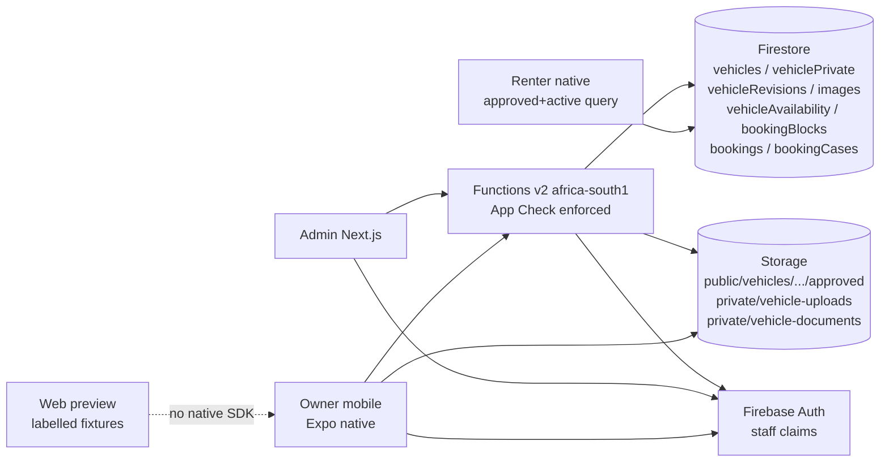
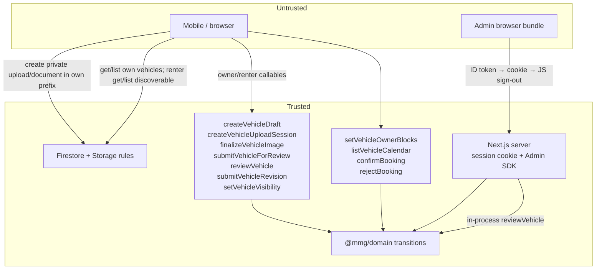
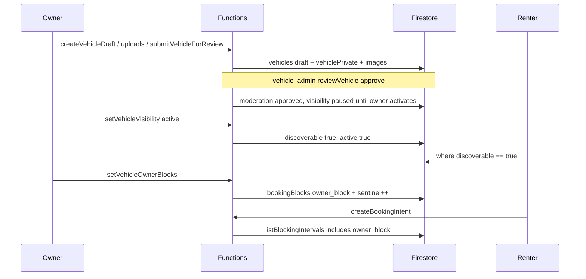
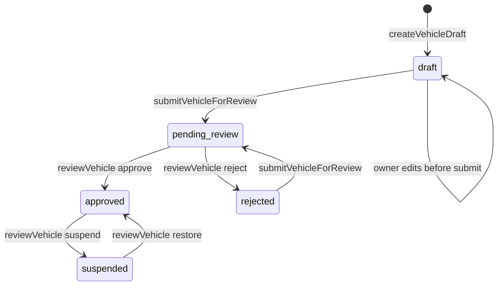
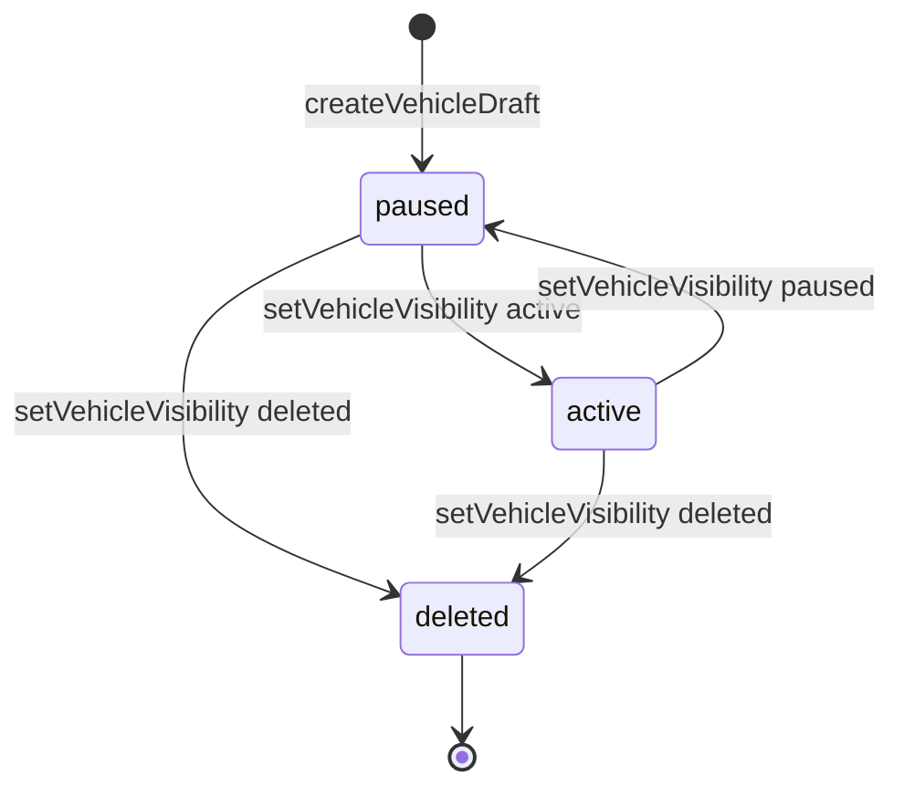
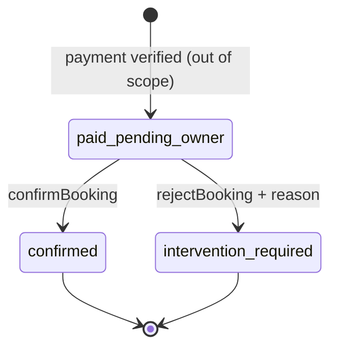

# Owner Sequences 2–3 — Vehicle inventory and owner operations

**Document type:** Agent implementation contract
**Author:** Implementation architect (draft)
**Date:** 15 August 2026
**Status:** Draft (revision 0)
**Branch:** `Taste_Redesign`
**Repository:** `/Users/franklin/Documents/ChatGPT/MMG Concierge Development`
**Firebase project (current development):** `mmg-concierge`
**Firestore:** Standard edition, Native mode, `(default)`, `africa-south1`
**Architecture authority:** `docs/architecture/MMG_CONCIERGE_TECHNICAL_ARCHITECTURE_AND_IMPLEMENTATION_HANDOFF.md` v1.0 (12 August 2026)

This document is the implementation contract for **Owner Sequence 2** (vehicle inventory and Lagos inspection) and **Owner Sequence 3** (host availability calendar and owner booking operations). A coding agent executes it. A separate reviewer reruns the gates and reviews the diff. The implementer does not invent business rules, collection names, states, error codes, Storage paths, or security shortcuts.

When sources disagree: architecture locked rules win; this spec then binds the Sequence 2–3 slice.

**Sequence numbering.** `docs/implementation/ANTIGRAVITY_SEQUENCE_1_3_WORKPLAN.md` Sequences 1–3 (booking intent / admin booking queue / renter trips) are **DONE**. Do **not** implement that workplan. Owner Sequence 1 (verification) is **complete**. Do **not** reopen Sequence 1 states, commands, Storage prefixes, or owner-verification UX except the additive listing-pause port specified in K14.

---

## Overview

Owner Sequence 1 left an approved owner with no listing path. The renter fleet is still the labelled web preview in `apps/mobile/src/features/discovery/data/preview-discovery-gateway.ts`; native discovery hooks also read that preview. `createBookingIntent` already holds dates against `vehicles/{vehicleId}` + `vehicleAvailability/{vehicleId}` + `bookingBlocks/{blockId}` (`apps/functions/src/booking/create-booking-intent-service.ts`). Admin bookings stay `fixture | unavailable` (`apps/admin/src/app/page.tsx`). Paystack is not connected.

**Owner Sequence 2** lets an `ownerProfiles.verificationStatus === 'approved'` owner create a vehicle draft, upload 1–20 images plus optional documents, set specs and an integer-kobo daily rate, record a Lagos base (exact private, approximate public), and submit for review. `vehicle_admin` or `super_admin` inspects and approves or rejects (reason required on reject). An approved listing can be paused or resumed by the owner; delete is a tombstone. Native discovery then reads **only approved + active** public snapshots. Web keeps labelled preview fixtures. Exact coordinates never reach renter clients.

**Owner Sequence 3** lets the owner maintain blocked dates in the **existing** `bookingBlocks` + `vehicleAvailability` sentinel model (no second calendar). The owner bookings desk lists bookings for their vehicles. `confirmBooking` and `rejectBooking` apply only to `paid_pending_owner`. Unpaid cannot be confirmed. Rejection opens an intervention case. Paystack is **not** in this spec: implement the commands and truthful UI; if no paid booking exists, show empty — never fake payment or confirmation.

Named callables (architecture §8.3 / §8.5 plus the calendar pair this spec locks):

| Sequence | Callable |
|---|---|
| 2 | `createVehicleDraft`, `createVehicleUploadSession`, `finalizeVehicleImage`, `submitVehicleForReview`, `reviewVehicle`, `submitVehicleRevision`, `setVehicleVisibility` |
| 3 | `setVehicleOwnerBlocks`, `listVehicleCalendar`, `confirmBooking`, `rejectBooking` |

`searchVehicles` ranking / Places / geohash discovery is **not** this slice. Date-specific rate overrides are **deferred** (architecture does not define them). Changing `ownerDailyRateKobo` is a Sequence 2 **major revision**.

---

## Authority and precedence

1. Architecture handoff locked rules (`docs/architecture/MMG_CONCIERGE_TECHNICAL_ARCHITECTURE_AND_IMPLEMENTATION_HANDOFF.md`), especially §§3.4–3.9, 6.2, 6.4–6.5, 7.2, 7.4–7.5, 8.3–8.5, 10, 11, 12.1–12.2, 14 Phase 2–4, 15.
2. This contract, for names, fields, transitions, UX copy, files, and tests in Owner Sequences 2 and 3.
3. `docs/implementation/SEQUENCE_1_OWNER_VERIFICATION_SPEC.md` — copy trust, callable envelope, App Check, fixture isolation, PII, agent protocol. Do not reopen Sequence 1.
4. Existing booking callable / rules / admin fixture patterns, which this slice must extend rather than fork.

Do not rename collections, states, callable names, staff claim keys, Storage path prefixes, or money/error field conventions. Architecture §15.3–15.4 still apply.

Do not treat the completed booking workplan as in-scope work. Session cookies already authorize the **owners** module. The bookings page stays `fixture | unavailable`. Do not cookie-gate `/`.

---

## Background and motivation

**Current state**

| Surface | What exists | What is missing |
|---|---|---|
| Owner verification | Full Sequence 1 desk + staff review | Approved-owner listing dashboard |
| Vehicles | `createBookingIntent` reads `vehicles/{id}` with `{ ownerId, active, ownerDailyRateKobo, displayName, areaLabel, categoryLabel, imageKey?, imageUrl? }` | Drafts, private record, images, moderation, visibility, revisions |
| Availability | `vehicleAvailability` sentinel + `bookingBlocks` (`held` \| `paid` \| `confirmed`) | Owner `owner_block` intervals feeding the same query |
| Discovery | Web + native preview fleet (`preview-pearl-suv`, …) | Native query of approved+active only |
| Functions | `createBookingIntent` + three owner-verification callables | Seven vehicle callables + four Sequence 3 callables |
| Firestore rules | Owner get on `ownerProfiles`; deny-all on `bookingBlocks` / `vehicleAvailability`; renter read on `bookings` | Vehicle grants; owner booking read; no client writes |
| Storage | `private/owner-verification/{ownerId}/{uploadId}` create-only | Vehicle private upload / document / public approved prefixes |
| Admin | Owners module (`verification_admin` \| `super_admin`); bookings fixture | Vehicles module (`vehicle_admin` \| `super_admin`) |
| Domain/contracts | Booking + owner verification | Vehicle states, commands, owner-visible / renter-visible vehicle docs, confirm/reject |

**Pain.** MMG cannot list a real chauffeured Lagos vehicle. Discovery cannot leave preview fixtures on native. Owners cannot block dates or confirm a paid booking even if one exists.

---

## Goals and non-goals

### Goals

1. Ship the seven architecture §8.3 vehicle callables with the Sequence 1 command envelope, App Check, idempotency, and `CommandError`.
2. Persist `vehicles`, `vehiclePrivate`, `vehicleRevisions`, `vehicles/{id}/images/{imageId}`; extend `vehicleAvailability` and `bookingBlocks` (do not fork).
3. Lagos inspection: staff `reviewVehicle` with a locked checklist; reject requires a reason; exact plate/coords/docs stay private.
4. Public images are processed variants only (EXIF/GPS stripped). Private uploads and documents never become renter-readable.
5. Native discovery reads only `discoverable == true` (approved + active). Web keeps labelled preview fixtures. Exact coordinates never leave `vehiclePrivate`.
6. Pause / resume / tombstone-delete. Owner suspension/revocation pauses every non-deleted listing and blocks new drafts.
7. Owner calendar writes `bookingBlocks.state === 'owner_block'` through the existing sentinel transaction so `createBookingIntent` cannot double-book.
8. Owner bookings desk + `confirmBooking` / `rejectBooking` for `paid_pending_owner` only. Rejection opens `bookingCases`. Truthful empty state when no paid booking exists.
9. Admin vehicles queue/inspector copying owners-module session, fixture isolation, server-side PII masking, and signed-URL previews. `verification_admin` cannot approve vehicles unless also `super_admin`.
10. Additive Firestore/Storage rules and negative tests. Do not weaken booking, owner-verification, or `users` immutability.

### Non-goals (explicitly deferred)

| Deferred | Why |
|---|---|
| Paystack initialize / webhook / refund / escrow | Sequence 4. Never fake payment or confirmation |
| `searchVehicles` / `resolveSearchPlace` / geohash ranking | Architecture Phase 3 discovery. Catalog swap only |
| Date-specific rate overrides | Architecture does not define a collection, function, or snapshot rule. `ownerDailyRateKobo` changes are a major revision |
| FCM delivery and device tokens | Outbox rows may exist with `status: 'unavailable'` |
| Wallets, ledger, withdrawals, `ownerPayoutProfiles` | Later phase |
| Chat, trip start, completion | Architecture later |
| MFA-for-all-admins staging policy | Same as Sequence 1 |
| Renter Places checkout profile | Renter path |
| In-app role switching | `users.accountType` immutable |
| Account deletion / privacy workflow | Architecture §10.5 |
| Vehicle video, self-drive, favorites, live tracking | Architecture §3.12 |
| Commit, deploy, secret addition | Agent rule |

---

## Key Decisions

| # | Decision | Rationale |
|---|---|---|
| K1 | Moderation and visibility are independent dimensions exactly as architecture §7.2. Discovery requires **both** `moderationStatus === 'approved'` **and** `visibility === 'active'`. Server persists derived `discoverable: boolean` and booking-facing `active` as that same boolean so `createBookingIntent` keeps working. | Architecture §7.2. Existing `TrustedVehicle.active` in `create-booking-intent-service.ts`. |
| K2 | Only `ownerProfiles.verificationStatus === 'approved'` may create or submit vehicles or set visibility `active`. `suspended` / `revoked` / any other status is `FORBIDDEN` + `not_approved_owner`. | Locked product rule. Sequence 1 K11: approval is the profile projection, not a custom claim. |
| K3 | When `reviewOwnerVerification` transitions to `suspended` or `revoked`, a Sequence 2 `listingPausePort` pauses every non-deleted vehicle (`visibility: 'paused'`, `discoverable: false`, `active: false`). Owner cannot resume until verification is `approved` again. Sequence 1 states/commands/payloads do not change. | Architecture §7.1 “active listings paused”. Additive port so existing Sequence 1 tests stay green with a no-op; production `index.ts` must wire the port. |
| K4 | Same command envelope as Sequence 1: `schemaVersion: 1`, `idempotencyKey`, `africa-south1`, `enforceAppCheck: true`, Zod `.strict()`, `CommandError` + `safeDetails.reason` from `@mmg/contracts` only. Idempotency document id is `sha256({ actorId, commandName, idempotencyKey })`. | Sequence 1 K6 / existing `apps/functions/src/index.ts`. |
| K5 | Client never writes vehicle status, visibility, prices as authoritative, plate, exact coords, image moderation, or `discoverable`. Owner may **create** private upload/document objects in their prefix only. Staff JS has **zero** Firestore/Storage access to vehicle private data. | Architecture §5.5, §10.2–10.3. Same trust as bookings and owner verification. |
| K6 | Public images: processed variants only; EXIF/GPS stripped via `sharp` in Functions. Private: plate, exact address/coords, insurance docs — staff via signed URL / Admin SDK, never renter. | Architecture §10.3. |
| K7 | Storage prefixes follow architecture §10.3 exactly: `public/vehicles/{vehicleId}/approved/{imageId}/{variant}`, `private/vehicle-uploads/{ownerId}/{vehicleId}/{uploadId}`, `private/vehicle-documents/{ownerId}/{vehicleId}/{uploadId}`. `{imageId}` is required to disambiguate 1–20 images under the locked `approved/` prefix. | Architecture path + implementable multi-image layout. |
| K8 | Staff for vehicle review: `vehicle_admin` \| `super_admin`. Reuse session cookies, `getUser` every request, fixture isolation (`MMG_ADMIN_FIXTURES==='1' && NODE_ENV!=='production'`), no live writes in fixture mode, mask PII server-side. `verification_admin` does **not** approve vehicles unless also `super_admin`. | Architecture §10.1, §11.1. Sequence 1 K7–K8, K16–K17. |
| K9 | `expectedVersion` is required on `reviewVehicle`, `setVehicleVisibility`, `submitVehicleRevision`, `setVehicleOwnerBlocks`, `confirmBooking`, and `rejectBooking`. Mismatch → `FAILED_PRECONDITION` + `stale_version`. | Architecture §6.1. Sequence 1 K22. |
| K10 | Money is integer kobo. Owner submits `ownerDailyRateKobo` only. Server snapshots fees at booking time (`calculateAuthoritativePrice`). Client never submits a trusted total. Rate change is a major revision. Date-specific overrides are **out of scope**. | Architecture §3.8. Existing domain. IMPLEMENTATION_PHASES mentions overrides; architecture does not define them. |
| K11 | Chauffeur and delivery are `included` for every MVP listing. No self-drive control in any command, schema, or UI. Server writes both policies; client cannot send another value (`.strict()` + server overwrite). | Architecture §3.6. Locked decision 1. |
| K12 | No Paystack, wallets, chat, FCM delivery (outbox may be `unavailable`), no renter Places checkout profile, no MFA, no role switching. | Locked decision 10. |
| K13 | Copy Sequence 1 agent protocol: `[AUDIT] [PLAN] [IMPLEMENT] [VALIDATE] [HANDOFF]`. No commit/deploy/secrets. | Sequence 1. |
| K14 | `reviewOwnerVerification` gains an optional `listingPausePort` dependency. Sequence 1 unit tests omit it. Sequence 2 production wiring is mandatory. | Avoids reopening Sequence 1 transition tests while fulfilling K3. |
| K15 | Renter catalog in this slice is a **constrained client query** of public `vehicles` where `discoverable == true`. This is not `searchVehicles`. Architecture “discovery through server” remains the future geohash function. Public vehicle schema has **no** exact coords, plate, private paths, or owner address line. | User lock for catalog swap vs deferred Places search. |
| K16 | Owner calendar does **not** create `vehicleAvailability` child dates or a new collection. It replaces `bookingBlocks` with `state: 'owner_block'` inside the existing sentinel transaction. `createBookingIntent` already calls `listBlockingIntervals` + `intervalsOverlap`. Sequence 3 extends `blockSchema` and `isActiveBlockingInterval` only. | Architecture §6.4. User lock: do not fork the calendar. |
| K17 | `confirmBooking` / `rejectBooking` apply only to `paid_pending_owner` with a verified paid booking document. Intent-only / unpaid / other states → `INVALID_STATE_TRANSITION` or `FAILED_PRECONDITION` + `not_paid`. If no paid booking exists, UI is empty. Never confirm from a client status field. | Architecture §7.4, §3.9. |
| K18 | Rejection writes `bookings.state = 'intervention_required'`, **deletes** the booking’s `bookingBlocks` row (releases dates), creates `bookingCases/{caseId}` with `type: 'owner_rejection'` and `status: 'open'`, increments the sentinel. Admin alternative/refund is **not** this slice. | Architecture §6.4, §7.4–7.5. |
| K19 | Exact Lagos coordinates: owner may send them on draft/submit (native map pin). Server writes them **only** to `vehiclePrivate`. Public doc gets `areaLabel` + `approxLatitude` / `approxLongitude` rounded to **2 decimal degrees** (~1.1 km). Lagos bounding box is locked below. Staff may correct exact coords on `reviewVehicle` approve. | Architecture §3.4, §6.5. Places is not wired. |
| K20 | Major vs minor edits are locked: description-only (and optional feature-tag-only) apply immediately on an approved listing via `submitVehicleRevision` with `revisionClass: 'minor'`. Everything else is `major` and does not mutate the approved snapshot until `reviewVehicle` approve. Safety-critical major fields (plate, location, image set, documents) auto-pause visibility during review. Daily rate is always major. | Architecture §3.4 / §7.2. Conservative fill-in. |
| K21 | Image count 1–20. MIME `image/jpeg` \| `image/png` \| `image/webp`. Max 10 MiB. Min dimensions 1280×720. Max 8000×8000. Documents (optional insurance / other) use the Sequence 1 MIME set including PDF, same 10 MiB cap, no dimension rule. | Architecture §3.4, §10.3. Sequence 1 size lock. |
| K22 | Staff session cookie mint accepts `verification_admin` \| `vehicle_admin` \| `super_admin`. Module layouts re-check the claim required for that module. `requireLiveStaffSession(module)` replaces the current owners-only check. | Sequence 1 cookie path must grow without weakening owners. |
| K23 | Owner may `get`/`list` own vehicles (`ownerId == uid`) and `get` own `vehiclePrivate`. Renters may `get`/`list` only `discoverable == true` public vehicles and their approved image subdocs. `vehicleRevisions` owner-get own; no renter read. `bookingBlocks` / `vehicleAvailability` stay deny-all. Owner may read `bookings` where `ownerId == uid`. No client writes on any of these. | Least privilege + owner desk + catalog swap. |
| K24 | Web Expo preview never selects native Firebase Storage, Functions, or the live vehicle catalog. Owner/renter visual review on web uses labelled fixtures. | Sequence 1 K14. |
| K25 | `CommandError.safeDetails.reason` allowlist grows only by the codes in this spec. Client maps `code + reason` only. Never interpolate `error.message`. | Sequence 1 K19. |
| K26 | Admin vehicle document preview is `mintVehiclePrivateReadUrl` in a `server-only` module (copy `mintOwnerVerificationReadUrl`). **No** vehicle signed-URL callable. No staff JS `getDownloadURL`. | Sequence 1 K5 / K16. |
| K27 | Automatic single-field indexes suffice: `vehicles.discoverable`, `vehicles.ownerId`, `bookings.ownerId`, `vehicleRevisions.vehicleId`, `vehicleRevisions.status`. Existing `bookingBlocks` composite `(vehicleId, startDate)` is reused. Do not add a composite unless a compound query is introduced and emulator-tested. | Sequence 1 K13. |
| K28 | `flagOwnerResponseSla` is **deferred** with Paystack. Sequence 3 implements confirm/reject and calendar only. Do not auto-cancel. | Architecture job exists; without paid traffic it would only create noise. |

---

## Proposed design

### System context



### Trust boundary



The mobile app and the admin browser are untrusted. Admin SDK credentials, session-cookie verification, signed URL minting, staff Firestore/Storage reads, status/visibility/price writes, EXIF stripping, and variant promotion stay on Functions or Next.js **Node** modules that are never imported from a `'use client'` file.

### Catalog and calendar data flow



---

## State machines

### Vehicle moderation (architecture §7.2)

```text
draft -> pending_review -> approved
                   \----> rejected -> pending_review
approved -> suspended -> approved
```



`pending_review` is entered by `submitVehicleForReview` (owner). Staff `start_review` assigns `reviewerUid` but does **not** change status (the file is already in the queue). Do not skip `pending_review` on the way to `approved` or `rejected`.

There is **no** `deleted` moderation state. Delete is visibility.

### Vehicle visibility (architecture §7.2)

```text
paused <-> active -> deleted
```



`deleted` is terminal. Tombstone retains `vehicleId`, `ownerId`, last approved rate, and `deletedAt`. Personal listing fields on `vehiclePrivate` (plate, exact address, coords, document paths) are nulled on delete. Booking/financial snapshots stay.

### Combined discoverability

| moderationStatus | visibility | `discoverable` / `active` | Native catalog | Owner may set `active` |
|---|---|---|---|---|
| `draft` | `paused` | `false` | Hidden | No |
| `pending_review` | `paused` or previous | `false` unless already approved snapshot + `active` (revision case) | Live snapshot only if previously approved+active and not auto-paused | No (not while first publish is unapproved) |
| `approved` | `paused` | `false` | Hidden | Yes, if owner verification is `approved` |
| `approved` | `active` | `true` | Shown | — |
| `approved` | `deleted` | `false` | Hidden | No |
| `rejected` | `paused` | `false` | Hidden | No |
| `suspended` | `paused` (forced) | `false` | Hidden | No |

A **major revision** of an already-approved listing does **not** mutate the approved public snapshot until `reviewVehicle` approve. If the revision is safety-critical, visibility is forced `paused` for the review window (live catalog hides it). If the revision is rate/make/model/year only, the old snapshot may stay `active`.

### Legal vehicle transitions

| From (moderation) | To | Command | Actor | Preconditions | Required payload |
|---|---|---|---|---|---|
| _(missing)_ | `draft` | `createVehicleDraft` | Approved owner | Profile `approved`; email verified | Initial specs (may be partial). Server sets visibility `paused`, policies `included` |
| `draft` | `draft` | `createVehicleDraft` (update) or implicit field writes via later commands | Owner of vehicle | Still `draft`; `expectedVersion` on updates that carry it | Same owner |
| `draft` | `pending_review` | `submitVehicleForReview` | Owner of vehicle | Completeness (below); 1–20 finalized images; Lagos private base present; `expectedVersion` | `vehicleId`, `expectedVersion` |
| `rejected` | `pending_review` | `submitVehicleForReview` | Owner of vehicle | Same completeness; new or existing finalized images | `vehicleId`, `expectedVersion` |
| `pending_review` | `pending_review` | `reviewVehicle` `start_review` | `vehicle_admin` \| `super_admin` | Status is `pending_review`; `expectedVersion` | `vehicleId`, `expectedVersion`. No note |
| `pending_review` | `approved` | `reviewVehicle` `approve` | same | Checklist all true; `expectedVersion`; private plate + exact coords present (staff may supply override) | Checklist. **No reason.** Optional exact-base override |
| `pending_review` | `rejected` | `reviewVehicle` `reject` | same | `expectedVersion` | Reason 10–500 |
| `approved` | `suspended` | `reviewVehicle` `suspend` | same | `expectedVersion` | Reason 10–500. Forces visibility `paused` |
| `suspended` | `approved` | `reviewVehicle` `restore` | same | `expectedVersion` | No note. Visibility stays `paused` (owner must resume) |
| `approved` + `paused` | `approved` + `active` | `setVehicleVisibility` | Owner of vehicle **or** `vehicle_admin` \| `super_admin` | Owner verification `approved`; moderation `approved`; not deleted; `expectedVersion` | `visibility: 'active'` |
| `approved` + `active` | `approved` + `paused` | `setVehicleVisibility` | Owner or staff above | Not deleted; `expectedVersion` | `visibility: 'paused'` |
| `approved` + `paused`/`active` | `deleted` | `setVehicleVisibility` | Owner or staff above | `expectedVersion` | `visibility: 'deleted'` |
| `approved` (live snapshot) | `approved` (unchanged) + revision `pending_review` | `submitVehicleRevision` major | Owner | Listing not `deleted`; `expectedVersion` | Changed fields. Safety-critical → auto-pause |
| `approved` | `approved` (mutated) | `submitVehicleRevision` minor | Owner | Description/features only; `expectedVersion` | Minor fields. Applies immediately |

### Forbidden vehicle transitions

- Owner or client sets `moderationStatus`, `visibility`, `discoverable`, `active`, `ownerDailyRateKobo` on a public write, plate, or exact coords via Firestore.
- `draft` → `approved` (must pass `pending_review`).
- `pending_review` → `draft`.
- `rejected` → `approved` without a new submit.
- `deleted` → any visibility.
- `setVehicleVisibility` `active` while owner verification is not `approved`, or moderation is not `approved`.
- `setVehicleVisibility` `active` while moderation is `suspended`.
- `createVehicleDraft` / `submitVehicleForReview` / `submitVehicleRevision` / `createVehicleUploadSession` when owner is not `approved`.
- `reviewVehicle` `approve` with any checklist flag false or omitted.
- `reviewVehicle` `reject` / `suspend` without reason.
- `reviewVehicle` by `verification_admin` who is not also `super_admin`.
- Review/visibility/revision when `expectedVersion` ≠ stored `version` → `stale_version` (not a transition error).
- Renter, anonymous, or other-owner actor on owner vehicle commands.
- Extra command fields → `INVALID_ARGUMENT` (`.strict()`).

### Revision class

| Field change | Class | Live snapshot | Visibility during review |
|---|---|---|---|
| `description` | minor | Mutated immediately | Unchanged |
| `features` | minor | Mutated immediately | Unchanged |
| `make`, `model`, `year`, `colour`, `category`, `seats`, `transmission`, `mileageKm`, `fuelType` | major | Unchanged until approve | Unchanged |
| `ownerDailyRateKobo` | major | Unchanged until approve | Unchanged |
| `areaLabel`, exact address/coords/`placeId` | major, **safety-critical** | Unchanged until approve | Forced `paused` |
| plate / registration | major, **safety-critical** | Unchanged until approve | Forced `paused` |
| primary image, image set, required documents | major, **safety-critical** | Unchanged until approve | Forced `paused` |
| `chauffeurPolicy` / `deliveryPolicy` | **illegal** | — | — |

A payload that mixes minor and major is **major**. A payload that includes any safety-critical field is safety-critical.

### Owner booking confirm / reject (existing paid states)

Architecture §7.4. Domain already has `canTransitionPaidBooking` in `packages/domain/src/index.ts`:

```text
paid_pending_owner -> confirmed          (confirmBooking)
paid_pending_owner -> intervention_required  (rejectBooking)
```



Do **not** add `completion_pending` or other architecture states in this slice. Do **not** implement alternative assignment or refund.

| From | To | Command | Actor | Preconditions | Required payload |
|---|---|---|---|---|---|
| `paid_pending_owner` | `confirmed` | `confirmBooking` | Owner of `bookings.ownerId` **or** `super_admin` | Booking exists; state is `paid_pending_owner`; `expectedVersion`; corresponding `bookingBlocks` row exists in `paid` or `confirmed` is not already set | `bookingId`, `expectedVersion` |
| `paid_pending_owner` | `intervention_required` | `rejectBooking` | Owner of vehicle (not staff-as-owner-substitute except `super_admin`) | Same; reason 10–500 | `bookingId`, `expectedVersion`, reason |

`vehicle_admin` does **not** confirm/reject bookings unless also `super_admin`. Support does not.

### Forbidden booking transitions in this slice

- Confirm or reject `intent_created`, `checkout_pending`, or any unpaid record.
- Confirm `intervention_required`, `confirmed`, `cancelled`, `refund_pending`, `refunded`, `in_progress`, `completed`.
- Owner B confirms owner A’s booking.
- Client write of `bookings.state`.
- Reject without reason.
- Confirm when no booking document exists (tests may seed one; UI must not invent one).

### Owner calendar vs booking blocks

`isActiveBlockingInterval` today (`create-booking-intent-service.ts`):

- `held` is active only if `expiresAt > now`.
- `paid` and `confirmed` are always active.

Sequence 3 adds `owner_block` as **always active** (no `expiresAt`).

`setVehicleOwnerBlocks` **must fail** if any new owner interval overlaps an active `held` / `paid` / `confirmed` block. It may replace previous `owner_block` rows for that vehicle.

---

## API / interface changes

### Canonical errors

Keep every existing code in `canonicalErrorCodeSchema`. **Do not add new domain codes** unless a situation cannot be expressed. Sequence 2–3 use existing codes plus `safeDetails.reason` extensions.

Extend `commandSafeReasonSchema` (only in `@mmg/contracts`):

```ts
export const commandSafeReasonSchema = z.enum([
  'email_unverified',
  'phone_unverified',
  'not_owner',
  'not_staff',
  'upload_invalid',
  'terms_stale',
  'stale_version',
  'not_approved_owner',
  'not_vehicle_owner',
  'listing_incomplete',
  'image_limit',
  'dates_overlap',
  'not_paid',
]);
```

| Situation | Code | `safeDetails.reason` | Safe message (server) |
|---|---|---|---|
| No `auth.uid` | `UNAUTHENTICATED` | — | `Sign in to continue.` |
| Email not verified | `FORBIDDEN` | `email_unverified` | `Verify your email before continuing.` |
| `accountType !== 'owner'` | `FORBIDDEN` | `not_owner` | `Only an owner account can manage vehicles.` |
| Owner verification not `approved` | `FORBIDDEN` | `not_approved_owner` | `Your owner account must be approved before you can list a vehicle.` |
| Not the vehicle’s `ownerId` | `FORBIDDEN` | `not_vehicle_owner` | `You cannot manage this vehicle.` |
| Missing `vehicle_admin` / `super_admin` (or wrong module) | `FORBIDDEN` | `not_staff` | `You are not authorized to review vehicles.` |
| Zod failure / extra fields | `INVALID_ARGUMENT` | — | `The request is invalid.` |
| Unknown vehicle / booking / revision | `NOT_FOUND` | — | `The record was not found.` |
| Upload missing / MIME / magic-byte / size / dimensions | `FAILED_PRECONDITION` | `upload_invalid` | `The file could not be verified.` |
| Image count would exceed 20 | `FAILED_PRECONDITION` | `image_limit` | `A listing can include at most 20 images.` |
| Submit missing required fields / images / Lagos base / plate | `PROFILE_INCOMPLETE` or `FAILED_PRECONDITION` | `listing_incomplete` | `Complete the listing before submitting.` Use `PROFILE_INCOMPLETE` for submit completeness (same HTTPS mapping). |
| `expectedVersion` mismatch | `FAILED_PRECONDITION` | `stale_version` | `This record changed. Refresh and try again.` |
| Owner blocks overlap a hold/booking | `VEHICLE_UNAVAILABLE` | `dates_overlap` | `Those dates are already reserved.` |
| Confirm/reject when state is not `paid_pending_owner` | `FAILED_PRECONDITION` | `not_paid` | `Only a paid booking can be confirmed or declined.` |
| Illegal transition | `INVALID_STATE_TRANSITION` | — | `This listing cannot move to that state.` |
| Same key, different payload | `IDEMPOTENCY_CONFLICT` | — | `This idempotency key was already used for a different request.` |
| `systemConfig/vehicle` present and malformed | `CONFIGURATION_UNAVAILABLE` | — | `Vehicle configuration is unavailable.` |
| Unexpected | `INTERNAL` | — | `The request could not be completed.` |

`httpsCodeByDomainCode` in `apps/functions/src/index.ts` is unchanged.

### Shared constants

```ts
export const VEHICLE_MODERATION_STATES = [
  'draft',
  'pending_review',
  'approved',
  'rejected',
  'suspended',
] as const;

export const VEHICLE_VISIBILITY_STATES = [
  'paused',
  'active',
  'deleted',
] as const;

export const VEHICLE_REVIEW_DECISIONS = [
  'start_review',
  'approve',
  'reject',
  'suspend',
  'restore',
] as const;

export const VEHICLE_REVIEW_CHECKLIST_KEYS = [
  'images_complete_and_legible',
  'specs_match_images',
  'plate_matches_documents',
  'lagos_base_plausible',
  'rate_plausible',
  'chauffeur_delivery_included',
  'no_fraud_indicators',
] as const;

export const VEHICLE_CATEGORIES = ['executive_suv', 'executive_sedan'] as const;

export const VEHICLE_TRANSMISSIONS = ['automatic', 'manual'] as const;

export const VEHICLE_FUEL_TYPES = ['petrol', 'diesel', 'hybrid'] as const;

export const VEHICLE_FEATURE_KEYS = [
  'leather',
  'panoramic_roof',
  'apple_carplay',
  'android_auto',
  'climate_control',
  'third_row',
  'wifi',
  'privacy_glass',
] as const;

export const VEHICLE_IMAGE_VARIANTS = ['thumb', 'card', 'detail'] as const;

export const VEHICLE_UPLOAD_PURPOSES = ['listing_image', 'vehicle_document'] as const;

export const VEHICLE_DOCUMENT_KINDS = ['insurance', 'other'] as const;

export const BOOKING_BLOCK_STATES = ['held', 'paid', 'confirmed', 'owner_block'] as const;

export const OWNER_CALENDAR_KINDS = ['owner_block', 'hold', 'booking'] as const;

export const MIN_OWNER_DAILY_RATE_KOBO = 5_000_000;      // ₦50,000
export const MAX_OWNER_DAILY_RATE_KOBO = 1_000_000_000;  // ₦10,000,000
export const MIN_VEHICLE_YEAR = 2010;
export const MAX_VEHICLE_IMAGES = 20;
export const MAX_VEHICLE_DOCUMENTS = 5;
export const MAX_UPLOAD_BYTES = 10 * 1024 * 1024;
export const MIN_IMAGE_WIDTH = 1280;
export const MIN_IMAGE_HEIGHT = 720;
export const MAX_IMAGE_EDGE = 8000;

/** Inclusive Lagos bounding box for exact coordinates (WGS84). */
export const LAGOS_BBOX = {
  minLatitude: 6.35,
  maxLatitude: 6.72,
  minLongitude: 3.05,
  maxLongitude: 3.70,
} as const;
```

`VehicleCategory` already exists on the discovery contract (`executive_suv` \| `executive_sedan`). Reuse it. Do not add new public categories.

Current Lagos year for `MAX_VEHICLE_YEAR` is `new Date()` in `Africa/Lagos` plus 1, computed in domain (not a hardcoded calendar year in contracts except tests).

### Zod schemas to add in `@mmg/contracts`

Reuse `schemaVersionSchema`, `idempotencyKeySchema`, `boundedIdSchema`, `isoDateTimeSchema`, `dateOnlySchema`, `lagosAreaLabelSchema`, `ownerAddressSchema`.

```ts
export const vehicleModerationStatusSchema = z.enum(VEHICLE_MODERATION_STATES);
export const vehicleVisibilitySchema = z.enum(VEHICLE_VISIBILITY_STATES);
export const vehicleReviewDecisionSchema = z.enum(VEHICLE_REVIEW_DECISIONS);
export const vehicleCategorySchema = z.enum(VEHICLE_CATEGORIES);
export const vehicleTransmissionSchema = z.enum(VEHICLE_TRANSMISSIONS);
export const vehicleFuelTypeSchema = z.enum(VEHICLE_FUEL_TYPES);
export const vehicleFeatureKeySchema = z.enum(VEHICLE_FEATURE_KEYS);
export const vehicleImageVariantSchema = z.enum(VEHICLE_IMAGE_VARIANTS);
export const bookingBlockStateSchema = z.enum(BOOKING_BLOCK_STATES);

export const ownerDailyRateKoboSchema = z
  .number()
  .int()
  .min(MIN_OWNER_DAILY_RATE_KOBO)
  .max(MAX_OWNER_DAILY_RATE_KOBO);

export const vehicleYearSchema = z.number().int().min(MIN_VEHICLE_YEAR).max(2035);

export const vehicleSeatsSchema = z.number().int().min(2).max(8);

export const vehicleMakeModelSchema = z.string().trim().min(1).max(40);

export const vehicleColourSchema = z.string().trim().min(2).max(40);

export const vehicleDescriptionSchema = z.string().trim().min(40).max(2000);

export const nigerianPlateSchema = z
  .string()
  .trim()
  .toUpperCase()
  .regex(/^[A-Z]{3}-?\d{2,3}[A-Z]{2,3}$/, 'Enter a Nigerian registration plate.');

export const lagosLatitudeSchema = z.number().gte(LAGOS_BBOX.minLatitude).lte(LAGOS_BBOX.maxLatitude);
export const lagosLongitudeSchema = z.number().gte(LAGOS_BBOX.minLongitude).lte(LAGOS_BBOX.maxLongitude);

export const exactLagosPointSchema = z.object({
  latitude: lagosLatitudeSchema,
  longitude: lagosLongitudeSchema,
  placeId: z.string().trim().min(1).max(256).optional(),
}).strict();

export const vehicleSpecsSchema = z.object({
  make: vehicleMakeModelSchema,
  model: vehicleMakeModelSchema,
  year: vehicleYearSchema,
  colour: vehicleColourSchema,
  category: vehicleCategorySchema,
  seats: vehicleSeatsSchema,
  transmission: vehicleTransmissionSchema.optional(),
  fuelType: vehicleFuelTypeSchema.optional(),
  mileageKm: z.number().int().min(0).max(1_000_000).optional(),
  description: vehicleDescriptionSchema,
  features: z.array(vehicleFeatureKeySchema).max(16).optional(),
}).strict();

export const vehicleReviewChecklistSchema = z.object({
  images_complete_and_legible: z.literal(true),
  specs_match_images: z.literal(true),
  plate_matches_documents: z.literal(true),
  lagos_base_plausible: z.literal(true),
  rate_plausible: z.literal(true),
  chauffeur_delivery_included: z.literal(true),
  no_fraud_indicators: z.literal(true),
}).strict();
```

#### Commands — Sequence 2

```ts
export const createVehicleDraftDataSchema = z.object({
  specs: vehicleSpecsSchema.partial().extend({
    make: vehicleMakeModelSchema.optional(),
    model: vehicleMakeModelSchema.optional(),
    year: vehicleYearSchema.optional(),
    colour: vehicleColourSchema.optional(),
    category: vehicleCategorySchema.optional(),
    seats: vehicleSeatsSchema.optional(),
    description: z.string().trim().min(1).max(2000).optional(),
  }).strict().optional(),
  ownerDailyRateKobo: ownerDailyRateKoboSchema.optional(),
  areaLabel: lagosAreaLabelSchema.optional(),
  baseAddress: ownerAddressSchema.optional(),
  exactBase: exactLagosPointSchema.optional(),
  plate: nigerianPlateSchema.optional(),
}).strict();

export const createVehicleDraftCommandSchema = z.object({
  schemaVersion: schemaVersionSchema,
  idempotencyKey: idempotencyKeySchema,
  data: createVehicleDraftDataSchema,
}).strict();

export const createVehicleDraftResultSchema = z.object({
  requestId: z.string().min(1).max(128),
  result: z.object({
    vehicleId: boundedIdSchema,
    moderationStatus: z.literal('draft'),
    visibility: z.literal('paused'),
    version: z.number().int().positive(),
  }).strict(),
}).strict();

export const createVehicleUploadSessionDataSchema = z.object({
  vehicleId: boundedIdSchema,
  purpose: z.enum(VEHICLE_UPLOAD_PURPOSES),
  contentType: z.enum(['image/jpeg', 'image/png', 'image/webp', 'application/pdf']),
  byteSize: z.number().int().positive().max(MAX_UPLOAD_BYTES),
  originalFileName: z.string().trim().min(1).max(120),
  documentKind: z.enum(VEHICLE_DOCUMENT_KINDS).optional(),
}).strict().superRefine((value, ctx) => {
  if (value.purpose === 'listing_image' && value.contentType === 'application/pdf') {
    ctx.addIssue({ code: 'custom', path: ['contentType'], message: 'Listing images cannot be PDF.' });
  }
  if (value.purpose === 'vehicle_document' && !value.documentKind) {
    ctx.addIssue({ code: 'custom', path: ['documentKind'], message: 'Document kind is required.' });
  }
});

export const createVehicleUploadSessionCommandSchema = z.object({
  schemaVersion: schemaVersionSchema,
  idempotencyKey: idempotencyKeySchema,
  data: createVehicleUploadSessionDataSchema,
}).strict();

export const createVehicleUploadSessionResultSchema = z.object({
  requestId: z.string().min(1).max(128),
  result: z.object({
    uploadId: boundedIdSchema,
    storagePath: z.string().min(1).max(512),
    purpose: z.enum(VEHICLE_UPLOAD_PURPOSES),
    maxBytes: z.literal(MAX_UPLOAD_BYTES),
  }).strict(),
}).strict();

export const finalizeVehicleImageDataSchema = z.object({
  vehicleId: boundedIdSchema,
  uploadId: boundedIdSchema,
  order: z.number().int().min(0).max(19),
}).strict();

export const finalizeVehicleImageCommandSchema = z.object({
  schemaVersion: schemaVersionSchema,
  idempotencyKey: idempotencyKeySchema,
  data: finalizeVehicleImageDataSchema,
}).strict();

export const finalizeVehicleImageResultSchema = z.object({
  requestId: z.string().min(1).max(128),
  result: z.object({
    imageId: boundedIdSchema,
    order: z.number().int().min(0).max(19),
    status: z.enum(['processed', 'rejected']),
    width: z.number().int().positive(),
    height: z.number().int().positive(),
  }).strict(),
}).strict();

export const submitVehicleForReviewDataSchema = z.object({
  vehicleId: boundedIdSchema,
  expectedVersion: z.number().int().positive(),
}).strict();

export const submitVehicleForReviewCommandSchema = z.object({
  schemaVersion: schemaVersionSchema,
  idempotencyKey: idempotencyKeySchema,
  data: submitVehicleForReviewDataSchema,
}).strict();

export const submitVehicleForReviewResultSchema = z.object({
  requestId: z.string().min(1).max(128),
  result: z.object({
    vehicleId: boundedIdSchema,
    moderationStatus: z.literal('pending_review'),
    submittedAt: isoDateTimeSchema,
    version: z.number().int().positive(),
  }).strict(),
}).strict();

export const reviewVehicleDataSchema = z.object({
  vehicleId: boundedIdSchema,
  revisionId: boundedIdSchema.optional(),
  expectedVersion: z.number().int().positive(),
  decision: vehicleReviewDecisionSchema,
  reason: z.string().trim().min(10).max(500).optional(),
  checklist: z.object({
    images_complete_and_legible: z.boolean(),
    specs_match_images: z.boolean(),
    plate_matches_documents: z.boolean(),
    lagos_base_plausible: z.boolean(),
    rate_plausible: z.boolean(),
    chauffeur_delivery_included: z.boolean(),
    no_fraud_indicators: z.boolean(),
  }).strict().optional(),
  exactBaseOverride: exactLagosPointSchema.optional(),
}).strict().superRefine((value, ctx) => {
  if (['reject', 'suspend'].includes(value.decision) && !value.reason) {
    ctx.addIssue({ code: 'custom', path: ['reason'], message: 'A reason is required.' });
  }
  if (value.decision === 'approve') {
    const parsed = vehicleReviewChecklistSchema.safeParse(value.checklist);
    if (!parsed.success) {
      ctx.addIssue({ code: 'custom', path: ['checklist'], message: 'Complete the approval checklist.' });
    }
  }
});

export const reviewVehicleCommandSchema = z.object({
  schemaVersion: schemaVersionSchema,
  idempotencyKey: idempotencyKeySchema,
  data: reviewVehicleDataSchema,
}).strict();

export const reviewVehicleResultSchema = z.object({
  requestId: z.string().min(1).max(128),
  result: z.object({
    vehicleId: boundedIdSchema,
    revisionId: boundedIdSchema.nullable(),
    fromStatus: vehicleModerationStatusSchema,
    toStatus: vehicleModerationStatusSchema,
    visibility: vehicleVisibilitySchema,
    decidedAt: isoDateTimeSchema,
    version: z.number().int().positive(),
  }).strict(),
}).strict();

export const submitVehicleRevisionDataSchema = z.object({
  vehicleId: boundedIdSchema,
  expectedVersion: z.number().int().positive(),
  specs: vehicleSpecsSchema.partial().strict().optional(),
  ownerDailyRateKobo: ownerDailyRateKoboSchema.optional(),
  areaLabel: lagosAreaLabelSchema.optional(),
  baseAddress: ownerAddressSchema.optional(),
  exactBase: exactLagosPointSchema.optional(),
  plate: nigerianPlateSchema.optional(),
  primaryImageId: boundedIdSchema.optional(),
  imageOrder: z.array(boundedIdSchema).min(1).max(20).optional(),
}).strict();

export const submitVehicleRevisionCommandSchema = z.object({
  schemaVersion: schemaVersionSchema,
  idempotencyKey: idempotencyKeySchema,
  data: submitVehicleRevisionDataSchema,
}).strict();

export const submitVehicleRevisionResultSchema = z.object({
  requestId: z.string().min(1).max(128),
  result: z.object({
    vehicleId: boundedIdSchema,
    revisionId: boundedIdSchema,
    revisionClass: z.enum(['minor', 'major']),
    safetyCritical: z.boolean(),
    moderationStatus: vehicleModerationStatusSchema,
    visibility: vehicleVisibilitySchema,
    version: z.number().int().positive(),
  }).strict(),
}).strict();

export const setVehicleVisibilityDataSchema = z.object({
  vehicleId: boundedIdSchema,
  expectedVersion: z.number().int().positive(),
  visibility: z.enum(['paused', 'active', 'deleted']),
}).strict();

export const setVehicleVisibilityCommandSchema = z.object({
  schemaVersion: schemaVersionSchema,
  idempotencyKey: idempotencyKeySchema,
  data: setVehicleVisibilityDataSchema,
}).strict();

export const setVehicleVisibilityResultSchema = z.object({
  requestId: z.string().min(1).max(128),
  result: z.object({
    vehicleId: boundedIdSchema,
    visibility: vehicleVisibilitySchema,
    discoverable: z.boolean(),
    version: z.number().int().positive(),
  }).strict(),
}).strict();
```

`createVehicleUploadSessionResult.storagePath` is returned to the **owner** so they can `putFile`. It is a private path they already know how to construct; it is **not** a download URL. Never return a signed GET.

#### Commands — Sequence 3

```ts
export const dateIntervalSchema = z.object({
  startDate: dateOnlySchema,
  endDate: dateOnlySchema,
}).strict();

export const setVehicleOwnerBlocksDataSchema = z.object({
  vehicleId: boundedIdSchema,
  expectedVersion: z.number().int().positive(),
  intervals: z.array(dateIntervalSchema).max(180),
}).strict();

export const setVehicleOwnerBlocksCommandSchema = z.object({
  schemaVersion: schemaVersionSchema,
  idempotencyKey: idempotencyKeySchema,
  data: setVehicleOwnerBlocksDataSchema,
}).strict();

export const setVehicleOwnerBlocksResultSchema = z.object({
  requestId: z.string().min(1).max(128),
  result: z.object({
    vehicleId: boundedIdSchema,
    blockCount: z.number().int().nonnegative(),
    version: z.number().int().positive(),
  }).strict(),
}).strict();

export const listVehicleCalendarDataSchema = z.object({
  vehicleId: boundedIdSchema,
  fromDate: dateOnlySchema,
  toDate: dateOnlySchema,
}).strict();

export const listVehicleCalendarCommandSchema = z.object({
  schemaVersion: schemaVersionSchema,
  idempotencyKey: idempotencyKeySchema,
  data: listVehicleCalendarDataSchema,
}).strict();

export const ownerVisibleCalendarIntervalSchema = z.object({
  startDate: dateOnlySchema,
  endDate: dateOnlySchema,
  kind: z.enum(OWNER_CALENDAR_KINDS),
}).strict();

export const listVehicleCalendarResultSchema = z.object({
  requestId: z.string().min(1).max(128),
  result: z.object({
    vehicleId: boundedIdSchema,
    intervals: z.array(ownerVisibleCalendarIntervalSchema),
    version: z.number().int().positive(),
  }).strict(),
}).strict();

export const confirmBookingDataSchema = z.object({
  bookingId: boundedIdSchema,
  expectedVersion: z.number().int().positive(),
}).strict();

export const confirmBookingCommandSchema = z.object({
  schemaVersion: schemaVersionSchema,
  idempotencyKey: idempotencyKeySchema,
  data: confirmBookingDataSchema,
}).strict();

export const confirmBookingResultSchema = z.object({
  requestId: z.string().min(1).max(128),
  result: z.object({
    bookingId: boundedIdSchema,
    fromState: z.literal('paid_pending_owner'),
    toState: z.literal('confirmed'),
    decidedAt: isoDateTimeSchema,
    version: z.number().int().positive(),
  }).strict(),
}).strict();

export const rejectBookingDataSchema = z.object({
  bookingId: boundedIdSchema,
  expectedVersion: z.number().int().positive(),
  reason: z.string().trim().min(10).max(500),
}).strict();

export const rejectBookingCommandSchema = z.object({
  schemaVersion: schemaVersionSchema,
  idempotencyKey: idempotencyKeySchema,
  data: rejectBookingDataSchema,
}).strict();

export const rejectBookingResultSchema = z.object({
  requestId: z.string().min(1).max(128),
  result: z.object({
    bookingId: boundedIdSchema,
    caseId: boundedIdSchema,
    fromState: z.literal('paid_pending_owner'),
    toState: z.literal('intervention_required'),
    decidedAt: isoDateTimeSchema,
    version: z.number().int().positive(),
  }).strict(),
}).strict();
```

`listVehicleCalendar` still uses the envelope (including `idempotencyKey`) for uniformity. A replay with the same key returns the stored result; a later genuine refresh must use a new key. The service is read-only aside from idempotency.

#### Visible documents

Owner-visible vehicle (client parse of `vehicles/{vehicleId}` when `ownerId == uid`). Persist **every** key on every write (`null` not omitted):

```ts
export const ownerVisibleVehicleSchema = z.object({
  vehicleId: boundedIdSchema,
  ownerId: boundedIdSchema,
  displayName: z.string().min(1).max(120),
  make: vehicleMakeModelSchema.nullable(),
  model: vehicleMakeModelSchema.nullable(),
  year: vehicleYearSchema.nullable(),
  colour: vehicleColourSchema.nullable(),
  category: vehicleCategorySchema.nullable(),
  seats: vehicleSeatsSchema.nullable(),
  transmission: vehicleTransmissionSchema.nullable(),
  fuelType: vehicleFuelTypeSchema.nullable(),
  mileageKm: z.number().int().min(0).max(1_000_000).nullable(),
  description: z.string().min(1).max(2000).nullable(),
  features: z.array(vehicleFeatureKeySchema),
  ownerDailyRateKobo: ownerDailyRateKoboSchema.nullable(),
  chauffeurPolicy: z.literal('included'),
  deliveryPolicy: z.literal('included'),
  areaLabel: lagosAreaLabelSchema.nullable(),
  approxLatitude: z.number().nullable(),
  approxLongitude: z.number().nullable(),
  moderationStatus: vehicleModerationStatusSchema,
  visibility: vehicleVisibilitySchema,
  discoverable: z.boolean(),
  lastDecisionReason: z.string().min(1).max(500).nullable(),
  pendingRevisionId: boundedIdSchema.nullable(),
  imageCount: z.number().int().min(0).max(20),
  primaryImagePath: z.string().max(512).nullable(),
  createdAt: isoDateTimeSchema,
  updatedAt: isoDateTimeSchema,
  version: z.number().int().positive(),
}).strict();
```

`ownerVisibleVehicleSchema` has **no** plate, **no** exact coords, **no** private document paths. The owner reads plate/exact address via a **get** of own `vehiclePrivate/{vehicleId}` (separate schema).

```ts
export const ownerVisibleVehiclePrivateSchema = z.object({
  vehicleId: boundedIdSchema,
  ownerId: boundedIdSchema,
  plate: nigerianPlateSchema.nullable(),
  baseAddress: ownerAddressSchema.nullable(),
  exactBase: exactLagosPointSchema.nullable(),
  documents: z.array(z.object({
    uploadId: boundedIdSchema,
    documentKind: z.enum(VEHICLE_DOCUMENT_KINDS),
    contentType: z.enum(['image/jpeg', 'image/png', 'image/webp', 'application/pdf']),
    byteSize: z.number().int().positive(),
    originalFileName: z.string().min(1).max(120),
    uploadedAt: isoDateTimeSchema,
    status: z.enum(['uploaded', 'submitted', 'cleared']),
  }).strict()).max(5),
  createdAt: isoDateTimeSchema,
  updatedAt: isoDateTimeSchema,
  version: z.number().int().positive(),
}).strict();
```

`ownerVisibleVehiclePrivateSchema` has **no** `storagePath` and **no** download URL.

Renter-visible vehicle (client parse of a `discoverable` public doc). Same document as owner-visible **minus** fields renters must not see. Implement as a **pick**, not a second persisted shape:

```ts
export const renterVisibleVehicleSchema = ownerVisibleVehicleSchema.pick({
  vehicleId: true,
  displayName: true,
  make: true,
  model: true,
  year: true,
  colour: true,
  category: true,
  seats: true,
  transmission: true,
  fuelType: true,
  description: true,
  features: true,
  ownerDailyRateKobo: true,
  chauffeurPolicy: true,
  deliveryPolicy: true,
  areaLabel: true,
  approxLatitude: true,
  approxLongitude: true,
  primaryImagePath: true,
  imageCount: true,
});
```

Renter clients **must not** parse or display `approxLatitude` / `approxLongitude` as a street address. Map pin is allowed. `ownerId`, `moderationStatus`, `visibility`, `lastDecisionReason`, `pendingRevisionId`, `version` stay on the document (rules cannot strip fields) but renter UI **must not** render them. Native catalog mapper copies only `renterVisibleVehicleSchema` keys into `VehicleSummary`.

`VehicleSummary` stays the discovery card contract. Native mapper:

```ts
{
  id: vehicle.vehicleId,
  displayName,
  category,
  areaLabel,
  seats,
  dailyRateKobo: ownerDailyRateKobo,
  distanceKm: 0, // hide in UI when === 0; Places ranking is deferred
  chauffeurPolicy: 'included',
  deliveryPolicy: 'included',
  imageUrl: public card variant HTTPS path or getDownloadURL of approved card
}
```

Do not add `imageKey` for live listings. Keep `imageKey` on preview fixtures.

Admin-visible vehicle (built on Next.js server after Admin SDK read):

```ts
export const adminVisibleVehicleSchema = z.object({
  vehicleId: boundedIdSchema,
  ownerId: boundedIdSchema,
  ownerLegalName: z.string().min(1).max(120),
  displayName: z.string().min(1).max(120),
  specs: z.record(z.string(), z.unknown()),
  ownerDailyRateKobo: ownerDailyRateKoboSchema.nullable(),
  moderationStatus: vehicleModerationStatusSchema,
  visibility: vehicleVisibilitySchema,
  lastDecision: vehicleReviewDecisionSchema.nullable(),
  lastDecisionReason: z.string().min(1).max(500).nullable(),
  checklist: z.record(z.string(), z.boolean()).nullable(),
  plateMasked: z.string().min(2).max(16).nullable(), // first 3 + *** + last 2
  areaLabel: lagosAreaLabelSchema.nullable(),
  baseAddress: ownerAddressSchema.nullable(),
  exactBase: exactLagosPointSchema.nullable(), // staff only, never serialized to a public renter DTO
  documentPreviewUrls: z.array(z.string().url().max(2048)).max(5),
  imagePreviewUrls: z.array(z.string().url().max(2048)).max(20),
  submittedAt: isoDateTimeSchema.nullable(),
  reviewedAt: isoDateTimeSchema.nullable(),
  reviewerUid: boundedIdSchema.nullable(),
  version: z.number().int().positive(),
  createdAt: isoDateTimeSchema,
  updatedAt: isoDateTimeSchema,
}).strict();
```

Mask plate on the server: `ABC***XY` from `ABC-123XY`. Never send `storagePath` to a Client Component.

Owner-visible booking (client parse of `bookings/{id}` when `ownerId == uid`):

```ts
export const ownerVisibleBookingSchema = z.object({
  id: boundedIdSchema,
  ownerId: boundedIdSchema,
  renterId: boundedIdSchema, // opaque
  vehicleId: boundedIdSchema,
  startDate: dateOnlySchema,
  endDate: dateOnlySchema,
  state: paidBookingStateSchema,
  priceSnapshot: priceSnapshotSchema,
  vehicleSnapshot: renterVehicleSnapshotSchema,
  lastOwnerDecisionReason: z.string().min(1).max(500).nullable(),
  createdAt: isoDateTimeSchema,
  updatedAt: isoDateTimeSchema,
  version: z.number().int().positive(),
}).strict();
```

No renter email/phone/delivery address (those fields are not on today’s booking docs). Do not add them.

### Domain helpers in `@mmg/domain`

Add beside owner-verification helpers. Do not reuse booking helpers for vehicle states.

```ts
export const vehicleModerationTransitions = {
  draft: ['pending_review'],
  pending_review: ['approved', 'rejected'],
  approved: ['suspended'],
  rejected: ['pending_review'],
  suspended: ['approved'],
} as const;

export const vehicleVisibilityTransitions = {
  paused: ['active', 'deleted'],
  active: ['paused', 'deleted'],
  deleted: [],
} as const;

export function canTransitionVehicleModeration(from, to): boolean;
export function canTransitionVehicleVisibility(from, to): boolean;

export function vehicleDecisionTargetStatus(decision): VehicleModerationStatus;
// start_review→pending_review, approve→approved, reject→rejected,
// suspend→suspended, restore→approved

export function actorMayReviewVehicle(actor: 'owner' | 'vehicle_admin' | 'super_admin' | 'verification_admin' | 'system'): boolean;
// vehicle_admin and super_admin only

export function ownerMayCreateVehicle(verificationStatus: OwnerVerificationStatus | null): boolean;
// true only for 'approved'

export function ownerMayActivateVehicle(input: {
  verificationStatus: OwnerVerificationStatus | null;
  moderationStatus: VehicleModerationStatus;
  visibility: VehicleVisibility;
}): boolean;
// verification approved && moderation approved && visibility !== 'deleted'

export function isDiscoverable(moderationStatus, visibility): boolean;
// approved && active

export function composeVehicleDisplayName(year, make, model): string;
// `${year} ${make} ${model}` trimmed; fallback 'Untitled vehicle'

export function coarsenLagosPoint(lat: number, lng: number): { approxLatitude: number; approxLongitude: number };
// Number(lat.toFixed(2)), Number(lng.toFixed(2))

export function isInsideLagosBbox(lat: number, lng: number): boolean;

export function classifyVehicleRevision(patch): { revisionClass: 'minor' | 'major'; safetyCritical: boolean };

export function validateNigerianPlate(plate: string): string; // uppercase, throw if invalid

export function maskPlate(plate: string): string; // ABC***XY

export function ownerBlockOverlapsActiveBooking(
  ownerIntervals: readonly { startDate: string; endDate: string }[],
  blocks: readonly { startDate: string; endDate: string; state: BookingBlockState; expiresAt?: Date }[],
  now: Date,
): boolean;
// uses intervalsOverlap + isActiveBlockingInterval including owner_block

export function actorMayConfirmBooking(actor: { uid: string; role?: string }, bookingOwnerId: string): boolean;
// uid === bookingOwnerId || role === 'super_admin'

export function bookingMayBeConfirmed(state: PaidBookingState): boolean;
// state === 'paid_pending_owner'

export function bookingMayBeRejected(state: PaidBookingState): boolean;
// state === 'paid_pending_owner'
```

Extend `isActiveBlockingInterval` (move the function from `create-booking-intent-service.ts` into `@mmg/domain` **or** keep a thin wrapper that treats `owner_block` as always active). Prefer promoting to `@mmg/domain` and updating the booking service import so calendar and booking share one definition.

```ts
export function isActiveBlockingInterval(
  block: { state: 'held' | 'paid' | 'confirmed' | 'owner_block'; expiresAt?: Date },
  now: Date,
): boolean {
  if (block.state === 'held') return Boolean(block.expiresAt && block.expiresAt.getTime() > now.getTime());
  return block.state === 'paid' || block.state === 'confirmed' || block.state === 'owner_block';
}
```

Unit-test every legal vehicle cell and a representative illegal cell, including `draft → approved` failure, `deleted → active` failure, `ownerMayCreateVehicle('suspended') === false`, coarsen `{ 6.4281, 3.4219 }` → `{ 6.43, 3.42 }`, and owner-block overlap with an active `held` interval.

### Callable adapters

Export from `apps/functions/src/index.ts` alongside existing functions. All:

```ts
{ region: 'africa-south1', enforceAppCheck: true, timeoutSeconds: 30, memory: '256MiB' }
```

except:

| Callable | timeoutSeconds | memory |
|---|---|---|
| `finalizeVehicleImage` | 60 | `512MiB` |
| `reviewVehicle` | 60 | `512MiB` |

Scheduled:

```ts
export const expireAbandonedVehicleUploads = onSchedule({
  region: 'africa-south1',
  schedule: 'every 24 hours',
  timeZone: 'Africa/Lagos',
  timeoutSeconds: 540,
  memory: '512MiB',
}, handler);
```

Each handler:

1. Authenticates via `apps/functions/src/owner/callable-auth.ts` (extend) or `apps/functions/src/vehicle/callable-auth.ts` (new; may re-export owner helpers).
2. Parses `request.data` as the command. Builds a **trusted** actor from auth (`uid`, staff `role`). Actor is **never** taken from `command.data`.
3. Calls the matching service with `(command, actor, deps)`.
4. Logs the event name with `requestId`, `uid`, `vehicleId` / `bookingId`, statuses only.
5. Maps `CommandError` through `httpsCodeByDomainCode`. Unexpected errors become `internal` with no provider text.

### Auth helpers

Add to `apps/functions/src/owner/callable-auth.ts` (keep one module; do not duplicate):

```ts
export function requireVehicleAdmin(auth): { uid: string; role: 'vehicle_admin' | 'super_admin' };
// super_admin wins if both are set
// FORBIDDEN / not_staff otherwise
// verification_admin alone is NOT enough

export function requireSuperAdmin(auth): { uid: string; role: 'super_admin' };
```

`accountType` and `verificationStatus` are **never** arguments. Each owner vehicle service reads `users/{uid}` and `ownerProfiles/{uid}` inside the transaction.

`confirmBooking` / `rejectBooking`: `requireAuthenticatedUser` + email verified. Service then asserts owner-of-booking or `super_admin`.

### Idempotency

Same as Sequence 1:

- `requestHash = sha256(JSON.stringify(command.data))`
- `idempotencyDocumentId = sha256({ actorId, commandName, idempotencyKey })`
- Collection: `idempotencyKeys/{idempotencyDocumentId}`
- Stored fields: `requestHash`, `result`, `commandName`, `actorId`, `createdAt`

`commandName` is one of:

`createVehicleDraft` | `createVehicleUploadSession` | `finalizeVehicleImage` | `submitVehicleForReview` | `reviewVehicle` | `submitVehicleRevision` | `setVehicleVisibility` | `setVehicleOwnerBlocks` | `listVehicleCalendar` | `confirmBooking` | `rejectBooking`

### Service transactional effects

#### `createVehicleDraft`

1. Parse command. `requireVerifiedEmailOwnerAuth`.
2. Transaction:
   - Read `users/{uid}`; require `accountType === 'owner'`.
   - Read `ownerProfiles/{uid}`; require `verificationStatus === 'approved'` else `FORBIDDEN` / `not_approved_owner`.
   - Allocate `vehicleId` (UUID).
   - Create `vehicles/{vehicleId}` with every `ownerVisibleVehicleSchema` key: moderation `draft`, visibility `paused`, `discoverable: false`, `active: false`, `chauffeurPolicy: 'included'`, `deliveryPolicy: 'included'`, `displayName` from `composeVehicleDisplayName` or `'Untitled vehicle'`, `features: []`, nulls written as `null`, `version: 1`.
   - Create `vehiclePrivate/{vehicleId}` with plate/address/exactBase if provided, `documents: []`, `ownerId: uid`.
   - Create `vehicleAvailability/{vehicleId}` `{ vehicleId, version: 1, updatedAt }`.
   - `auditEvents` `vehicle.draft_created`.
   - Save idempotency.
3. Return `{ vehicleId, moderationStatus: 'draft', visibility: 'paused', version: 1 }`.

Re-calling with the same idempotency key returns the same `vehicleId`. A second **new** key creates a second vehicle (owners may have many listings).

#### `createVehicleUploadSession`

1. Parse. Require approved owner and vehicle `ownerId === uid`. Vehicle not `deleted`.
2. If `purpose === 'listing_image'` and existing non-cleared images ≥ 20 → `image_limit`.
3. If `purpose === 'vehicle_document'` and documents ≥ 5 → `INVALID_ARGUMENT`.
4. Allocate `uploadId`. Persist a pending upload receipt on `vehiclePrivate.pendingUploads[uploadId]` **or** a server-only map on the vehicle private doc (`{ uploadId, purpose, contentType, byteSize, createdAt, state: 'authorized' }`).
5. Return `storagePath`:
   - images: `private/vehicle-uploads/{ownerId}/{vehicleId}/{uploadId}`
   - documents: `private/vehicle-documents/{ownerId}/{vehicleId}/{uploadId}`
6. Do not write public objects. Do not return a download URL.

#### `finalizeVehicleImage`

1. Parse. Owner of vehicle.
2. Admin Storage `getMetadata` + first-bytes + `sharp` metadata:
   - Path must match owner/vehicle/uploadId.
   - MIME + magic bytes (reuse `sniffMagicBytes`; PDF forbidden).
   - Size ≤ 10 MiB.
   - Dimensions ≥ 1280×720 and each edge ≤ 8000.
3. `sharp` pipeline: rotate (respect then strip EXIF), strip ICC/GPS, generate JPEG quality 80 variants:
   - `thumb` width 320
   - `card` width 800
   - `detail` width 1600
   Write under `private/vehicle-uploads/{ownerId}/{vehicleId}/{uploadId}/variants/{variant}`. **Do not** write `public/` yet.
4. Transaction: create `vehicles/{vehicleId}/images/{imageId}` with `status: 'processed'`, dimensions, sha256 of original, `order`, **no** public URL, **no** renter-readable private path (store private paths only on `vehiclePrivate` or a server-only field on the image doc that renter rules cannot read — simplest: image subdoc renter-visible keys only after approval; before approval renter cannot read the parent vehicle as discoverable, but owner can). Persist two field groups on the image doc:
   - public-safe: `imageId`, `order`, `status`, `width`, `height`, `contentType`, `byteSize`
   - server/owner: `privateOriginalPath`, `privateVariantPaths`
   Renter image-read rules (below) allow read only when parent `discoverable` **and** `status === 'approved'` **and** public variant paths are present. Until then owner get is allowed.
5. Increment vehicle `imageCount` / `version`.
6. `auditEvents` `vehicle.image_finalized`.

If `sharp` fails or dimensions fail → `upload_invalid`. Do not leave a public object.

Pin `sharp` in `apps/functions/package.json` only. Do not add it to mobile or admin.

#### `submitVehicleForReview`

Completeness (all required or `listing_incomplete`):

- `make`, `model`, `year`, `colour`, `category`, `seats`, `description` (40–2000)
- `ownerDailyRateKobo` in range
- `areaLabel` + `vehiclePrivate.baseAddress` (line1 ≥ 8, city Lagos, country NG)
- `vehiclePrivate.exactBase` inside Lagos bbox
- `vehiclePrivate.plate` valid
- `imageCount` in 1–20 and every image `status === 'processed'`
- `chauffeurPolicy` / `deliveryPolicy` are `included` (server-enforced)

Transaction: `draft|rejected` → `pending_review`; clear previous reviewer; move last reason to `previousDecisionReason`; `notificationOutbox` `{ eventType: 'vehicle.submitted', status: 'unavailable', reason: 'fcm_not_in_sequence_2_3' }`; `auditEvents` `vehicle.submitted`.

#### `reviewVehicle(command, actor, deps)`

Signature lock (same trusted-actor split as `reviewOwnerVerification`):

```ts
export function reviewVehicle(
  command: z.infer<typeof reviewVehicleCommandSchema>,
  actor: { uid: string; role: 'vehicle_admin' | 'super_admin' },
  deps: ReviewVehicleDeps,
): Promise<z.infer<typeof reviewVehicleResultSchema>>;
```

`actor` comes only from `requireVehicleAdmin` or `requireLiveStaffSession('vehicles')`. **No** `skipAuth`.

On `approve` (first publish or revision):

- Publish / patch the public snapshot from the draft or revision diff.
- Promote processed variants to `public/vehicles/{vehicleId}/approved/{imageId}/{variant}` via Admin Storage. Set image `status: 'approved'`. Write `publicVariantPaths` only (never private paths on renter-readable fields).
- Set `primaryImagePath` to the card variant of `order === 0` (or `primaryImageId`).
- Write `approxLatitude` / `approxLongitude` via `coarsenLagosPoint`. Apply `exactBaseOverride` to `vehiclePrivate` only.
- `moderationStatus: 'approved'`. Visibility stays `paused` on first approve (owner must activate). On revision approve, restore previous visibility unless it was safety-paused — conservative: leave `paused` and let the owner resume (truthful; no surprise re-list).
- `adminAuditLogs` `vehicle.decided` with `beforeHash` / `afterHash` of `{ moderationStatus, visibility, ownerDailyRateKobo, imageCount, version }` — never plate, coords, or bytes.
- `auditEvents` `vehicle.approved`. Outbox `unavailable`.

On `reject`: reason required; no public promotion; `auditEvents` `vehicle.rejected`.

On `suspend`: force visibility `paused`; `discoverable: false`.

On `restore`: moderation `approved`; visibility remains `paused`.

#### `submitVehicleRevision`

Compute `classifyVehicleRevision`. Minor: apply to snapshot in the same transaction; `revisionId` still recorded with `status: 'applied_minor'`. Major: write `vehicleRevisions/{revisionId}` `{ status: 'pending_review', patch, revisionClass, safetyCritical, vehicleId, ownerId, expectedBaseVersion }` and set `vehicles.pendingRevisionId`. If `safetyCritical`, `set visibility paused`. Do not change `ownerDailyRateKobo` on the live snapshot.

#### `setVehicleVisibility`

Read owner profile + vehicle. Enforce `ownerMayActivateVehicle` for `active`. Tombstone on `deleted`:

- `visibility: 'deleted'`, `discoverable: false`, `active: false`
- Null `vehiclePrivate.plate`, `exactBase`, `baseAddress.line1/line2`, `documents` (delete private storage objects asynchronously in the same command after the transaction, or in the scheduled job if the transaction cannot I/O — prefer after-commit Admin Storage deletes in the service, like Sequence 1 cleanup)
- Keep `vehicleId`, `ownerId`, last `ownerDailyRateKobo`, `displayName`, `deletedAt`

#### `listingPausePort` (Sequence 2 hook on Sequence 1 review)

```ts
export interface ListingPausePort {
  pauseAllForOwner(ownerId: string, reason: 'owner_suspended' | 'owner_revoked'): Promise<void>;
}
```

Implementation: query `vehicles` where `ownerId == uid` via Admin SDK (this is a server query; add the single-field index already implied). For each non-deleted vehicle, set `visibility: 'paused'`, `discoverable: false`, `active: false`, increment `version`, write `auditEvents` `vehicle.visibility_changed`. Best-effort after the verification transaction commits is acceptable if including every vehicle in one verification transaction is impractical; **must not** fail the verification decision if a listing write retries. Log failures. A follow-up reconcile in `expireAbandonedVehicleUploads` (or a dedicated scheduled pass in the same job file) re-pauses any stray `active` listing whose owner is `suspended`/`revoked`.

Wire in `apps/functions/src/index.ts` `reviewOwnerVerification` wrapper and in `apps/admin/.../review-owner-verification-action.ts` live path. Fixture mode must **not** write listings.

#### `setVehicleOwnerBlocks`

1. Parse. Validate each interval with `calculateChargedDays` (end > start, ≤ 365). `startDate >= today Africa/Lagos`.
2. Transaction:
   - Owner of vehicle; listing not `deleted`.
   - `vehicleAvailability.version === expectedVersion` (this is the sentinel version, **not** the vehicle listing version). Document the field: persist `version` on `vehicleAvailability` (today the repo only writes `vehicleId` + `updatedAt` — Sequence 3 **adds** `version`, defaulting missing to `1` on first read).
   - `listBlockingIntervals` for a window covering all new intervals (use max `endDate`).
   - If any new interval overlaps an active `held`/`paid`/`confirmed` → `VEHICLE_UNAVAILABLE` / `dates_overlap`.
   - Delete existing `bookingBlocks` where `vehicleId == id && state == 'owner_block'`.
   - Create one `bookingBlocks/{blockId}` per interval: `{ vehicleId, ownerId, startDate, endDate, state: 'owner_block', source: 'owner_calendar', createdAt }` — no `renterId`, no `expiresAt`, no `intentId`.
   - Increment sentinel `version`.
3. Return `{ blockCount, version }`.

#### `listVehicleCalendar`

Read-only. Owner of vehicle or `vehicle_admin`/`super_admin`. Map blocks in `[fromDate, toDate)`:

| block.state | kind |
|---|---|
| `owner_block` | `owner_block` |
| `held` (active) | `hold` |
| `paid` \| `confirmed` | `booking` |
| expired `held` | omit |

Never return `renterId`, `intentId`, or prices.

#### `confirmBooking`

1. Parse. Trusted actor = uid (+ optional super_admin role).
2. Transaction:
   - Read booking; `NOT_FOUND` if missing.
   - `version === expectedVersion` or `stale_version`.
   - `ownerId === actor.uid` or actor is `super_admin`.
   - State `paid_pending_owner` else `not_paid`.
   - `canTransitionPaidBooking(..., 'confirmed')`.
   - Write booking `state: 'confirmed'`, increment `version`.
   - Update `bookingBlocks/{bookingId or intentId}` from `paid` → `confirmed` if present (block doc id is the intent id today — look up `where vehicleId + startDate` or store `blockId` on the booking when payment exists). Sequence 3 lock: booking docs **must** carry `blockId` when seeded/created; confirm updates that id. If a seed has no block, confirm still succeeds and writes an audit warning field `blockMissing: true` (do not invent a hold).
   - Increment vehicle sentinel.
   - `auditEvents` `booking.owner_confirmed`. Outbox `unavailable`.
3. Return result.

#### `rejectBooking`

Same guards + `validateReviewReason`.

- Booking `state: 'intervention_required'`, `lastOwnerDecisionReason: reason`.
- **Delete** the `bookingBlocks/{blockId}` row (release). Do not leave a `released` state (current `blockSchema` fail-closes on unknown states).
- Create `bookingCases/{caseId}`:
  ```
  {
    caseId, bookingId, vehicleId, ownerId, renterId,
    type: 'owner_rejection',
    status: 'open',
    ownerReason,
    openedAt, openedBy: actor.uid,
    version: 1
  }
  ```
- Sentinel++.
- `auditEvents` `booking.owner_rejected` and `booking.case_opened`.
- Outbox `unavailable`.

Client cannot read `bookingCases` (deny-all). Owner sees `intervention_required` + reason on the booking.

### Admin live mutations

Copy Sequence 1:

- `apps/admin/src/features/vehicles/data/review-vehicle-action.ts` — `'use server'` + `import 'server-only'` + `requireLiveStaffSession('vehicles')` then `reviewVehicle(command, actor, deps)`.
- Client inspector **must not** import `@mmg/functions-vehicle/*` or Admin SDK.
- Fixture mode: in-memory only; `MMG_ADMIN_FIXTURES==='1' && NODE_ENV!=='production'`.

`confirmBooking` / `rejectBooking` are **not** wired into the admin bookings page in this slice (page stays fixture | unavailable). Services are importable for a later admin PR.

### Scheduled cleanup

`expireAbandonedVehicleUploads` daily `Africa/Lagos`:

| Object | Condition | Action |
|---|---|---|
| Unreferenced private image/document | `timeCreated` > 24h and `uploadId` not referenced by `vehiclePrivate` pending map, images, or documents | Delete object (including `/variants/**`) |
| Draft listing idle | `moderationStatus === 'draft'` and `updatedAt` < now − 30 days | Delete unreferenced uploads; leave draft; image records `status: 'cleared'` |
| Rejected listing bytes | `rejected` and `reviewedAt` < now − 90 days and no new submit | Delete private originals; keep public nothing (never promoted) |
| Owner suspended/revoked with `discoverable == true` | Reconcile | Force pause (K14) |

Never change moderation from the job except the reconcile pause. Log `vehicle.upload_expired` with `ownerId`, `vehicleId`, `uploadId` only.

---

## Data model changes

Do not add client fields to `users/{uid}`.

### `vehicles/{vehicleId}`

Server writes. Owner get/list own. Authenticated renter get/list only if `discoverable == true`. No client write.

| Field | Type | Notes |
|---|---|---|
| `vehicleId` | string | Immutable |
| `ownerId` | string | Immutable |
| `displayName` | string | Server-composed |
| `make` `model` `year` `colour` `category` `seats` | | Nullable on draft |
| `transmission` `fuelType` `mileageKm` | | Optional |
| `description` | string \| null | |
| `features` | string[] | Always present, maybe empty |
| `ownerDailyRateKobo` | int \| null | Integer kobo |
| `chauffeurPolicy` | `'included'` | Server-forced |
| `deliveryPolicy` | `'included'` | Server-forced |
| `areaLabel` | enum \| null | Public |
| `approxLatitude` `approxLongitude` | number \| null | 2-decimal coarsened. **Never** exact |
| `moderationStatus` | enum | Authoritative moderation |
| `visibility` | enum | Authoritative visibility |
| `discoverable` | bool | Derived |
| `active` | bool | **Alias of `discoverable`** for `createBookingIntent` |
| `lastDecisionReason` | string \| null | Write `null`, never omit |
| `pendingRevisionId` | string \| null | |
| `imageCount` | int | |
| `primaryImagePath` | string \| null | Public card path after approve |
| `deletedAt` | timestamp \| null | |
| `createdAt` `updatedAt` `version` | | Increment every write |

No plate. No exact coords. No `geohash` on the public doc (deferred with `searchVehicles`). No owner legal name.

### `vehiclePrivate/{vehicleId}`

Server writes. Owner **get** own (`ownerId == uid`). No list. No renter. No staff client.

| Field | Type |
|---|---|
| `vehicleId` `ownerId` | string |
| `plate` | string \| null |
| `baseAddress` | `ownerAddressSchema` \| null |
| `exactBase` | `{ latitude, longitude, placeId? }` \| null |
| `geohash` | string \| null (full precision, **private only**, unused by clients) |
| `documents[]` | metadata without download URL |
| `pendingUploads` | map of authorized uploadIds |
| `internalNotes` | string \| null (staff via Admin SDK only; do not put on owner-visible private schema) |
| `createdAt` `updatedAt` `version` | |

### `vehicleRevisions/{revisionId}`

Server writes. Owner get own (`ownerId == uid`). No renter. No staff client.

| Field | Type |
|---|---|
| `revisionId` `vehicleId` `ownerId` | |
| `status` | `pending_review` \| `approved` \| `rejected` \| `applied_minor` |
| `revisionClass` | `minor` \| `major` |
| `safetyCritical` | bool |
| `patch` | map of changed fields (no raw image bytes) |
| `reviewerUid` `reason` | |
| `createdAt` `updatedAt` `version` | |

### `vehicles/{vehicleId}/images/{imageId}`

Server writes. Read: owner of parent **or** (parent `discoverable` **and** `status == 'approved'`).

Renter-visible keys after approve: `imageId`, `order`, `status`, `width`, `height`, `publicVariantPaths.{thumb,card,detail}`.

Private paths must not be present on documents a renter can `get`. On approve, **delete** `privateOriginalPath` / `privateVariantPaths` from the image doc (bytes remain in Storage until retention; staff can still compute the private path server-side if needed, or keep paths only on `vehiclePrivate`).

### `vehicleAvailability/{vehicleId}`

Server only (already deny-all).

| Field | Type |
|---|---|
| `vehicleId` | string |
| `version` | int ≥ 1 — **add this** (Sequence 3). Missing treated as `1` |
| `updatedAt` | timestamp |

`createBookingIntent` `writeAvailabilitySentinel` must increment `version` rather than only `updatedAt` once Sequence 3 lands. Do this in the calendar PR and update booking tests.

### `bookingBlocks/{blockId}`

Server only. Extend state enum with `owner_block`. Existing fields for holds remain. Owner-block rows:

| Field | Type |
|---|---|
| `vehicleId` `ownerId` | string |
| `startDate` `endDate` | `YYYY-MM-DD` `[start, end)` |
| `state` | `'owner_block'` |
| `source` | `'owner_calendar'` |
| `createdAt` | timestamp |

No `renterId`, `intentId`, `expiresAt`.

### `bookingCases/{caseId}`

Server only. Deny all client access.

### `bookings/{bookingId}`

Add `version` (int, default 1 if missing) and `lastOwnerDecisionReason` (string \| null) and `blockId` (string \| null). **Additive.** Do not change renter read rules except the owner-read grant below. Do not let owners write.

### `systemConfig/vehicle`

Optional, server-only. If present:

```ts
{
  maxVehicleImages: 20,
  maxVehicleDocuments: 5,
  maxUploadBytes: 10485760,
  minOwnerDailyRateKobo: 5000000,
  maxOwnerDailyRateKobo: 1000000000,
}
```

If present and disagrees with constants → `CONFIGURATION_UNAVAILABLE`.

### Firestore rules (additive)

Do **not** add staff client reads. Do **not** change `users`, `ownerVerifications`, `adminAuditLogs`, `bookingIntents` (renter read stays), `bookingBlocks`, `vehicleAvailability`, `payments`, `auditEvents`, `notificationOutbox`, `idempotencyKeys`, `systemConfig`.

```
function isVehicleOwner() {
  return isAuthenticated()
    && resource.data.ownerId is string
    && resource.data.ownerId == request.auth.uid;
}

function isDiscoverableVehicle() {
  return isAuthenticated()
    && resource.data.discoverable == true;
}

match /vehicles/{vehicleId} {
  allow get: if isVehicleOwner() || isDiscoverableVehicle();
  allow list: if isVehicleOwner() || isDiscoverableVehicle();
  allow write: if false;
}

match /vehicles/{vehicleId}/images/{imageId} {
  allow get, list: if isAuthenticated() && (
    get(/databases/$(database)/documents/vehicles/$(vehicleId)).data.ownerId == request.auth.uid
    || (
      get(/databases/$(database)/documents/vehicles/$(vehicleId)).data.discoverable == true
      && resource.data.status == 'approved'
    )
  );
  allow write: if false;
}

match /vehiclePrivate/{vehicleId} {
  allow get: if isVehicleOwner();
  allow list, write: if false;
}

match /vehicleRevisions/{revisionId} {
  allow get: if isVehicleOwner();
  allow list: if isVehicleOwner();
  allow write: if false;
}

match /bookings/{bookingId} {
  allow read: if isRenterRecord() || (
    isAuthenticated()
    && resource.data.ownerId is string
    && resource.data.ownerId == request.auth.uid
  );
  allow write: if false;
}

match /bookingCases/{caseId} {
  allow read, write: if false;
}
```

List queries **must** include the matching equality filter (`where('ownerId','==',uid)` or `where('discoverable','==',true)`). Emulator tests must prove an unfiltered `getDocs(vehicles)` fails.

### Indexes

| Query | Index |
|---|---|
| `vehicles` `ownerId ==` | Automatic single-field |
| `vehicles` `discoverable ==` | Automatic single-field |
| `bookings` `ownerId ==` | Automatic single-field |
| `vehicleRevisions` `ownerId ==` / `status ==` | Automatic single-field |
| `bookingBlocks` `vehicleId` + `startDate` | **Existing** composite — keep |

Default: do **not** edit `firebase/firestore.indexes.json`. If admin live list uses `orderBy('updatedAt')` + `where('moderationStatus','==',…)`, that is Admin SDK (still needs a composite). Prefer `where('moderationStatus','==','pending_review')` without `orderBy`, sort in memory (queue is small). Same as a conservative Sequence 1 default.

---

## Storage

Bucket remains `mmg-concierge.firebasestorage.app`. No public ACL. No new buckets.

### Paths

```
public/vehicles/{vehicleId}/approved/{imageId}/{variant}
private/vehicle-uploads/{ownerId}/{vehicleId}/{uploadId}
private/vehicle-uploads/{ownerId}/{vehicleId}/{uploadId}/variants/{variant}
private/vehicle-documents/{ownerId}/{vehicleId}/{uploadId}
```

`public/**` client **write** remains denied. Authenticated **read** of approved variants only.

### Object constraints

| Prefix | Client create | Client read | MIME | Size |
|---|---|---|---|---|
| `private/vehicle-uploads/{ownerId}/{vehicleId}/{uploadId}` (object, not `/variants/**`) | Owner of both path segments; `users.accountType=='owner'`; metadata `purpose=='listing_image'`; JPEG/PNG/WEBP | Deny | image/jpeg, image/png, image/webp | ≤ 10 MiB |
| `.../variants/**` | Deny (server only) | Deny | — | — |
| `private/vehicle-documents/{ownerId}/{vehicleId}/{uploadId}` | Owner; `purpose=='vehicle_document'`; JPEG/PNG/WEBP/PDF | Deny | same + PDF | ≤ 10 MiB |
| `public/vehicles/{vehicleId}/approved/**` | Deny | Authenticated | server-written JPEG | — |
| anything else | Deny | Deny | — | — |

Owner update/delete denied (no byte swap). Staff JS `getDownloadURL` on private prefixes **denied**.

### Metadata (client-set)

```
contentType: allowed MIME
customMetadata.ownerId: == uid
customMetadata.vehicleId: == path vehicleId
customMetadata.purpose: listing_image | vehicle_document
customMetadata.uploadId: == path uploadId
```

### Storage rules (normative sketch)

```
function ownerAccount() {
  return firestore.get(/databases/(default)/documents/users/$(request.auth.uid)).data.accountType == 'owner';
}

match /private/vehicle-uploads/{ownerId}/{vehicleId}/{uploadId} {
  allow read: if false;
  allow create: if pathUidIsAuth(ownerId)
    && ownerAccount()
    && uploadId.matches('^[A-Za-z0-9_-]{8,128}$')
    && request.resource.contentType in ['image/jpeg', 'image/png', 'image/webp']
    && request.resource.size <= 10 * 1024 * 1024
    && request.resource.metadata.purpose == 'listing_image'
    && request.resource.metadata.ownerId == request.auth.uid
    && request.resource.metadata.vehicleId == vehicleId;
  allow update, delete: if false;
}

match /private/vehicle-uploads/{ownerId}/{vehicleId}/{uploadId}/variants/{variant} {
  allow read, write: if false;
}

match /private/vehicle-documents/{ownerId}/{vehicleId}/{uploadId} {
  allow read: if false;
  allow create: if pathUidIsAuth(ownerId)
    && ownerAccount()
    && request.resource.contentType in ['image/jpeg', 'image/png', 'image/webp', 'application/pdf']
    && request.resource.size <= 10 * 1024 * 1024
    && request.resource.metadata.purpose == 'vehicle_document'
    && request.resource.metadata.ownerId == request.auth.uid
    && request.resource.metadata.vehicleId == vehicleId;
  allow update, delete: if false;
}

match /public/vehicles/{vehicleId}/approved/{imageId}/{variant} {
  allow read: if isAuth();
  allow write: if false;
}
```

Keep the existing owner-verification match. Keep the catch-all deny.

`test:storage-rules` already uses `--only storage,firestore`. Add vehicle cases to `firebase/storage.rules.test.ts`. Seed `users/{uid}.accountType`. Do **not** drop `ownerAccount()`.

### Admin preview

`apps/admin/src/features/vehicles/data/mint-vehicle-private-read-url.ts` — `server-only`. Copy Sequence 1 mint algorithm (session + `getUser` + path equals Admin-SDK-read storage path + 15-minute GET). Use for private documents and **unapproved** originals. Approved public variants may be read by the admin server without a signed URL (Admin SDK) or via the public authenticated path.

**No** `createVehicleDocumentAccess` callable.

### Mobile upload flow

1. `createVehicleUploadSession` → `uploadId` + `storagePath`.
2. Native `@react-native-firebase/storage` `putFile` with locked metadata.
3. Local preview from `file://` only.
4. `finalizeVehicleImage` for listing images.
5. Documents: session + putFile; validated again on `submitVehicleForReview` (magic bytes + size), no public variant.
6. Replace-before-submit: new `uploadId`. Do not overwrite.
7. Web: labelled unavailable.

Reuse Sequence 1 camera / photo-library usage strings. Do **not** add new permission keys. In-app copy on the vehicle image step:

> MMG Concierge uses the camera or photo library to photograph your vehicle for the listing. Processed photos may be shown to renters after approval. Registration documents stay private.

---

## Owner mobile — screen and command level

### Route map

Keep `(owner)` guard: signed in, `emailVerified`, `profile.accountType === 'owner'`.

| Route file | URL | Purpose |
|---|---|---|
| `apps/mobile/src/app/(owner)/index.tsx` | `/(owner)` | Dashboard: verification chip + listings. Replaces “next phase” copy when `approved` |
| `apps/mobile/src/app/(owner)/vehicles/new.tsx` | `/(owner)/vehicles/new` | Create-draft wizard |
| `apps/mobile/src/app/(owner)/vehicles/[vehicleId].tsx` | `/(owner)/vehicles/[vehicleId]` | Listing inspector / resume submit |
| `apps/mobile/src/app/(owner)/vehicles/[vehicleId]/calendar.tsx` | `/(owner)/vehicles/[vehicleId]/calendar` | Sequence 3 calendar |
| `apps/mobile/src/app/(owner)/bookings/index.tsx` | `/(owner)/bookings` | Sequence 3 bookings desk |
| `apps/mobile/src/app/(owner)/bookings/[bookingId].tsx` | `/(owner)/bookings/[bookingId]` | Confirm / reject |
| Existing identity/phone/id/submit | unchanged | Sequence 1 |

Thin route re-exports. Screens live in `apps/mobile/src/features/owner/screens/` and `apps/mobile/src/features/owner-vehicles/`, `apps/mobile/src/features/owner-bookings/`.

Keep `BrandWordmark`, `PressableScale`, `@mmg/brand`, `useReducedMotion`, Ionicons, hero `apps/mobile/assets/images/fleet/lagos-arrival-hero.png`.

### Dashboard (`/(owner)`) when verification is `approved`

Update `getDeskPresentation` in `apps/mobile/src/features/owner/domain/owner-application.ts`:

| Trusted status | Eyebrow / title | Body | Primary action |
|---|---|---|---|
| `approved` | `APPROVED` / `Your listings.` | “List a chauffeured vehicle for Lagos inspection. Renters only see approved, active listings.” | `LIST A VEHICLE` → `/(owner)/vehicles/new` |

Secondary: `BOOKINGS` → `/(owner)/bookings` (Sequence 3; until then the route may show “Booking operations arrive next” **only if Sequence 3 is not yet merged** — once Sequence 3 lands, the desk must navigate). Do not claim earnings.

Unapproved states keep Sequence 1 copy. Do not offer the wizard when not `approved`.

List the owner’s vehicles under the hero (`where ownerId == uid`). Row: displayName, moderation pill, visibility pill, rate or “Rate not set”. Tap → listing inspector. Empty: “No listings yet.”

### Wizard (`/(owner)/vehicles/new`) — one primary action per step

Steps (horizontal, not a tab mosaic):

1. **Specs** — make, model, year, colour, category (`executive_suv` \| `executive_sedan`), seats, optional transmission/fuel/mileage, description, features chips. Primary: `SAVE AND CONTINUE` → `createVehicleDraft` (or update if `vehicleId` already returned).
2. **Rate** — integer naira input converted to kobo (`naira * 100`, reject fractions). Show “Renters will see a service fee on top of this rate. MMG sets that fee.” Do **not** show a client-computed renter total as authoritative. Primary: `SAVE RATE`.
3. **Images** — 1–20. Session + putFile + finalize. Primary: `SAVE IMAGES` enabled at ≥ 1 processed.
4. **Lagos base** — `LAGOS_AREA_LABELS`, line1/line2, read-only Lagos / NG, native map pin (lat/lng). No Places autocomplete. Primary: `SAVE LOCATION`.
5. **Plate + documents** — plate field; optional insurance PDF/image. Primary: `SAVE AND REVIEW`.
6. **Submit** — read-only summary (no exact coords shown as a street map to a renter; owner may see their pin). Chauffeur and delivery shown as **Included — required**. Primary: `SUBMIT FOR INSPECTION` → `submitVehicleForReview`.

Pause/delete live on the listing inspector, not the wizard.

### Listing inspector

| moderation / visibility | Eyebrow | Primary |
|---|---|---|
| `draft` incomplete | `DRAFT` | `CONTINUE LISTING` |
| `draft` complete | `READY` | `SUBMIT FOR INSPECTION` |
| `pending_review` | `IN INSPECTION` | none |
| `rejected` | `NOT APPROVED` + reason | `UPDATE LISTING` |
| `approved` + `paused` | `PAUSED` | `GO LIVE` → `setVehicleVisibility active` |
| `approved` + `active` | `LIVE` | `PAUSE LISTING` |
| `suspended` | `SUSPENDED` + reason | none |
| `deleted` | `REMOVED` | none |

Secondary on approved: `CALENDAR`, `MAJOR CHANGES` (revision). Delete is a confirm sheet: “Remove this listing from MMG. Past bookings stay on file. This cannot be undone.”

### Calendar (Sequence 3)

Month grid, `Africa/Lagos`. Colours + text labels (not colour alone): free / owner blocked / hold / booking. Primary: `SAVE UNAVAILABLE DATES` → `setVehicleOwnerBlocks` replace-all for the edited set in the visible range **union** already-saved owner blocks outside the range (client sends the full merged list; server replaces all `owner_block` rows). Overlap with hold/booking → mapped `dates_overlap` copy. Do not allow toggling booking/hold days.

### Bookings desk (Sequence 3)

Groups: `AWAITING YOU` (`paid_pending_owner`), `CONFIRMED`, `NEEDS ATTENTION` (`intervention_required`), `OTHER`. Empty: “No paid bookings yet. Payment is not available in this release.” **Never** show a fake `paid_pending_owner` on native live adapters.

Detail: vehicle snapshot, dates, `formatNairaFromKobo` on `baseRentalKobo`, commission bps, `ownerEarningsKobo`. One primary: `CONFIRM BOOKING` when `paid_pending_owner`. Secondary: `DECLINE` → reason 10–500 confirm sheet → `rejectBooking`. Unpaid / other states: no confirm.

### Error copy

Extend `ownerCommandErrorMessage` (or add `vehicleCommandErrorMessage` that the vehicle screens call). Map only `code + reason`:

| Trigger | Copy |
|---|---|
| `FORBIDDEN` + `not_approved_owner` | `Your owner account must be approved before you can list a vehicle.` |
| `FORBIDDEN` + `not_vehicle_owner` | `You cannot manage this vehicle.` |
| `FAILED_PRECONDITION` + `listing_incomplete` or `PROFILE_INCOMPLETE` | `Complete every required listing step before submitting.` |
| `FAILED_PRECONDITION` + `image_limit` | `A listing can include at most 20 images.` |
| `FAILED_PRECONDITION` + `upload_invalid` | `That photo could not be used. Try a larger, clearer image.` |
| `VEHICLE_UNAVAILABLE` + `dates_overlap` | `Those dates are already reserved.` |
| `FAILED_PRECONDITION` + `not_paid` | `Only a paid booking can be confirmed or declined.` |
| `FAILED_PRECONDITION` + `stale_version` | `This record changed. Refresh and try again.` |
| existing Sequence 1 mappings | unchanged |

### Data layer

```
apps/mobile/src/features/owner-vehicles/
  data/owner-vehicle-repository.ts          # native: query vehicles where ownerId == uid
  data/owner-vehicle-repository.web.ts      # fixtures
  data/owner-vehicle-gateway.ts             # callables + storage put
  data/owner-vehicle-gateway.web.ts         # labelled unavailable
  domain/owner-vehicle.ts                   # completeness, presentation
  domain/owner-vehicle.test.ts
  screens/owner-dashboard-listings.tsx
  screens/owner-vehicle-wizard-screen.tsx
  screens/owner-vehicle-inspector-screen.tsx

apps/mobile/src/features/owner-bookings/
  data/owner-booking-repository.ts          # native: bookings where ownerId == uid
  data/owner-booking-repository.web.ts
  data/owner-booking-gateway.ts             # confirm/reject + calendar callables
  data/owner-booking-gateway.web.ts
  domain/owner-booking.ts
  domain/owner-booking.test.ts
  screens/owner-calendar-screen.tsx
  screens/owner-bookings-desk-screen.tsx
  screens/owner-booking-detail-screen.tsx
```

Native parse with the owner-visible Zod schemas after Timestamp → ISO. `.strict()`. Missing key → sync error, no crash.

Web: labelled gold flask banner `DEVELOPMENT FIXTURE · ACTIONS DO NOT CHANGE LIVE DATA`. Fixture vehicles cover draft/pending/approved/rejected/paused/deleted. Fixture bookings **must** be labelled; production web export must not call live confirm.

### Native catalog swap (Sequence 2, last vehicle PR)

| File | Change |
|---|---|
| `apps/mobile/src/features/discovery/data/firestore-discovery-gateway.ts` | `getFeaturedVehicles` / `searchVehicles` query `vehicles` `where('discoverable','==',true)`. Map through `renterVisibleVehicleSchema` → `VehicleSummary`. `distanceKm: 0`. Hide distance in cards when `0`. |
| `apps/mobile/src/features/discovery/data/firestore-discovery-gateway.web.ts` | Re-export preview gateway |
| `hooks/use-featured-vehicles.ts` | Native uses firestore gateway; do not import preview on native |
| `hooks/use-vehicle-search.ts` | Native: client filter of the discoverable list (area/category/query only). **Not** geohash ranking |
| `screens/vehicle-detail-screen.tsx` | Native: get `vehicles/{id}` only if discoverable parse succeeds; missing → existing “Vehicle unavailable.” Never read `vehiclePrivate`. Hide `approx*` as a written address; optional coarsened map pin |
| `preview-discovery-gateway.ts` | Unchanged; web only |

`createBookingIntent` `getVehicle` must treat a vehicle as bookable only when `discoverable === true` **or** (`active === true` **and** `moderationStatus === 'approved'`). Update `vehicleSchema` in `firestore-booking-intent-repository.ts` to prefer `discoverable` and keep `active` as the alias. Update booking unit/emulator seeds to the new public shape in the catalog-swap PR.

Web renter journey remains preview fixtures. Native empty catalog is correct when no approved+active vehicles exist.

---

## Admin — screen and command level

### Session generalization

Update `apps/admin/src/features/auth/server/session.ts`:

```ts
export type StaffRole = 'verification_admin' | 'vehicle_admin' | 'super_admin';
export type StaffModule = 'owners' | 'vehicles' | 'any';

export async function createStaffSessionCookie(idToken: string): Promise<string>;
// getUser claims: verification_admin || vehicle_admin || super_admin

export async function requireLiveStaffSession(module: StaffModule = 'owners'): Promise<StaffSession>;
// fixture short-circuit unchanged
// owners: verification_admin || super_admin
// vehicles: vehicle_admin || super_admin
// any: any of the three
```

`apps/admin/src/app/owners/layout.tsx` calls `requireLiveStaffSession('owners')` (explicit). New `apps/admin/src/app/vehicles/layout.tsx` calls `requireLiveStaffSession('vehicles')`. A `verification_admin` hitting `/vehicles` is redirected to `/owners` (or 403). A `vehicle_admin` hitting `/owners` is redirected to `/vehicles`.

Do **not** add Edge `middleware.ts`. Do **not** cookie-gate `/`. Bookings page stays fixture | unavailable.

Fixture wins over session in non-production (`MMG_ADMIN_FIXTURES==='1'`). Production never fixtures.

### Vehicles module UX

Reuse owners/booking shell: dark sidebar, ivory workspace, lucide, `MotionConfig reducedMotion="user"`.

| Route | File | Purpose |
|---|---|---|
| `/vehicles` | `apps/admin/src/app/vehicles/page.tsx` | Queue |
| `/vehicles/[vehicleId]` | `apps/admin/src/app/vehicles/[vehicleId]/page.tsx` | Inspector |
| existing `/owners` | unchanged | |

Sidebar: add `Vehicles` (`Car`) with count of `pending_review`. `aria-current="page"`.

Header: eyebrow `VEHICLE INSPECTION` / title `Listing queue` / subtitle `Review Lagos listings and record only legal decisions.`

Filters: `pending_review` (default) \| `approved` \| `rejected` \| `suspended` \| `all`. Search: displayName, vehicleId, ownerId suffix, areaLabel — **not** plate.

Row: displayName, areaLabel, rate (`formatNairaFromKobo`), image count, moderation pill. **No** plate, **no** map pin, **no** document thumb.

Inspector:

- Specs, description, features, rate
- Coarsened + exact base (staff). Label exact as `STAFF ONLY`
- Masked plate + signed-URL document preview
- Image gallery from signed URLs (unapproved) or public variants (approved)
- Checklist on approve
- Reason on reject/suspend
- `expectedVersion` from loaded record

Actions (`permittedVehicleReviewActions`):

| Status | Actions |
|---|---|
| `pending_review` | `Start review` · `Approve` (checklist) · `Reject` (reason) |
| `approved` | `Suspend` · `Pause listing` (`setVehicleVisibility` via in-process service if needed — or only suspend in this slice; prefer `reviewVehicle suspend` + owner-facing pause already exists) |
| `suspended` | `Restore` |
| others | none |

Approve: seven checkboxes all required, no reason field. Disable while busy. Stale version → `stale_version` copy. Fixture banner `FIXTURE DOCUMENT · NOT A REAL LISTING`.

Loading / empty / unavailable / retry copy the owners module, substituting “vehicle listings”.

### Admin domain

`apps/admin/src/features/vehicles/domain/admin-vehicle.ts`:

```ts
export function permittedVehicleReviewActions(status): readonly VehicleReviewDecision[];
export function validateVehicleDecisionPayload(...): void; // @mmg/domain
```

Fixture gateway: one record per moderation state; synthetic names; fleet PNGs labelled fixture.

Live gateway: Admin SDK list/get; mask plate; mint URLs; mutate only through `reviewVehicleAction`.

---

## File-level implementation map

Follow `features/<domain>/{data,domain,screens}`.

### `packages/contracts`

| File | Change |
|---|---|
| `packages/contracts/src/index.ts` | Constants, schemas, commands, visible docs, extended `commandSafeReasonSchema` |
| `packages/contracts/src/index.test.ts` | Accept/reject cases, extra fields, rate bounds, plate, Lagos bbox, checklist |

### `packages/domain`

| File | Change |
|---|---|
| `packages/domain/src/index.ts` | Vehicle + visibility + revision classifiers + coarsen + plate mask + shared `isActiveBlockingInterval` |
| `packages/domain/src/index.test.ts` | Full legal/illegal matrix |

### `apps/functions`

| File | Change |
|---|---|
| `apps/functions/src/owner/callable-auth.ts` | `requireVehicleAdmin`, `requireSuperAdmin` |
| `apps/functions/src/owner/callable-auth.test.ts` | `verification_admin` cannot pass `requireVehicleAdmin` |
| `apps/functions/src/owner/review-owner-verification-service.ts` | Optional `listingPausePort` only |
| `apps/functions/src/vehicle/create-vehicle-draft-service.ts` + test | New |
| `apps/functions/src/vehicle/create-vehicle-upload-session-service.ts` + test | New |
| `apps/functions/src/vehicle/finalize-vehicle-image-service.ts` + test | New (`sharp`) |
| `apps/functions/src/vehicle/submit-vehicle-for-review-service.ts` + test | New |
| `apps/functions/src/vehicle/review-vehicle-service.ts` + test | Importable; no `onCall`; no `skipAuth` |
| `apps/functions/src/vehicle/submit-vehicle-revision-service.ts` + test | New |
| `apps/functions/src/vehicle/set-vehicle-visibility-service.ts` + test | New |
| `apps/functions/src/vehicle/pause-owner-listings.ts` + test | `listingPausePort` impl |
| `apps/functions/src/vehicle/expire-abandoned-vehicle-uploads.ts` + test | Scheduled |
| `apps/functions/src/vehicle/firestore-vehicle-repository.ts` | Admin SDK adapter |
| `apps/functions/src/vehicle/storage-processing.ts` | `sharp` + magic bytes reuse |
| `apps/functions/src/booking/create-booking-intent-service.ts` | Import shared `isActiveBlockingInterval`; treat `owner_block` |
| `apps/functions/src/booking/firestore-booking-intent-repository.ts` | `discoverable`/`active` alias; sentinel `version`++; `owner_block` in `blockSchema` |
| `apps/functions/src/booking/set-vehicle-owner-blocks-service.ts` + test | New |
| `apps/functions/src/booking/list-vehicle-calendar-service.ts` + test | New |
| `apps/functions/src/booking/confirm-booking-service.ts` + test | New |
| `apps/functions/src/booking/reject-booking-service.ts` + test | New |
| `apps/functions/src/index.ts` | Export new callables + schedule |
| `apps/functions/package.json` | Pin `sharp` |
| `apps/functions/tsconfig.json` + `apps/admin/tsconfig.json` | `@mmg/functions-vehicle/*` → `apps/functions/src/vehicle/*` |

### `firebase/`

| File | Change |
|---|---|
| `firebase/firestore.rules` | Additive vehicle + owner booking + `bookingCases` matches |
| `firebase/firestore.rules.test.ts` | Matrix F-V* / F-B* below; existing tests stay green |
| `firebase/storage.rules` | Additive vehicle prefixes |
| `firebase/storage.rules.test.ts` | Matrix S-V* |
| `firebase/firestore.indexes.json` | Unchanged by default |

### `apps/admin`

| File | Change |
|---|---|
| `apps/admin/src/features/auth/server/session.ts` + test | Module-scoped claims |
| `apps/admin/src/app/vehicles/layout.tsx` | Node cookie + `vehicles` module |
| `apps/admin/src/app/vehicles/page.tsx` | Queue |
| `apps/admin/src/app/vehicles/[vehicleId]/page.tsx` | Inspector |
| `apps/admin/src/features/vehicles/**` | Gateway, fixtures, action, mint URL, domain, components |
| `apps/admin/src/features/owners/components/owner-verification-queue.tsx` | Add Vehicles nav link (and bookings ops sidebar if shared) |
| `apps/admin/src/app/page.tsx` | **Unchanged** — do not cookie-gate |

### `apps/mobile`

| File | Change |
|---|---|
| `apps/mobile/src/app/(owner)/index.tsx` + desk presentation | Approved → listings |
| `apps/mobile/src/app/(owner)/vehicles/**` | New routes |
| `apps/mobile/src/app/(owner)/bookings/**` | Sequence 3 routes |
| `apps/mobile/src/features/owner-vehicles/**` | New |
| `apps/mobile/src/features/owner-bookings/**` | New |
| `apps/mobile/src/features/owner/domain/owner-application.ts` | Approved copy/action |
| `apps/mobile/src/features/owner/domain/owner-errors.ts` | Extra reason mappings |
| `apps/mobile/src/features/discovery/**` | Native catalog swap only in the dedicated PR |

### Docs (end of slice, evidence-based)

| File | Change |
|---|---|
| `README.md` | Vehicles + calendar + confirm/reject; name unavailable Paystack/FCM/search |
| `docs/IMPLEMENTATION_PHASES.md` | Sequence 2 and 3 checkpoints only after gates pass |

Do not edit `GoogleService-Info.plist` or `google-services.json`.

---

## Security test matrix

Every row is mandatory. “Allow” means the named actor + API succeeds. “Deny” means rules reject **or** the callable throws the listed code.

### Identity / vehicle callables

| # | Actor / condition | Action | Expected |
|---|---|---|---|
| C-V1 | Anonymous | Any vehicle callable | `UNAUTHENTICATED` |
| C-V2 | Renter, email verified | `createVehicleDraft` | `FORBIDDEN` / `not_owner` |
| C-V3 | Owner, email not verified | `createVehicleDraft` | `FORBIDDEN` / `email_unverified` |
| C-V4 | Owner `draft` / `submitted` / `rejected` / `suspended` / `revoked` | `createVehicleDraft` | `FORBIDDEN` / `not_approved_owner` |
| C-V5 | Owner `approved` | `createVehicleDraft` | `draft` + `paused` + `discoverable false` |
| C-V6 | Owner B | mutate owner A’s vehicle | `FORBIDDEN` / `not_vehicle_owner` |
| C-V7 | Approved owner, 21st image session | `createVehicleUploadSession` | `image_limit` |
| C-V8 | JPEG magic + `contentType: application/pdf` on listing image | `finalizeVehicleImage` | `upload_invalid` |
| C-V9 | Image 640×480 | `finalizeVehicleImage` | `upload_invalid` |
| C-V10 | Submit without plate / coords / images | `submitVehicleForReview` | `listing_incomplete` |
| C-V11 | Extra `moderationStatus: 'approved'` on any command | any | `INVALID_ARGUMENT` (`.strict()`) |
| C-V12 | Owner sets `chauffeurPolicy: 'self_drive'` | any | `INVALID_ARGUMENT` or server overwrite; persisted value `included` |
| C-V13 | Same idempotency key, same payload | replay draft | same `vehicleId`, no second doc |
| C-V14 | Same key, different rate | replay | `IDEMPOTENCY_CONFLICT` |
| C-V15 | Missing App Check | any callable | platform reject before handler |
| C-V16 | `verification_admin` only | `reviewVehicle` | `FORBIDDEN` / `not_staff` |
| C-V17 | `support` only | `reviewVehicle` | `FORBIDDEN` |
| C-V18 | `vehicle_admin` | `approve` on `draft` | `INVALID_STATE_TRANSITION` |
| C-V19 | `vehicle_admin` | `approve` on `pending_review` without checklist | `INVALID_ARGUMENT` |
| C-V20 | `vehicle_admin` | `reject` without reason | `INVALID_ARGUMENT` |
| C-V21 | `super_admin` | `approve` + checklist + matching version | `approved`, visibility `paused`, public variants exist |
| C-V22 | Stale `expectedVersion` | `reviewVehicle` / `setVehicleVisibility` | `stale_version` |
| C-V23 | Owner `setVehicleVisibility active` while verification `suspended` | | `not_approved_owner` |
| C-V24 | Owner `setVehicleVisibility active` while moderation `draft` | | `INVALID_STATE_TRANSITION` |
| C-V25 | `setVehicleVisibility deleted` then `active` | | `INVALID_STATE_TRANSITION` |
| C-V26 | Major rate revision | live `ownerDailyRateKobo` unchanged until approve | assert |
| C-V27 | Safety-critical location revision | visibility forced `paused` | assert |
| C-V28 | Owner suspend via verification + wired port | all listings `discoverable false` | assert |

### Identity / Sequence 3 callables

| # | Actor / condition | Action | Expected |
|---|---|---|---|
| C-B1 | Anonymous | `confirmBooking` / `setVehicleOwnerBlocks` | `UNAUTHENTICATED` |
| C-B2 | Renter | `setVehicleOwnerBlocks` | `FORBIDDEN` |
| C-B3 | Owner A blocks dates overlapping B’s hold on A’s vehicle | `setVehicleOwnerBlocks` | `VEHICLE_UNAVAILABLE` / `dates_overlap` |
| C-B4 | Owner A blocks free dates | owner_block rows + sentinel++ | Allow |
| C-B5 | `createBookingIntent` on owner_block dates | | `VEHICLE_UNAVAILABLE` |
| C-B6 | `createBookingIntent` on day after owner_block `endDate` | | Allow (half-open) |
| C-B7 | Confirm `intent_created` / missing booking | `confirmBooking` | `not_paid` or `NOT_FOUND` |
| C-B8 | Confirm `paid_pending_owner` as other owner | | `FORBIDDEN` / `not_vehicle_owner` |
| C-B9 | Confirm `paid_pending_owner` as owner | | `confirmed` |
| C-B10 | Reject without reason | | `INVALID_ARGUMENT` |
| C-B11 | Reject `paid_pending_owner` | | `intervention_required` + `bookingCases` + block **deleted** |
| C-B12 | After reject, `createBookingIntent` same dates | | Allow (released) |
| C-B13 | Replay confirm same key | | same result, state not double-advanced |
| C-B14 | `vehicle_admin` confirm | | `FORBIDDEN` unless `super_admin` |
| C-B15 | Stale booking version | | `stale_version` |

### Firestore rules

| # | Actor | Action | Expected |
|---|---|---|---|
| F-V1 | Anonymous | read/write `vehicles/*`, `vehiclePrivate/*` | Deny |
| F-V2 | Renter | `get` non-discoverable vehicle | Deny |
| F-V3 | Renter | `get` / `list` `discoverable==true` | Allow |
| F-V4 | Renter | unfiltered `list` vehicles | Deny |
| F-V5 | Renter | read `vehiclePrivate/*` | Deny |
| F-V6 | Renter | read unapproved image subdoc | Deny |
| F-V7 | Renter | read approved image subdoc of discoverable vehicle | Allow |
| F-V8 | Renter | write any vehicle path | Deny |
| F-V9 | Owner A | `get`/`list` own vehicles (any status) | Allow |
| F-V10 | Owner A | `get` `vehiclePrivate/A` | Allow |
| F-V11 | Owner A | `get` `vehiclePrivate/B` | Deny |
| F-V12 | Owner A | client write `vehicles/A` `moderationStatus`/`ownerDailyRateKobo`/`discoverable` | Deny |
| F-V13 | Owner A | client write `vehiclePrivate/A.plate` | Deny |
| F-V14 | Staff JS `vehicle_admin` | `getDocs` vehicles / vehiclePrivate | **Deny** |
| F-V15 | Any client | read/write `bookingBlocks`, `vehicleAvailability`, `bookingCases` | Deny |
| F-B1 | Owner A | read `bookings` where `ownerId==A` | Allow |
| F-B2 | Owner A | read owner B’s booking | Deny |
| F-B3 | Owner A | write `bookings/*` | Deny |
| F-B4 | Renter | existing renter booking read | Allow (unchanged) |
| F-B5 | Owner A | client write `bookingIntents` | Deny (existing) |
| F-V16 | Owner A | `list` `ownerProfiles` | Deny (unchanged) |

### Storage rules

| # | Actor | Action | Expected |
|---|---|---|---|
| S-V1 | Anonymous | read/write any vehicle path | Deny |
| S-V2 | Owner A (seed accountType owner) | create listing image under own prefix, JPEG ≤10MiB + metadata | Allow |
| S-V3 | Owner A | create under owner B prefix | Deny |
| S-V4 | Owner A | create PDF as listing image | Deny |
| S-V5 | Owner A | create document PDF under documents prefix | Allow |
| S-V6 | Owner A | create under `public/vehicles/**` | Deny |
| S-V7 | Owner A | create `.../variants/card` | Deny |
| S-V8 | Owner A | get/download own private upload | Deny |
| S-V9 | Owner A | update/delete own upload | Deny |
| S-V10 | Renter (seed renter) | create/read private vehicle paths | Deny |
| S-V11 | `vehicle_admin` JS | `getDownloadURL` private document | **Deny** |
| S-V12 | Authenticated renter | read `public/vehicles/{id}/approved/{imageId}/card` | Allow |
| S-V13 | Unauthenticated | read public approved variant | Deny |
| S-V14 | Existing S1–S13 owner-verification rows | | Stay green |

### Admin session

| # | Condition | Expected |
|---|---|---|
| A-V1 | No cookie, fixtures unset, production | vehicles `unavailable` |
| A-V2 | Fixtures=1, development | labelled fixture vehicles; **no** live writes |
| A-V3 | Cookie, `verification_admin` only | `/owners` live; `/vehicles` denied |
| A-V4 | Cookie, `vehicle_admin` only | `/vehicles` live; `/owners` denied |
| A-V5 | Cookie, `super_admin` | both |
| A-V6 | Browser / Edge import of `firebase-admin` | lint/test failure |
| A-V7 | Production + fixtures | never fixture |
| A-V8 | Claim stripped on `getUser` | 403 |
| A-V9 | Staff JS `getDownloadURL` of private vehicle doc | rules deny |

---

## Alternatives considered

### 1. Client-writable `vehicles.moderationStatus` / `visibility`

**Rejected.** Architecture §5.5 / §7. Same loss already refused for bookings and owner verification.

### 2. A second `vehicleCalendar/{vehicleId}/days/{date}` collection

**Rejected.** User lock and architecture §6.4: one sentinel + `bookingBlocks`. A parallel calendar would race `createBookingIntent`.

### 3. Implement `searchVehicles` + geohash ranking in Sequence 2

**Rejected.** Explicitly deferred. Catalog swap is approved+active only. Places is not wired.

### 4. Date-specific rate overrides in Sequence 3

**Rejected / deferred.** IMPLEMENTATION_PHASES mentions them; architecture defines no collection, command, or snapshot rule. Inventing a second money path would desynchronize `calculateAuthoritativePrice`. Rate changes go through `submitVehicleRevision` (major).

### 5. Public download tokens on unprocessed originals

**Rejected.** Architecture §10.3: only processed approved variants are public. EXIF/GPS must be stripped first.

### 6. Staff client reads of `vehiclePrivate` gated by `vehicle_admin` claim

**Rejected.** Sequence 1 K16: staff ID token + rules grant yields durable `getDownloadURL` and enumerable PII. Admin SDK + 15-minute signed GET only.

### 7. Confirm unpaid holds so the owner desk is “demoable”

**Rejected.** User lock: never fake payment or confirmation. Empty state is the truthful UI until Sequence 4.

### 8. Custom Auth claim `owner_approved`

**Rejected.** Sequence 1 K11. Sequence 2 reads `ownerProfiles.verificationStatus`.

---

## Security and privacy

**Threat model**

| Threat | Severity | Mitigation |
|---|---|---|
| Unapproved owner lists a live vehicle | Critical | Callable checks profile; rules require `discoverable`; `discoverable` is server-derived |
| Exact coords / plate leak to renter | Critical | Private collection; renter mapper uses `renterVisibleVehicleSchema`; rules deny `vehiclePrivate`; coarsen to 2 decimals on public |
| Public EXIF GPS | High | `sharp` strip before `public/` write; tests assert no GPS in outbound JPEG |
| Staff JS `getDownloadURL` of insurance / plate photo | Critical | Storage deny all private reads; signed URL server-only; JS sign-out after cookie |
| Tampered client price / status | Critical | `.strict()`; server overwrite of policies and rate snapshot at booking |
| Confirm unpaid | Critical | State guard + `not_paid`; UI empty without a paid doc |
| Owner blocks overlapping a paid trip | High | Same overlap transaction as checkout |
| Cross-owner calendar or booking confirm | High | `ownerId` from trusted record, not client body |
| App Check bypass | High | `enforceAppCheck: true` |
| Fixture writes in production | Critical | Same `NODE_ENV` + `MMG_ADMIN_FIXTURES` gate as Sequence 1 |
| Suspended owner resumes listings | High | `ownerMayActivateVehicle`; reconcile job |

**AuthN/Z summary**

- Vehicle owner callables: Auth + verified email + `users.accountType==='owner'` + `ownerProfiles.verificationStatus==='approved'` + App Check.
- `reviewVehicle`: `vehicle_admin` \| `super_admin` via callable token or session `getUser`.
- `confirmBooking` / `rejectBooking`: Auth + verified email + booking.ownerId match (or super_admin).
- Storage create: path uid match + `ownerAccount()`.
- Staff data: Admin SDK only.

**Data handling**

- No DOB, selfie, renter licence, payout account numbers.
- Logs: `requestId`, `uid`, `vehicleId`, `bookingId`, states. No names, phones, emails, addresses, plates, exact coords, signed URLs (architecture §12.2).
- Synthetic people and plates in tests (`ABC-123XY`).

---

## Observability

| Event | Extra fields |
|---|---|
| `vehicle.draft_created` | `uid`, `vehicleId` |
| `vehicle.image_finalized` | `vehicleId`, `imageId` |
| `vehicle.submitted` | `uid`, `vehicleId` |
| `vehicle.approved` / `vehicle.rejected` | `actorUid`, `vehicleId`, `fromStatus`, `toStatus` |
| `vehicle.visibility_changed` | `vehicleId`, `visibility`, `discoverable` |
| `vehicle.upload_expired` | `ownerId`, `vehicleId`, `uploadId` |
| `booking.owner_confirmed` | `bookingId`, `vehicleId` |
| `booking.owner_rejected` | `bookingId`, `vehicleId`, `caseId` |
| `booking.case_opened` | `caseId`, `bookingId` |

Outbox lock: `{ eventType, ownerId, vehicleId?, bookingId?, status: 'unavailable', reason: 'fcm_not_in_sequence_2_3', createdAt }`. UI must not claim a push was sent.

Metrics: callable count/error rate by `code`; review decisions; cleanup deletions; admin `session_denied`.

Alerts: function error rate; storage denial spike; cleanup failure. Do not implement the payment alert set.

---

## Rollout plan

| Flag | Effect |
|---|---|
| `MMG_ADMIN_FIXTURES=1` | Admin visual fixtures; non-production only |
| Functions `enforceAppCheck: true` | Always on |

No remote-config flag. Native catalog swap ships in its own PR after at least one way to approve a vehicle exists (admin fixture is not native data).

### Staging order

1. Contracts + domain.
2. Firestore + Storage rules **before** client upload code in a shared build.
3. Vehicle create/upload/finalize callables.
4. Submit/review/visibility + listing-pause port.
5. Admin vehicles module.
6. Owner mobile wizard + dashboard.
7. Native catalog swap (booking `getVehicle` shape update in the same PR).
8. Calendar callables + `owner_block` + sentinel `version`.
9. confirm/reject + owner booking reads.
10. Owner calendar + bookings desk.
11. Docs after gates actually pass.

Agent **must not** deploy. Operator deploys Functions / rules when asked.

### Rollback

- Functions: previous `index.js`. Written states remain.
- Rules: previous file. Additive grants disappear — acceptable; Admin SDK still works.
- Mobile: previous Expo build; new routes 404 — keep dashboard renderable if wizard routes are missing.
- Catalog swap rollback restores preview-only native hooks; do not leave a half-mapper that reads `vehiclePrivate`.

### Compatibility

Do not migrate `users/{uid}`. Do not rewrite Sequence 1 owner verification documents. Preview fleet remains the **web** renter source of truth. Existing `createBookingIntent` emulator seeds must be updated in the catalog-swap PR to include `discoverable` / `moderationStatus` / `visibility` **or** keep writing `active` as the alias (both persisted).

---

## Acceptance gate table

No sequence is accepted with a failed mandatory row. Narration is not proof.

| Dimension | Mandatory evidence |
|---|---|
| Trust boundary | Client cannot write vehicle status, visibility, `discoverable`, rate, plate, exact coords, or image moderation. Tampered extras fail `.strict()`. Booking server-write-only paths still deny. Staff JS cannot `getDownloadURL` private vehicle docs. |
| State safety | Domain + service tests cover every legal vehicle cell, forbidden list, revision class, pause-on-owner-suspend, and `paid_pending_owner → confirmed / intervention_required`. |
| Approved-owner gate | Unapproved / suspended / revoked cannot create or activate. `verification_admin` cannot `reviewVehicle`. |
| Location privacy | Renter rules and mapper tests: no `vehiclePrivate`, no plate, no exact lat/lng. Public approx is 2-decimal. Network-level assertion in unit tests of the mapper (fields absent). |
| Image privacy | Public objects exist only after approve and only as `sharp` variants. EXIF GPS stripped (unit test with a GPS-tagged fixture buffer). |
| Calendar integrity | Owner block overlapping hold/booking fails. `createBookingIntent` fails on `owner_block`. Half-open end date is free. Reject deletes the paid block. |
| Confirm/reject honesty | Unpaid cannot confirm. Empty owner desk when no paid booking. No fixture presented as live on native. |
| Admin authorization | Module-scoped claims; fixture isolation; no live writes in fixture mode; `/` not cookie-gated. |
| Accessibility / visual quality | Image-led owner dashboard; one primary action; Ionicons/lucide; 44×44; polite live regions; truthful copy; admin queue→inspector→action. Browser review 390×844 and 1280×800. |
| Build quality | Commands below exit 0. |

### Exact commands (repository root)

```bash
npm test
npm run typecheck
npm run lint
npm run functions:typecheck
npm run functions:build
npm run functions:test
npm run admin:typecheck
npm run admin:lint
npm run admin:test
npm run admin:build
npm run test:rules
npm run test:storage-rules
```

When the environment supports it:

```bash
npm run test:functions:emulator
cd apps/mobile && npx tsc --noEmit
cd apps/mobile && npx expo export --platform web --output-dir /private/tmp/mmg-seq2-web
```

If native plugins/`package.json` native deps change (`sharp` is functions-only and does **not** count):

```bash
cd apps/mobile
npx expo export --platform ios --output-dir /private/tmp/mmg-seq2-ios
npx expo export --platform android --output-dir /private/tmp/mmg-seq2-android
```

Pass: web export succeeds; native outputs contain `.hbc` when those exports run.

Emulator commands need Java. If Java or the emulator is unavailable, report the blocker and **do not claim** the rules/storage rows.

### Diff hygiene

```bash
git status --short
git diff --check
git diff --stat
```

No secrets, no deploys, no unrelated generated trees, no unknown user files.

---

## Agent delivery protocol

Narrate with these exact markers:

1. `[AUDIT]` — relevant files, current tests, dirty worktree, risks.
2. `[PLAN]` — files and observable behavior for the next bounded step. Prefer the PR order below.
3. `[IMPLEMENT]` — completed checkpoints and any deliberate deviation (deviations need a cited architecture reason).
4. `[VALIDATE]` — exact commands, pass/fail, screenshot/export paths, untested boundaries.
5. `[HANDOFF]` — changed files, remaining risks, what the reviewer must rerun.

**Hard limits**

- Do not commit.
- Do not deploy (`firebase deploy`, EAS submit, hosting).
- Do not add secrets, service accounts, or Paystack keys.
- Do not weaken Firestore/Storage rules on booking, owner-verification, or other server-owned paths.
- Do not modify files outside this repository.
- Do not invent collections, states, claim names, or callable names beyond this contract.
- Do not implement Paystack, `searchVehicles`, MFA, wallets, chat, or account deletion.
- Do not reopen Sequence 1 except `listingPausePort`.
- Implementer implements. A separate reviewer reruns gates and reviews the diff.

---

## Explicitly deferred

- Paystack initialize / webhook / verify / refund / escrow.
- `searchVehicles`, `resolveSearchPlace`, geohash ranking, renter distance as a real number.
- Date-specific rate overrides and any second money path.
- FCM delivery and device tokens (outbox `unavailable`).
- Wallets, ledger, withdrawals, earnings dashboards.
- Chat, `recordTripStart`, completion, `resolveBookingCase`, `initiateRefund`.
- MFA required for every admin (not staging sign-off).
- Account deletion / `dataRightsRequests`.
- Vehicle video, self-drive, favorites, live tracking.
- Admin live bookings page (stays fixture \| unavailable).
- `flagOwnerResponseSla` auto-alert job.

---

## Risks

| Risk | Severity | Mitigation |
|---|---|---|
| Location leak via public vehicle fields or image EXIF | Critical | Private collection; coarsen; `sharp` strip; mapper tests; rules matrix |
| Unapproved owner or draft listing appears in native catalog | Critical | `discoverable` derived; query filter; callable gate; rules |
| Confirm unpaid / fake paid booking in UI | Critical | State guard; empty desk; web fixtures labelled |
| Fixture admin writes live vehicles | Critical | Same isolation as Sequence 1; tests A-V2 / A-V7 |
| Owner calendar races checkout | High | Shared sentinel + overlap; fail closed |
| `sharp` native binary in Functions bundle | Medium | Pin; functions-only; 512MiB on finalize/review |
| Catalog swap breaks web preview QA | Medium | `.web.ts` keeps fixtures |
| `createBookingIntent` vehicle shape drift | High | Persist `active === discoverable`; update seeds in the same PR |
| Sequence 1 review tests break when pause port is required | Medium | Optional port; production wiring mandatory |

---

## Open questions

None that block implementation. Conservative defaults above stand.

Operator facts the implementer cannot change in code (report in `[HANDOFF]`):

1. Whether any `vehicle_admin` claim has been minted (script already allowlists the role).
2. Whether the default Storage bucket is available in the target environment.
3. Whether any real `paid_pending_owner` booking will exist before Sequence 4 (assume **no**; UI must be empty-capable).

---

## References

- `docs/architecture/MMG_CONCIERGE_TECHNICAL_ARCHITECTURE_AND_IMPLEMENTATION_HANDOFF.md` §§3.4–3.9, 6.2, 6.4–6.5, 7.2, 7.4–7.5, 8.3–8.5, 10, 11, 12, 14 Phase 2–4, 15
- `docs/implementation/SEQUENCE_1_OWNER_VERIFICATION_SPEC.md`
- `docs/IMPLEMENTATION_PHASES.md`
- `docs/implementation/ANTIGRAVITY_SEQUENCE_1_3_WORKPLAN.md` (protocol format only; those sequences are done)
- `packages/contracts/src/index.ts`, `packages/domain/src/index.ts`
- `apps/functions/src/index.ts`, `booking/create-booking-intent-service.ts`, `booking/firestore-booking-intent-repository.ts`, `owner/callable-auth.ts`, `owner/review-owner-verification-service.ts`, `owner/storage-validation.ts`
- `firebase/firestore.rules`, `firebase/storage.rules`, `firebase/firestore.indexes.json`
- `apps/admin/src/features/auth/server/session.ts`, `features/owners/**`, `app/page.tsx`
- `apps/mobile/src/features/owner/**`, `features/discovery/**`, `app/(owner)/**`

---

## PR Plan

Each PR is independently reviewable and mergeable. Later PRs may depend on earlier ones. Do not combine Storage rules with mobile UI in the first merge. Do not combine Sequence 3 calendar with Sequence 2 inventory.

### PR 1 — Vehicle and owner-operations contracts/domain

- **Title:** `contracts(domain): add vehicle moderation, visibility, and owner booking commands`
- **Files:** `packages/contracts/src/index.ts`, `packages/contracts/src/index.test.ts`, `packages/domain/src/index.ts`, `packages/domain/src/index.test.ts`
- **Depends on:** none (Sequence 1 already merged)
- **Description:** Locked constants, Zod command/result/visible-document schemas, extended `commandSafeReasonSchema`, vehicle/visibility/revision helpers, `coarsenLagosPoint`, `maskPlate`, promoted `isActiveBlockingInterval` including `owner_block`. No Firebase, no UI.

### PR 2 — Firestore access for vehicles and owner bookings

- **Title:** `security(firestore): server-own vehicles, vehiclePrivate, owner booking reads`
- **Files:** `firebase/firestore.rules`, `firebase/firestore.rules.test.ts`
- **Depends on:** PR 1
- **Description:** Additive matches only. Owner get/list own vehicles and get own `vehiclePrivate`. Renter get/list `discoverable==true` only. Image subdoc read as specified. Owner read `bookings` by `ownerId`. `bookingCases` deny-all. **No** staff client reads. Existing booking/owner-verification negative tests remain green.

### PR 3 — Storage rules for vehicle prefixes

- **Title:** `security(storage): vehicle upload, document, and approved-variant prefixes`
- **Files:** `firebase/storage.rules`, `firebase/storage.rules.test.ts`
- **Depends on:** PR 2 (`firestore.get` of `users.accountType`)
- **Description:** Owner create-only on private image/document objects with MIME/size/metadata + `ownerAccount()`. Variants and `public/` writes denied to clients. Authenticated read of `public/vehicles/{id}/approved/**`. Staff JS private read denied. Keep Sequence 1 prefix and S1–S13.

### PR 4a — Draft, upload session, finalize image

- **Title:** `feat(functions): createVehicleDraft, upload session, finalizeVehicleImage`
- **Files:** `apps/functions/src/vehicle/**` (draft, session, finalize, repository, storage-processing), `apps/functions/src/owner/callable-auth.ts`, `apps/functions/src/index.ts`, `apps/functions/package.json` (`sharp`)
- **Depends on:** PR 1, PR 2, PR 3
- **Description:** Approved-owner gate. Idempotency with `commandName`. Magic bytes + `sharp` EXIF strip + private variants only. No public write. Tests C-V1–C-V9, C-V13–C-V15 as applicable.

### PR 4b — Submit, review, revision, visibility, pause port

- **Title:** `feat(functions): vehicle review, revision, visibility, owner-suspend pause`
- **Files:** submit/review/revision/visibility/pause/expire services + tests; `review-owner-verification-service.ts` optional port; `index.ts` schedule + wiring
- **Depends on:** PR 4a
- **Description:** Completeness on submit. Importable `reviewVehicle(command, actor, deps)` — **no `skipAuth`**. Checklist/reason/`expectedVersion`. Public promotion only on approve. Tombstone delete. `listingPausePort` optional in Sequence 1 service; **wired in production wrappers**. Cleanup job `Africa/Lagos`.

### PR 5 — Admin session modules + vehicles desk

- **Title:** `feat(admin): vehicle inspection queue and module-scoped staff session`
- **Files:** `session.ts` + tests, `app/vehicles/**`, `features/vehicles/**`, nav link
- **Depends on:** PR 1, PR 4b
- **Description:** Cookie mint accepts `vehicle_admin`. Layouts enforce module. Fixture isolation identical to owners. Live mutations through `reviewVehicleAction`. Signed URLs server-only. **Do not cookie-gate `/`.** A-V1–A-V9.

### PR 6 — Owner mobile inventory

- **Title:** `feat(mobile): owner vehicle dashboard, wizard, and inspector`
- **Files:** `(owner)` dashboard presentation, `app/(owner)/vehicles/**`, `features/owner-vehicles/**`, error mappings
- **Depends on:** PR 1, PR 3, PR 4a, PR 4b
- **Description:** Approved desk lists vehicles and `LIST A VEHICLE`. Wizard steps + one primary action. Native Storage + callables. Web labelled fixtures. No calendar/confirm yet.

### PR 7 — Native catalog swap

- **Title:** `feat(mobile): native discovery reads approved+active vehicles only`
- **Files:** `features/discovery/data/firestore-discovery-gateway.ts` + `.web.ts`, hooks, vehicle detail, `firestore-booking-intent-repository.ts` vehicle parse + seeds
- **Depends on:** PR 2, PR 4b, PR 6 (so a listing can exist)
- **Description:** Native query `discoverable==true`. No exact location. `distanceKm: 0` hidden. Web preview fixtures unchanged. Booking `getVehicle` requires discoverable/active alias. Mapper tests prove plate/exact coords absent.

### PR 8 — Sequence 3 contracts already landed in PR 1

No extra contracts PR if PR 1 included calendar/confirm schemas (it must). If a reviewer splits PR 1, the Sequence 3 schemas may land here instead — **do not implement calendar callables without the Zod lock**.

### PR 9 — Owner calendar callables

- **Title:** `feat(functions): setVehicleOwnerBlocks and listVehicleCalendar`
- **Files:** booking calendar services, `blockSchema` + `isActiveBlockingInterval` + sentinel `version`, tests C-B3–C-B6
- **Depends on:** PR 1, PR 2, PR 4a
- **Description:** Replace-all `owner_block`. Fail on overlap with active hold/booking. `createBookingIntent` emulator test with an `owner_block`. No new collection.

### PR 10 — confirm/reject callables + owner booking reads

- **Title:** `feat(functions): confirmBooking and rejectBooking with intervention case`
- **Files:** confirm/reject services + tests; rules already in PR 2
- **Depends on:** PR 1, PR 2, PR 9
- **Description:** `paid_pending_owner` only. Reject deletes block, opens `bookingCases`, writes reason. Unpaid fails `not_paid`. Importable services; admin bookings page **not** wired.

### PR 11 — Owner calendar + bookings desk

- **Title:** `feat(mobile): host calendar and owner booking operations`
- **Files:** `app/(owner)/vehicles/[vehicleId]/calendar.tsx`, `app/(owner)/bookings/**`, `features/owner-bookings/**`, dashboard secondary `BOOKINGS`
- **Depends on:** PR 6, PR 9, PR 10
- **Description:** Truthful empty paid-booking state. One primary confirm. Reject reason sheet. Web fixtures labelled. Never fake payment.

### PR 12 — Checkpoint documentation

- **Title:** `docs: Owner Sequences 2–3 vehicle inventory and owner operations checkpoint`
- **Files:** `README.md`, `docs/IMPLEMENTATION_PHASES.md`
- **Depends on:** PRs 1–11 landed and gates actually passed
- **Description:** Evidence-based. State explicitly: Paystack, `searchVehicles`, rate overrides, FCM, MFA, admin live bookings are **not** done. Native catalog is approved+active only. Do not mark a gate complete without a passing command.

---

_End of Owner Sequences 2–3 implementation contract._
